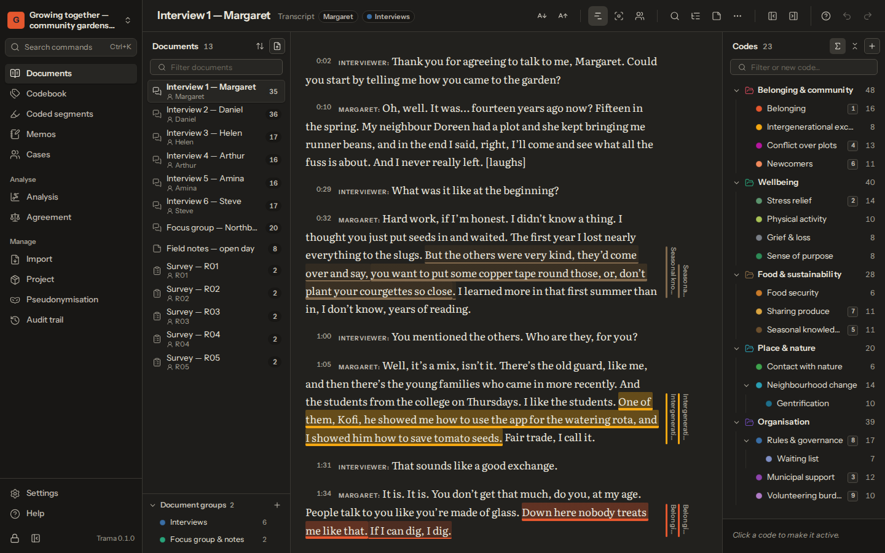
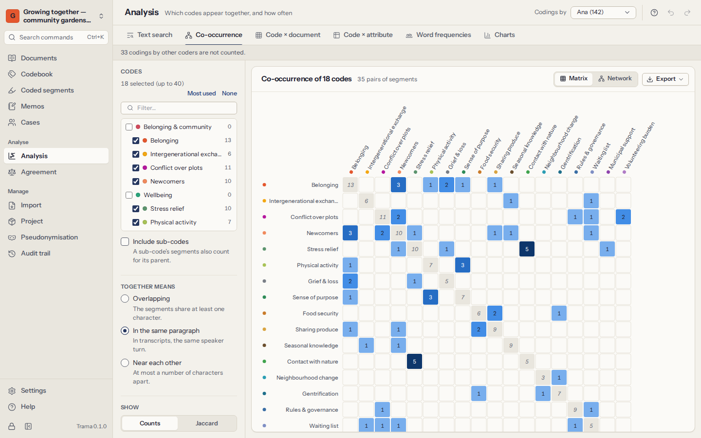
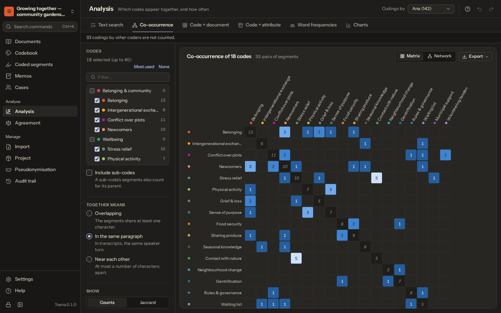
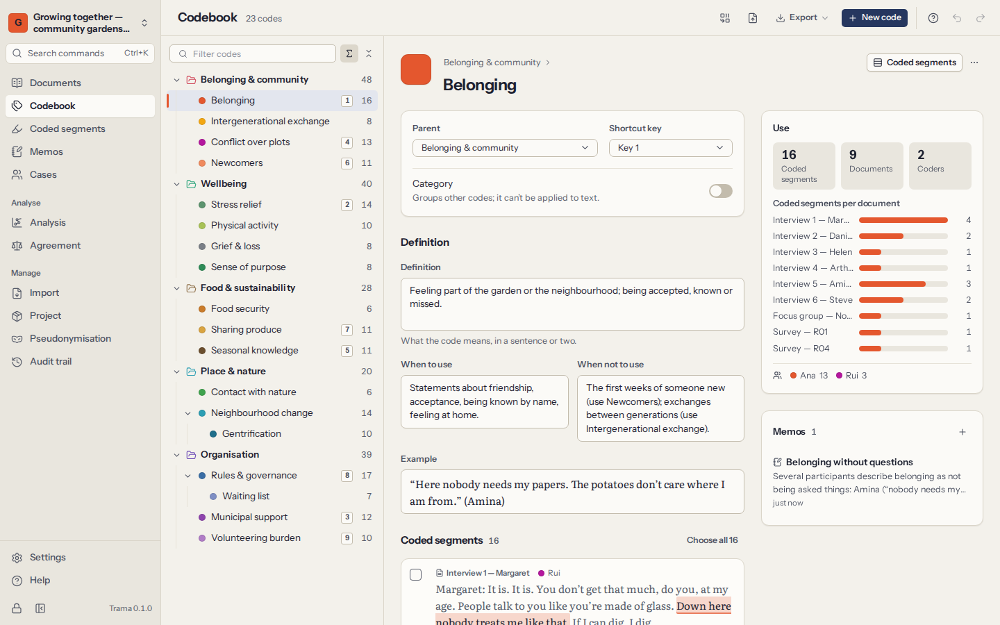
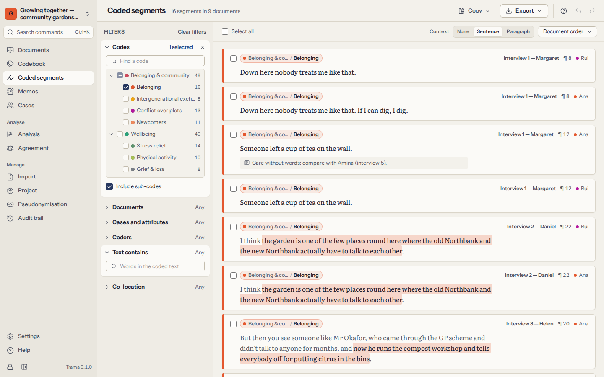
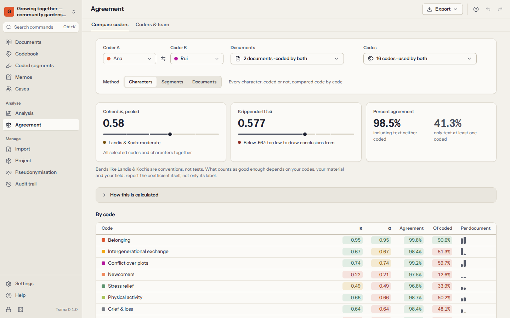
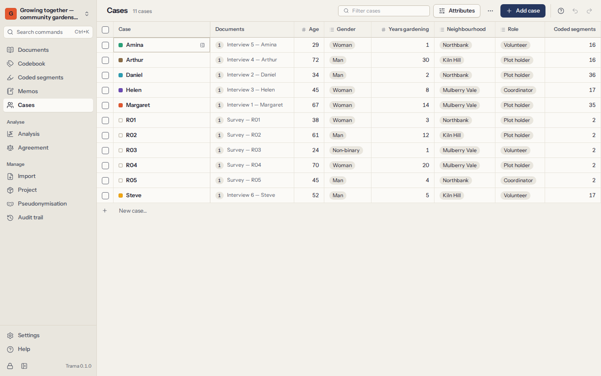
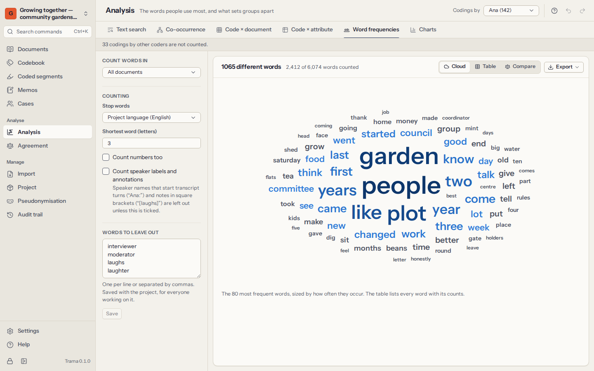

# Trama

**Qualitative analysis that stays on your computer.** Trama is a free, open-source program for qualitative data analysis: code interviews, focus groups, field notes, documents and open survey answers, write memos, describe your participants, and find patterns across your material. Every project is encrypted on your own computer. Trama needs no account and never connects to the internet.

[English](#english) · [Português](#português) · [Español](#español)

| Light theme | Dark theme |
|---|---|
|  |  |
|  |  |

| | |
|---|---|
|  |  |
|  |  |
|  |  |

> Trama is at an early stage (version 0.1). Test builds for Linux and Windows come first; macOS follows from the same code.

## English

**What it does**

- **Bring in your material.** Plain text, Word, OpenDocument, RTF, Markdown, web pages and PDF; transcripts from Zoom, Teams, Otter or a transcriptionist (one speaker turn per paragraph, with time stamps) and their audio or video; open survey answers from CSV or Excel, with respondents' details as attributes. Paste text, or write field notes straight into Trama.
- **Code it.** Select a passage and apply a code from a hierarchical codebook — with the mouse, or entirely from the keyboard (favourite codes on 1–9, in-vivo codes, find-and-code). Coding stripes in the margin, comments on segments, memos on passages, and text corrections that keep every coding in place.
- **Build the codebook.** Definitions with when to use and when not to use, examples, categories, merge and split, and codebook exchange as REFI-QDA (`.qdc`), Word, CSV, Excel or Markdown.
- **Retrieve and write.** Gather coded segments across documents with filters (codes, documents and groups, cases and attributes, coders, words, co-location), read them in context, copy or export them. Memos on the project, documents, codes, segments and cases.
- **Analyse.** Text search with keyword in context and code-all-hits, code co-occurrence (matrix and network, counts or Jaccard), code × document and code × attribute tables (with a chi-square test, honestly caveated), word frequencies and distinctive words, document portraits and charts — counting one coder's work or every coder's together, never double-counting a passage two people coded.
- **Work as a team, without a cloud.** Hand a teammate an encrypted copy and merge it back — the newer change wins, and a document text edited on both sides is kept and reported, never silently overwritten — then measure inter-coder agreement (percent agreement, Cohen's κ and Krippendorff's α, pooled correctly; segment-level agreement with Brennan–Prediger κ) with a disagreement review and a report that shows its working.
- **Exchange with other programs.** Import and export whole projects with NVivo, MAXQDA, ATLAS.ti and others through the open **REFI-QDA** standard (`.qdpx`); Trama always tells you what could not be carried over.
- **Protect participants.** Consistent pseudonymisation across documents and everywhere else a name can hide (document and file names, memos, comments, definitions, deleted items), with the key kept apart from exports; an append-only audit trail for ethics audits and methods sections, whose exports leave out the names the key replaced.

**Why**

- **Free and open source.** No licence fee, no licence server, no subscription. The code is public under the Mozilla Public License 2.0.
- **Offline, always.** Trama makes no network connections at all: no account, no cloud, no update check, no telemetry. [What leaves this computer](PRIVACY.md) lists every way data can leave — each only when you choose it.
- **Encrypted.** Each project is a SQLCipher database with its own key; files and recordings are sealed with XChaCha20-Poly1305; your library opens with your passphrase or a 12-word recovery phrase (Argon2id). Automatic backups are encrypted too. See the [threat model](docs/security/threat-model.md).
- **Open formats, no lock-in.** REFI-QDA in and out, and Trama's own `.trama` file is a ZIP of JSON lines, the original files, and plain-text copies of documents, codebook and memos — readable without Trama.
- **The same on Linux, Windows and macOS.** One codebase, the same features and the same files everywhere.

**Languages:** English, Português (Portugal), Español (España) — the interface and the manual.

**Help:** the manual is built into the app (**Help**) and is in [docs/manual](docs/manual/en/index.md).

## Português

O **Trama** é um programa gratuito e de código aberto para análise qualitativa de dados: codifique entrevistas, grupos focais, notas de campo, documentos e respostas abertas a inquéritos, escreva memorandos, descreva os participantes e encontre padrões em todo o material. Cada projeto fica cifrado no seu próprio computador; o Trama não precisa de conta e nunca se liga à Internet. Inclui um livro de códigos hierárquico com definições, recuperação de segmentos codificados com filtros, coocorrência, matrizes, frequência de palavras, concordância entre codificadores, pseudonimização, registo de auditoria e cópias de segurança cifradas, e troca projetos com o NVivo, o MAXQDA e o ATLAS.ti através do padrão aberto REFI-QDA. Disponível em português (Portugal), espanhol (Espanha) e inglês. O manual está na própria aplicação (**Ajuda**) e em [docs/manual/pt](docs/manual/pt/index.md).

## Español

**Trama** es un programa gratuito y de código abierto para el análisis cualitativo de datos: codifique entrevistas, grupos focales, notas de campo, documentos y respuestas abiertas de encuestas, escriba memorandos, describa a los participantes y encuentre patrones en todo el material. Cada proyecto se guarda cifrado en su propio ordenador; Trama no necesita cuenta y nunca se conecta a Internet. Incluye un libro de códigos jerárquico con definiciones, recuperación de segmentos codificados con filtros, coocurrencia, matrices, frecuencia de palabras, acuerdo entre codificadores, seudonimización, registro de auditoría y copias de seguridad cifradas, e intercambia proyectos con NVivo, MAXQDA y ATLAS.ti mediante el estándar abierto REFI-QDA. Disponible en español (España), portugués (Portugal) e inglés. El manual está en la propia aplicación (**Ayuda**) y en [docs/manual/es](docs/manual/es/index.md).

## Install

There are no published installers yet: build Trama from source (below). Test builds are not yet code-signed, so Windows SmartScreen and macOS Gatekeeper will warn before opening them.

The Windows installers and the Linux `.deb` and `.rpm` packages also add **Trama (example)** (elsewhere, start Trama with `--example`), which opens a fictional example study (passphrase `trama`) in a separate folder that is emptied every time — a safe place to try everything.

## Build from source

Requirements: Node.js 22.12 or later and a stable Rust toolchain (see `rust-toolchain.toml`). On Linux (Debian/Ubuntu):

```bash
sudo apt-get install libwebkit2gtk-4.1-dev libgtk-3-dev libsoup-3.0-dev librsvg2-dev patchelf
```

On Fedora: `webkit2gtk4.1-devel gtk3-devel libsoup3-devel librsvg2-devel patchelf`. Playing audio and video uses the system's GStreamer "good" plugins. Windows and macOS prerequisites are in [docs/platforms.md](docs/platforms.md).

```bash
npm install
npm run dev              # run the desktop app
npm run dev:web          # or: a browser demo with the fictional example project, in memory only
npm run build:desktop    # installers for your operating system (AppImage, .deb and .rpm on Linux)
npm run typecheck && npm test   # type checks (including missing translations) and the test suite
npm run test:rust        # the Rust tests (SQLCipher, Argon2 vectors, file helpers)
```

Installers land in `desktop/src-tauri/target/release/bundle/`.

Developer guide: [AGENTS.md](AGENTS.md). Contributing: [CONTRIBUTING.md](CONTRIBUTING.md). Security: [SECURITY.md](SECURITY.md). File formats: [`.trama`](docs/spec/trama-format-v1.md), [REFI-QDA mapping](docs/spec/refi-qda.md).

## Licence

The code is licensed under the [Mozilla Public License 2.0](LICENSE). The name "Trama" and its logo are not covered by that licence — see [TRADEMARKS.md](TRADEMARKS.md).

Fonts, self-hosted through Fontsource (never loaded from the internet):

- **Instrument Sans**, by Rodrigo Fuenzalida and Jordan Egstad, under the SIL Open Font License 1.1.
- **Literata**, by TypeTogether, under the SIL Open Font License 1.1.

Icons are from [Lucide](https://lucide.dev) (ISC licence).

Libraries bundled with Trama (also listed in the app under **Settings → About**):

| Library | Licence |
|---|---|
| React, React DOM | MIT |
| Luxon (dates) | MIT |
| noble-ciphers, noble-hashes, scure-bip39 (encryption, recovery phrase) | MIT |
| sql.js (SQLite for the browser demo and tests) | MIT; SQLite is public domain |
| fflate (ZIP) | MIT |
| xmldom (REFI-QDA XML) | MIT |
| Mammoth (Word import) | BSD-2-Clause |
| Papa Parse (CSV) | MIT |
| PDF.js (PDF import) | Apache-2.0 |
| Tauri and its dialog plugin (desktop shell) | Apache-2.0 / MIT |
| SQLCipher (encrypted databases) | BSD-3-Clause |
| rusqlite | MIT |
| OpenSSL (SQLCipher's cryptography) | Apache-2.0 |
| RustCrypto argon2 | Apache-2.0 / MIT |
| serde, serde_json, hex, zeroize, thiserror, percent-encoding | Apache-2.0 / MIT |
| walkdir | MIT / Unlicense |

The complete list, with every transitive dependency, is in the lockfiles (`package-lock.json`, `desktop/src-tauri/Cargo.lock`).
