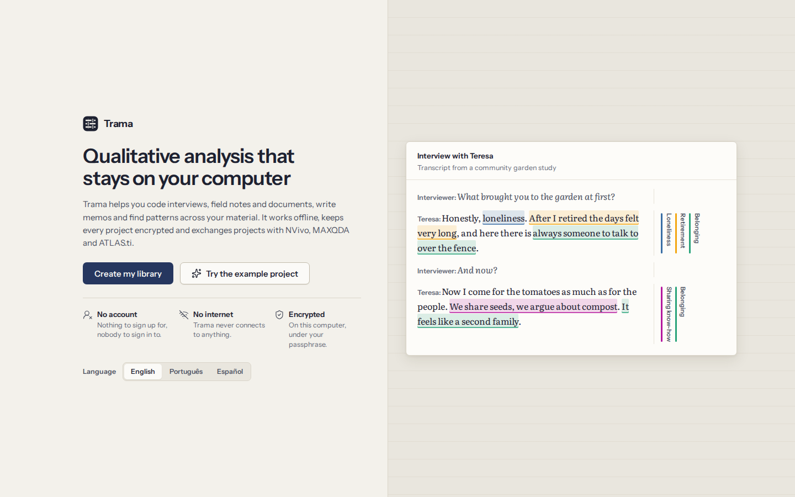
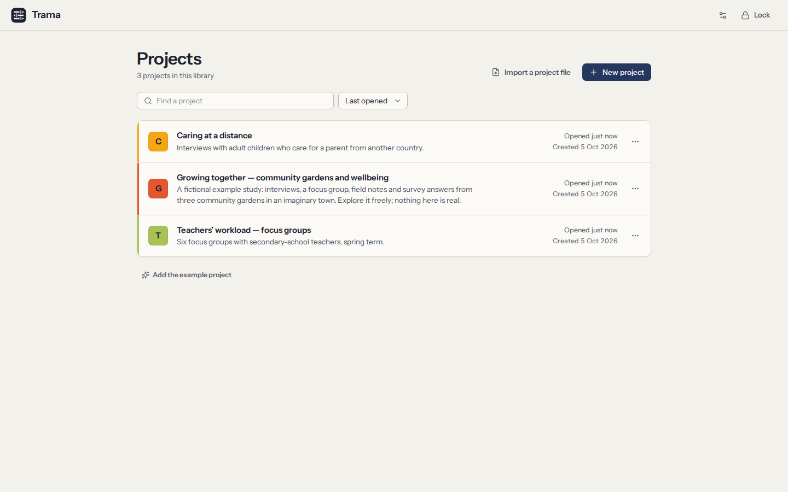

# Getting started

Trama keeps all your projects in one encrypted **library** on your computer. You open the library with a passphrase that only you know; inside it, each study is a **project** with its own documents, codebook, memos and cases.

## Install Trama

- **Linux:** use the `.deb` package on Ubuntu or Debian, the `.rpm` on Fedora, or the `.AppImage` on any distribution (make it executable, then open it). Playing audio and video uses the system’s GStreamer plugins, which most desktops already have.
- **Windows:** run the installer (`.exe` or `.msi`). Test versions are not yet signed, so Windows may say it protected your PC: choose **More info → Run anyway**.
- **macOS:** open the `.dmg` and drag **Trama** into **Applications**. If macOS refuses to open an unsigned app, allow it in **System Settings → Privacy & Security**.

Trama works the same way on all three systems. It needs no account, no licence key and no internet connection — not even to install updates or to check for them.

## Try the example project

The quickest way to see what Trama does is the example project: a fictional study of community gardens with six interviews, a focus group with its recording, field notes and survey answers, already coded by two researchers.

- On the welcome screen, choose **Try the example project**. It opens in memory: nothing you change is kept, and a ribbon at the top reminds you. Choose **Leave the example** to come back.
- In your own library, **Add the example project** puts a copy next to your projects, where you can keep it as long as you like and delete it when you are done.
- The installers also add a **Trama (example)** launcher. It opens a separate example library whose passphrase is **trama**, and it starts afresh every time. Your own library is never touched.

Everyone and everything in the example is invented. Never put real data in it.

## Open Trama for the first time

1. Choose your language at the top. You can change it later.
2. Choose **Create my library**.
3. Type your name or initials. It signs the coding you do, so co-authors can tell whose work is whose. It stays on this computer.
4. Choose a passphrase, then write down your recovery phrase (both explained below).

## Choose a passphrase

You type your passphrase each time you open Trama. It protects every project in the library.

- Use **a few unrelated words you can remember**, like `heron violet tram autumn`. Longer is stronger; it must have at least 10 characters. A bar under the field shows how strong it is.
- Trama cannot reset it for you, and nobody else can either: there is no server and no account. That is what the recovery phrase is for.
- You can change the passphrase later in **Settings**. Your projects stay as they are; only the lock changes.

## Write down your recovery phrase

Trama then shows **12 words**. They are the only way back into your library if you forget your passphrase.

1. Write the 12 words on paper, in order. You can also print them.
2. Keep the paper somewhere safe and away from the computer — a copy that lives only on this computer is lost with it.
3. Tick **I have written down the 12 words** and continue.
4. Trama asks for a few of the words, to check your copy is right. Then the library is created.

If you copy the words to the clipboard, paste them somewhere safe and then copy something else, so they do not stay in the clipboard.

## Projects

After unlocking, you see your projects. A project holds the material of one study: its documents, codes, coded segments, memos, cases and attributes. Your library can hold as many projects as you need, and each one is encrypted with its own key.

- **New project** asks for a name, an optional description (your research question, or a note to your future self) and a colour.
- Click a project to open it. Next time you unlock Trama, the project you last had open opens straight away.
- The **…** menu of a project lets you edit its details or delete it. Deleting asks you to type the project’s name, and removes it from this computer for good (backups kept elsewhere are not touched).
- **Import a project file** brings in a `.trama` file or a REFI-QDA project (`.qdpx`) from NVivo, MAXQDA or ATLAS.ti as a new project — see [Exchanging projects](09-exchange.md).
- To move to another project while one is open, use the project name at the top of the navigation.

## Finding your way around a project

The navigation on the left leads to every part of a project:

| Screen | What it is for |
|---|---|
| **Documents** | Reading and coding your material ([Coding](03-coding.md)) |
| **Codebook** | Your codes, their hierarchy and definitions ([The codebook](04-codebook.md)) |
| **Coded segments** | Everything you coded, filtered and gathered ([Coded segments](05-retrieval-and-memos.md)) |
| **Memos** | Your analytic writing ([Memos](05-retrieval-and-memos.md#memos)) |
| **Cases** | Participants, sites or organisations and their attributes ([Cases](06-cases-and-attributes.md)) |
| **Analysis** | Search, co-occurrence, matrices, word frequencies and charts ([Analysis](07-analysis.md)) |
| **Agreement** | Coders, teammates’ copies and inter-coder agreement ([Teamwork](08-teamwork-and-agreement.md)) |
| **Import** | Bringing in documents ([Documents](02-documents.md#import)) |
| **Export & backup** | Project files, REFI-QDA, reports and automatic backups ([Exchanging projects](09-exchange.md), [Backups](10-privacy-and-security.md#backups)) |
| **Pseudonymisation** | Replacing names consistently ([Pseudonymisation](10-privacy-and-security.md#pseudonymisation)) |
| **Audit trail** | A record of every change ([Audit trail](10-privacy-and-security.md#audit-trail)) |

The **command palette** (`Ctrl+K`) finds any screen, document, project or action by typing part of its name. **Back** (`Alt+←`, or the mouse’s back button) returns to where you were.

Everything you do is saved as you go. There is no Save button.

## Locking and unlocking

- Trama **locks itself** after 10 minutes without use. Choose how long in **Settings** (or in the preferences on the projects screen): 5, 10, 15, 30 or 60 minutes.
- To lock it yourself, choose **Lock** in the navigation or press `Ctrl+L`. Locking saves what you were writing, closes the project and erases the keys from memory.
- To unlock, type your passphrase. The project you had open opens again.

**Forgot your passphrase?** On the unlock screen, choose **Use the recovery phrase instead**, type the 12 words in order and choose a new passphrase. The old passphrase stops working.

If you lose **both** the passphrase and the recovery phrase, nobody can open the library — not you, not the people who make Trama. Keep encrypted backups and the paper with the 12 words.

## Settings

**Settings** gathers the choices that belong to you and to this computer:

- the interface language (English, Português, Español) and the theme (light, dark, or following the system);
- how soon Trama locks itself;
- your passphrase and recovery phrase, which you can change at any time;
- **What leaves this computer**: every way data can leave Trama, and when (see [Privacy and security](10-privacy-and-security.md));
- for the open project, the language of your material, used for word frequencies and stop words.

## Keyboard shortcuts

Everything in Trama can be done from the keyboard. The ones you will use most:

| Keys | What they do |
|---|---|
| `Ctrl+K` | Open the command palette |
| `Ctrl+Z` / `Ctrl+Shift+Z` | Undo / redo |
| `Ctrl+L` | Lock Trama |
| `Alt+←` | Back |
| `Ctrl+F` | Find in the document you are reading |
| `1` … `9` | With text selected, apply the code that has that shortcut key |
| `Enter` | With text selected, find or create a code; on coded text, show its codes |
| `Ctrl+I` | Make an in-vivo code from the selected words |
| `Delete` | Remove the selected coding, or delete the selected item in a list |
| `F2` | Rename the selected document, code or case |
| `Shift+F10` | Open the menu of the selected item |
| `?` | While reading a document, show its shortcuts |

Help has a full list on its **Keyboard shortcuts** page. Buttons show their shortcut in the tooltip.
