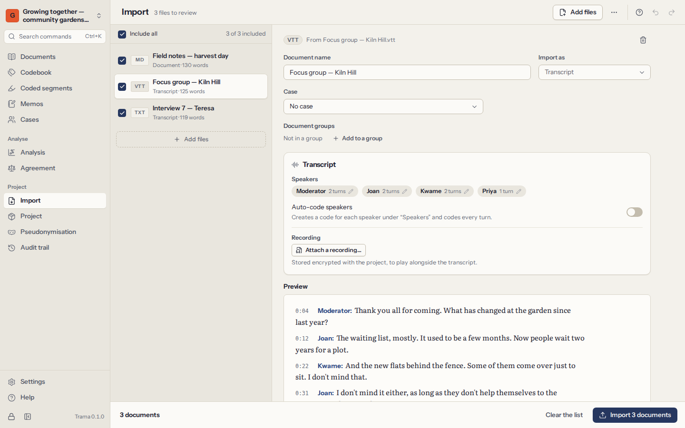
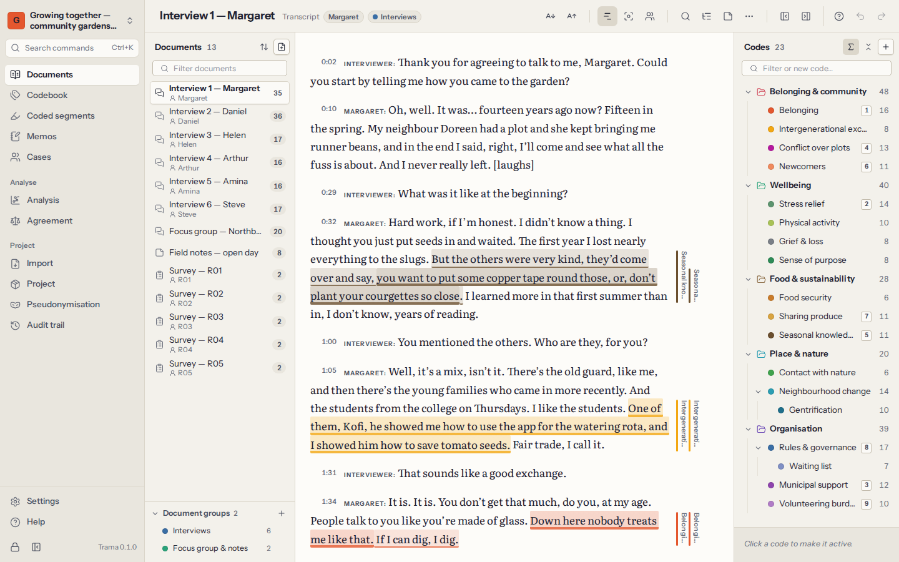

# Documents

Documents are your material: interview and focus-group transcripts, field notes, reports, articles, open answers to a survey. Trama works with their **text**: you code words, sentences and paragraphs. Original files and recordings are kept, encrypted, inside the project.

## Import documents

Open **Import** in the navigation (or **Import documents** in the document list) and choose the files. Trama reads each file, shows you what it found and any problems, and adds the documents when you confirm.

| Kind of file | Extensions | Notes |
|---|---|---|
| Plain text | `.txt` | Any encoding; files that are not UTF-8 are read as Windows-1252 and flagged so you can check accented letters. |
| Markdown | `.md` | Formatting marks are removed; the text stays. |
| Word | `.docx` | Text, headings and lists. Images and comments are left out (Trama tells you how many). The original file is kept. |
| OpenDocument | `.odt` | As for Word. |
| Rich Text | `.rtf` | Including older Windows code pages. |
| Web page | `.html`, `.htm` | The readable text, without menus and scripts. |
| PDF | `.pdf` | The text layer of each page. The original PDF is kept. Password-protected PDFs ask for the password. |
| Subtitles | `.vtt`, `.srt` | Read as transcripts with time stamps (see below). |
| Spreadsheets | `.csv`, `.xlsx` | Read as survey answers (see below). |

A few things to know:

- **Scanned PDFs** have no text layer, only pictures of pages. Trama tells you which pages have no text. It does not recognise text in images; run the scan through OCR software first, or import a Word or text version.
- **Names** come from the file names. Rename a document at any time (`F2` in the list).
- **Text is canonical**: line endings, invisible characters and Unicode forms are tidied on import, so positions stay exact. Paragraphs are separated by line breaks.
- Very large files are fine. A one-megabyte transcript opens and codes smoothly.

## Transcripts and recordings

Trama recognises transcripts and keeps **one speaker turn per paragraph**, written as `Speaker: what they said`. That makes it easy to code a whole turn, to compare speakers, and to read a focus group.

- **Subtitle files** (`.vtt`, `.srt`) from Zoom, Teams, Otter or transcription software become transcripts with a time stamp at each turn.
- **Text and Word files** are read as transcripts when they look like one: lines starting with a speaker’s name and a colon, or with time stamps such as `[00:01:23]`. Trama is careful: a field note with lines like `Date: …` stays an ordinary document. When importing, you can tell Trama to read a file as a transcript always, never, or when it looks like one.
- **Speaker names** that differ only in capitals (`INÊS` and `Inês`) are treated as one speaker. You can rename speakers before importing (“Speaker 1” → “Interviewer”).
- You can ask Trama to **code each speaker’s turns** with a code named after the speaker, so you can later retrieve everything one person said.

**Recordings.** A transcript can carry its audio or video. In the document’s header, choose **Attach a recording…** and pick the file; it is encrypted and stored in the project. A player appears above the text:

- `Ctrl+Space` plays or pauses; `Alt+Shift+←` and `Alt+Shift+→` jump back or forward 5 seconds.
- `Alt+Enter` plays from the paragraph where the cursor is.
- **Follow the recording** highlights the turn being spoken as it plays.
- Removing a recording erases the file from the project; the transcript and its time stamps stay.

## Survey answers

Open answers from a questionnaire usually arrive as a spreadsheet: one row per respondent, one column per question. Import the `.csv` or `.xlsx` file and Trama asks how to read it:

1. **The sheet** to read, for workbooks with several sheets.
2. **The column with the respondent id**, or none (the rows are then numbered).
3. **The columns with open answers** — the text you want to code.
4. **The columns that describe respondents** (age, group, site…). They become [case attributes](06-cases-and-attributes.md), with one case per respondent.
5. **The layout**: one document per respondent (each question as a heading with the answer under it), or one document per question (every respondent’s answer under their id).

Trama can also code each answer with a code named after its question, so “everything answered to question 3” is one click away later.

## The document list

**Documents** shows the list of documents on the left, the open document in the middle and the codebook on the right. Hide either side panel to give the text more room; drag the edges to resize them.

- **Filter** the list by typing part of a name.
- **Sort** by your own order (drag documents to rearrange), by name, by how much is coded, or by when they were added.
- **Group** the list by document group or by case.
- Select several documents with `Ctrl` or `Shift` and a click, then act on all of them from the menu.
- Each document’s menu (right-click, or `Shift+F10`) can **rename** it, set its **case**, put it in **groups**, give it a **colour**, open its **memo**, show its **properties** (kind, original file, length, number of coded segments, how much of the text is coded) or **delete** it.

Deleting a document also deletes its coded segments and the memos about it. Trama says how many before you confirm, and you can undo it straight away.

## Document groups

A document group gathers documents that belong together: the interviews, the first wave, one site, the documents still to code. A document can be in several groups.

- Create a group from **Document groups…** in a document’s menu, or in the groups section of the document list.
- Choose a group to show only its documents. Groups can also be renamed, coloured and deleted; deleting a group never deletes its documents.
- Groups are used throughout the analysis: to filter coded segments, to compare word use, as the columns of a code × document matrix, and in charts.

## Documents and cases

A **case** is a unit of analysis — usually a participant, sometimes a site, a household or an organisation. Each document can belong to one case; a case can have several documents (two interviews with the same person, say). Set a document’s case from its menu (**Set case…**): type to find a case, or type a new name to create one.

Cases carry **attributes** such as age, role or neighbourhood, which let you compare groups of people. They have [a chapter of their own](06-cases-and-attributes.md).
