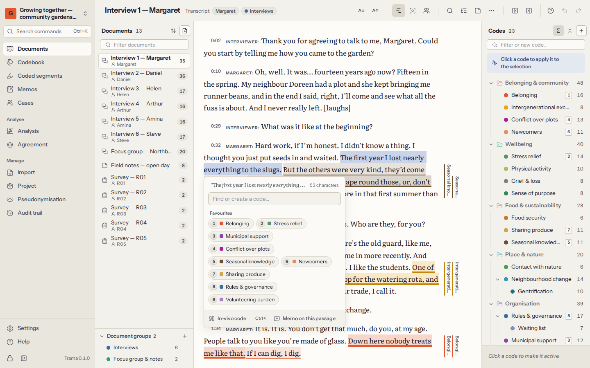

# Coding

Coding is marking a passage and giving it a code — a short label for what the passage is about, such as *Loneliness* or *Sharing know-how*. A passage can have several codes, codes can overlap, and the same code is applied wherever its idea appears. Later you retrieve every passage of a code, compare codes and look for patterns.

## Select and code a passage

Open a document from **Documents**. Then:

1. **Select the passage** with the mouse, or with `Shift` and the arrow keys.
2. A small panel opens next to the selection. Type to **find a code** — or type a new name to **create one** — and press `Enter`. Your **favourite codes** (those with a shortcut key) and the codes you used most recently are listed too; click one to apply it.
3. The passage is coded: a coloured stripe appears in the margin beside it, and the text is tinted with the code’s colour.

Spaces at the edges of a selection are left out. If you code a passage that touches or overlaps a passage you already coded with the same code, Trama **extends** that coded segment instead of making a second one.

Every coded segment is signed with your name as the coder (see [Teamwork](08-teamwork-and-agreement.md)). Coding can be undone with `Ctrl+Z`.

## The codes panel

The codebook beside the text is a second way to code:

- **With text selected**, click a code to apply it.
- **Without a selection**, a click makes the code **active**: its definition shows at the foot of the panel, so you can keep it in mind while you read. Click it again to let it go.
- The box at the top filters the codes as you type. If nothing matches, press `Enter` to **create a code** with that name — under the active code, if there is one.
- Counts beside each code show how many coded segments it has; you can show counts of each code alone, counts including its sub-codes, or no counts.
- Drag codes to rearrange them or to put one under another, and use each code’s menu to rename it, change its colour, give it a shortcut key, edit its definition, merge it or delete it. The [codebook chapter](04-codebook.md) explains all of these.

## In-vivo codes

An **in-vivo** code takes its name from the participant’s own words. Select a short phrase — “a second family”, “always someone to talk to” — and press `Ctrl+I`, or choose **In-vivo code** in the panel next to the selection. Trama creates a code named after the words and applies it to them. You can rename it, move it or merge it later like any other code.

## Coding with the keyboard

You can code a whole document without touching the mouse:

| Keys | What they do |
|---|---|
| Arrow keys | Move the cursor through the text |
| `Shift` + arrow keys | Select text |
| `1` … `9` | Apply the code that has that shortcut key |
| `Enter` | Open the panel to find or create a code for the selection |
| `Ctrl+I` | In-vivo code from the selection |
| `Esc` | Clear the selection |
| `Enter` (on coded text, nothing selected) | Show the codes at the cursor |
| `Delete` | Remove the coding chosen in that list |
| `Ctrl+F` | Find in the document |
| `?` | Show these shortcuts |

To give a code a shortcut key, choose **Shortcut key…** in its menu and pick a number from 1 to 9. Each number belongs to one code at a time; codes with a key are your **favourites**.

## Coding stripes and what you see

- **Stripes** in the margin show every coded segment beside its passage, one column per code, in the code’s colour. Point at a stripe to see the code’s name; click it to open that coded segment. Hide or show the stripes from the document’s header.
- **Show only the active code** fades every other code, which helps when you check how consistently one code was applied.
- **Coders**: when several people coded the project, choose whose coding to show — everyone’s, only yours, or one teammate’s.
- **Text size**: make the text larger or smaller from the header. The choice is remembered.
- Click coded text (or put the cursor in it and press `Enter`) to see the **coded segments here**. For each one you can add a comment, **change the code**, **adjust the boundaries** (select the new extent and press `Enter`), write a memo, open the code in the codebook, or **remove the coding**.

## Find in a document

`Ctrl+F` opens a find bar above the text. Matches are highlighted, with their number; `Enter` or the arrows beside the box move from one to the next. **Code all N…** (N being the number of matches) applies one code to every match at once — useful for names of places or recurring phrases. To search across all documents, use [Text search](07-analysis.md#search) in Analysis.

## Editing the text

Transcripts have typos, and sometimes a name must go. Choose **Edit the text…** in the document’s header to correct the text in place.

- Coded segments **move with their words**: if you insert a word before a coded passage, the coding shifts; if you change a word inside it, the coding stays around it.
- A coded segment whose text you delete entirely is removed. Trama warns you how many coded segments the document has before you start, and tells you afterwards if any were removed.
- Transcript time stamps move with the text too.
- Saving the text is one step you can undo.

To replace names consistently across every document, use [Pseudonymisation](10-privacy-and-security.md#pseudonymisation) rather than editing each document by hand.

## Memos and comments on passages

Two ways to note something about a passage:

- A **comment** is a short note on one coded segment (up to 4,000 characters) — “irony?”, “check with Rui”. Comments appear in [Coded segments](05-retrieval-and-memos.md) and in exports.
- A **memo** is longer, analytic writing. Choose **Memo on this passage** in the panel next to a selection, or **Memo** on a coded segment. Memos on passages are listed in the document’s **Memos** drawer and in [Memos](05-retrieval-and-memos.md#memos), with a link back to the passage.

## Coding while listening

For transcripts with an attached recording, the player sits above the text. Code as you listen: `Ctrl+Space` plays and pauses without leaving the text, `Alt+Shift+←` replays the last 5 seconds, and **Follow the recording** keeps the turn being spoken in view. See [Transcripts and recordings](02-documents.md#transcripts).
