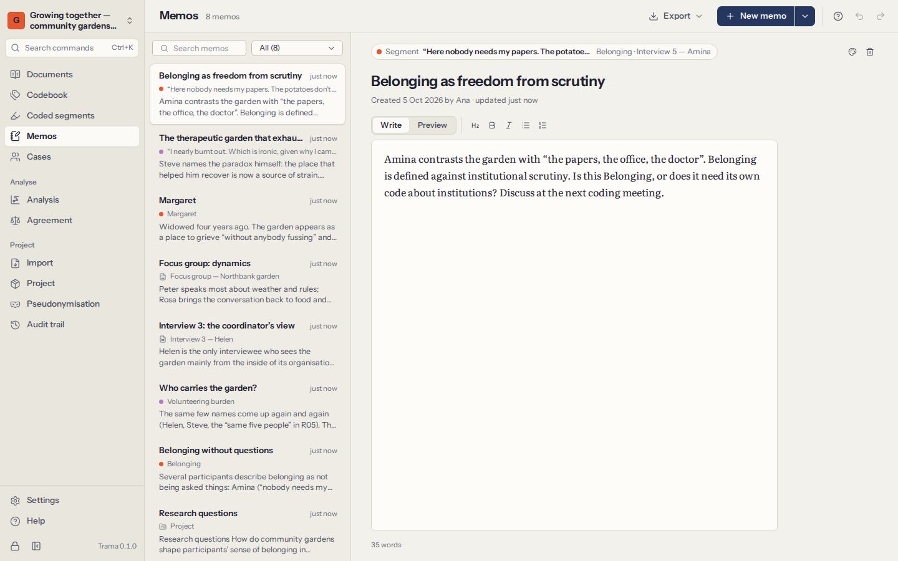

# Coded segments and memos

Coding is only half the work; the other half is reading what you coded, side by side, and writing down what you see. **Coded segments** gathers passages across documents; **Memos** holds your writing.

## Coded segments

**Coded segments** lists every coded passage in the project, each with its code, its document and where in the document it is. Filters on the left narrow the list; the list on the right updates as you choose.

### Filters

| Filter | What it keeps |
|---|---|
| **Codes** | Segments of the codes you tick. **Include sub-codes** adds the segments of their sub-codes. |
| **Documents** | Segments in the documents or document groups you tick. |
| **Cases and attributes** | Segments in the documents of chosen cases, or of cases that meet attribute conditions — *Age is more than 60*, *Role is Coordinator*. Combine conditions with **all** or **any**. |
| **Coders** | Segments coded by the people you tick. |
| **Text contains** | Segments whose text contains the words you type. |
| **Co-location** | Segments that **overlap with**, **lie within** or **contain** a segment of other codes in the same document — for example, passages coded *Loneliness* that lie within a passage coded *Retirement*. |

Filters combine: every filter you set must hold. **Clear filters** starts again. Opening **Coded segments** from a code (in the codebook or the codes panel) starts with that code already chosen.

### Reading the segments

- **Sort** by document order, codebook order, shortest first or newest first.
- **Context** shows each segment with the rest of its sentence or paragraph around it, so a short segment does not lose its meaning.
- Each segment shows its comment, if it has one, and a link to its memo.
- Click a segment’s document (or press `Enter`) to **open it in the document** at that passage, selected. Back (`Alt+←`) returns to the list.
- With the keyboard: the arrow keys move through the list, `Enter` opens, `Space` selects.

### Copying and exporting segments

- **Copy** puts the selected segments — or all the segments shown — on the clipboard, each with its source (document, code and paragraph), ready to paste into a draft.
- **Export** saves them as a **CSV** or **Excel** table (one row per segment: code, code path, document, paragraph, position, coder, text, text with context, comment, date), or as a **Word** or **HTML** report grouped by code. Reports begin with a description of the filters used, so the selection can be repeated and reported.

Exports leave Trama unencrypted. See [what leaves this computer](10-privacy-and-security.md#leaves).

## Memos

Memos hold your thinking as it develops: a hunch about the whole project, notes on an interview, the meaning of a code, an observation on a passage, a portrait of a participant. Writing memos as you go is what turns coding into analysis.

A memo is **about** something:

| Memo about | Start it from |
|---|---|
| The project | **Memos → New memo** |
| A document | the document’s menu (**Document memo…**), or **New memo about… → A document** |
| A code | the code’s details in **Codebook**, or **New memo about… → A code** |
| A coded segment | **Memo on this passage** while coding, or **Memo** on a coded segment |
| A case | the case’s details in **Cases**, or **New memo about… → A case** |

### Writing

- Memos save as you type; there is no Save button.
- Light formatting works and shows in **Preview**: `## heading`, `**bold**`, `*italic*`, `- list`, `1. list`. The toolbar adds it for you (`Ctrl+B`, `Ctrl+I`).
- Give a memo a **colour** to mark its status — an idea, a finding, something to check.
- Each memo shows who created it and when, and when it was last changed. **Go to** opens what it is about.

### Finding and exporting memos

**Memos** lists every memo, newest changes first. Search by words in the title or text, or show only one kind (project, documents, codes, coded segments, cases). Memos also appear where they belong: in the document’s memo drawer, in a code’s details, in a case’s details.

**Export** all memos as a **Word document** or as **Markdown**, grouped by what they are about — a good starting point for writing up findings or the methods section.

Deleting a memo can be undone straight away. Deleting a document, code or coded segment deletes the memos about it too (Trama says so before you confirm).
