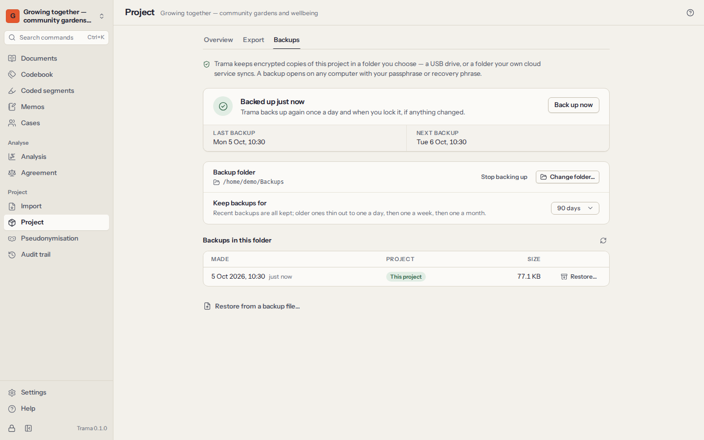

# Privacy and security

Interview data is personal data, often sensitive. Trama is built so that it stays on your computer, encrypted, under your control — and so that you can explain exactly how to an ethics committee, a data protection officer or a participant.

## Encryption

- Your **library** is unlocked by your passphrase or your 12-word recovery phrase. Each one unwraps a random 256-bit library key; neither the passphrase nor the key is ever stored. Turning a passphrase into a key uses **Argon2id** with 64 MiB of memory, so guessing passphrases is slow even on powerful hardware.
- Each **project** is a separate **SQLCipher** database (AES-256), with its own key derived from the library key.
- **Original files and recordings** are encrypted with **XChaCha20-Poly1305** in authenticated pieces, so any tampering is detected.
- The **list of projects** is encrypted too: someone with your files cannot even read the names of your studies.
- **Backups** and password-protected exports are encrypted (see below).

When Trama **locks** — after the time you chose without use, when you press `Ctrl+L`, or when you close it — it saves your work, closes the project and overwrites the keys it held in memory.

The technical details, and the limits, are in `docs/security/threat-model.md` in Trama’s source code.

## No network, no account

Trama makes **no network connections at all**. There is no account, no licence server, no cloud, no update check, no telemetry, no crash reporting. The desktop app has no permission to use the network, and its automated tests check that. The manual you are reading is part of the app.

This also means nobody — including the people who make Trama — can see your data, recover your passphrase or restore a lost library. Keep your recovery phrase on paper and keep backups.

## What leaves this computer

Data leaves Trama only when you make it leave. **Settings → What leaves this computer** lists every way, and the same list is published with Trama’s source code (`PRIVACY.md`):

| Way out | When | Encrypted? |
|---|---|---|
| Automatic backups | Once you choose a backup folder | Always |
| Project file (`.trama`) | When you export it | If you set a password |
| Copy for a teammate | When you make one | If you set a password (suggested) |
| REFI-QDA project (`.qdpx`) | When you export it | No |
| Codebook files | When you export them | No |
| Tables and reports (CSV, Excel, Word, HTML) | When you export them | No |
| The pseudonymisation key | Only if you export it or include it | Not as a table |
| The clipboard | When you copy something | No |

Unencrypted exports are ordinary files: store and share them as your data management plan says.

## Backups

A computer can break, be stolen or be lost. Set up automatic backups for every project that matters:

1. Open **Project**, go to the **Backups** tab and choose a **backup folder** — a USB drive you keep somewhere safe, your institution’s network drive, or a folder synchronised with a cloud drive. The backup is encrypted before it gets there.
2. Trama then backs up the project when it opens, once a day while it is open, when you lock Trama or close the project (if anything changed), and whenever you choose **Back up now**.
3. Choose how far back backups go: 30, 90 or 365 days. Older backups thin out with age — everything from the last day, then one a day for two weeks, one a week for two months, one a month after that — and the newest three are always kept.

Trama warns you when a backup fails (the folder is missing, full or not writable) and when the last good backup is more than three days old.

**What a backup holds:** the whole project, deleted items and the pseudonymisation key included, encrypted under your library’s key, with the keyring inside. It opens with your passphrase or your recovery phrase — on this computer or another one.

**Restoring:** in **Project → Backups**, choose **Restore…** next to a backup in the list, or **Restore from a backup file…** below the list. The backup becomes a new project in your library, named with the date you restored it — for example “Allotment gardens study (restored 2026-10-05)” — so it never overwrites what you have. The project you are working on stays open; choose **Open now** to switch to the restored copy. On a new computer, create your library first, then bring the backup in with **Import a project file** on the projects screen — Trama asks for the passphrase or recovery phrase of the library that made the backup.

Anyone who can open the backup folder sees that backup files exist, their dates and sizes, but not what is in them.

## Deleting

- Deleting a document, code, memo or case can be undone straight away (`Ctrl+Z`). Deleted items stay inside the encrypted project so that undo and merging teammates’ copies work correctly.
- Exports never contain the content of deleted items; encrypted backups do.
- **Deleting a project** removes its database and files from this computer for good. Backups elsewhere are not touched — delete those yourself if the data must be destroyed, for example at the end of a retention period.

## Pseudonymisation

**Pseudonymisation** replaces names and other identifying details consistently across every document — “Ana Lima” becomes “[Participant 1]” everywhere — while coded segments and transcript time stamps follow the changed text. The same replacements are made in the names of documents, cases, codes and groups, in file names, case descriptions and text attributes, memos, comments on coded segments and code definitions.

1. **Build the key.** Add entries one by one (the original, exactly as it appears, and its replacement), or choose **Suggest names**: Trama lists capitalised words and phrases from your documents that may be names or places, and numbers the replacements for you (`[Participant 1]`, `[Place 2]`…). Suggestions are only a starting point: nicknames, streets, workplaces and rare details can identify someone just as well. Read your documents too.
2. **Set each entry’s options.** **Whole word** leaves “Ana” inside “Anabela” alone. **Match case** replaces “Rose” the name, not “rose” the flower.
3. **Preview** shows every replacement before anything changes: document by document, then everywhere else in the project (names, file names, memos, comments, definitions), grouped by kind.
4. **Apply to documents.** The originals are replaced in the documents themselves, not only in exports. Coded segments that covered only a replaced name are removed. You can apply the whole key or only the entries you tick.

Applying can be undone only with **Undo straight afterwards**; once you carry on working, the change is permanent. Make a backup first.

**The key** (what replaced what) is the link back to who your participants are. It stays inside the encrypted project, is left out of every export and copy unless you explicitly include it, and is always in encrypted backups. **Export key** saves it as a CSV table for your records — store that file encrypted and apart from the pseudonymised material, as ethics approvals usually require. Deleting an entry erases the original name from the project immediately; it cannot be undone.

Original PDF and Word files are kept as imported. When a document’s text has been edited (pseudonymised, say), REFI-QDA exports and .trama copies leave out its original PDF, because the original would still show what was removed (backups keep everything).

**The audit trail is not pseudonymised.** It is never edited, so entries written before you applied the key (“Added document “Interview — Ana Lima””) keep the names. The preview and the Apply dialog say how many entries do. The trail travels in .trama copies of the project and in its CSV export: share those only with people allowed to see the names.

## The audit trail

**Audit trail** is an append-only record of every meaningful change: documents added, renamed, edited or deleted; codes created, merged, split or deleted; passages coded and uncoded; memos written; cases and attributes changed; pseudonymisation applied; copies merged; exports and backups made. Each entry says when, who (which coder) and what.

- Search the trail, or filter it by kind of action, coder and dates.
- **Export CSV** saves it, for an audit or for the methods section of a thesis.
- Entries cannot be edited or deleted. Undone and redone steps are recorded as such.

## Wording for ethics applications and data management plans

You may adapt the paragraphs below for an ethics application, a data management plan (DMP) or a participant information sheet. Check them against your institution’s requirements and describe your own backup and retention arrangements.

> **Software and storage.** Qualitative data will be analysed with Trama, free and open-source software (Mozilla Public License 2.0) that runs entirely on the researcher’s computer. Trama makes no network connections: it has no user account, cloud service, update check or telemetry, and no data is sent to the software’s developers or to any third party.

> **Encryption at rest.** All project data — transcripts, original files and recordings, codes, memos and participant attributes — is stored encrypted on the researcher’s computer: the project database with SQLCipher (AES-256) and files with XChaCha20-Poly1305, under keys derived from the researcher’s passphrase with Argon2id. The software locks automatically after a period of inactivity, removing the keys from memory. A 12-word recovery phrase, kept on paper in a secure location, allows access if the passphrase is forgotten.

> **Backups.** Encrypted backups are made automatically to [a university-managed network drive / an encrypted external drive kept in a locked cabinet]. Backups can only be opened with the researcher’s passphrase or recovery phrase.

> **Pseudonymisation.** Transcripts will be pseudonymised within the software, replacing names and identifying details consistently across all documents. The key linking pseudonyms to real identities is stored separately from the pseudonymised data, inside the encrypted project, and is excluded from all exported and shared files.

> **Sharing within the team.** Where co-researchers code the data, project copies are exchanged as password-protected encrypted files through [institutional file share / encrypted USB drive]; passwords are communicated through a separate channel. No data is uploaded to cloud analysis services.

> **Audit and retention.** The software keeps an append-only audit trail of changes to the data. At the end of the retention period, the project and its backups will be deleted from all storage locations.

Be accurate about what Trama does **not** do: it does not protect data that you export unencrypted (tables, reports, REFI-QDA files), it cannot protect an unlocked computer from someone sitting at it or from malware running on it, and it cannot recover data if both the passphrase and the recovery phrase are lost.
