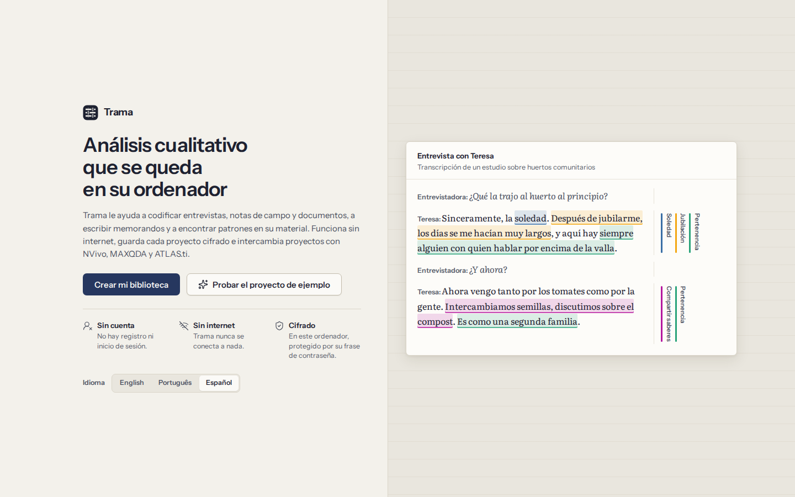
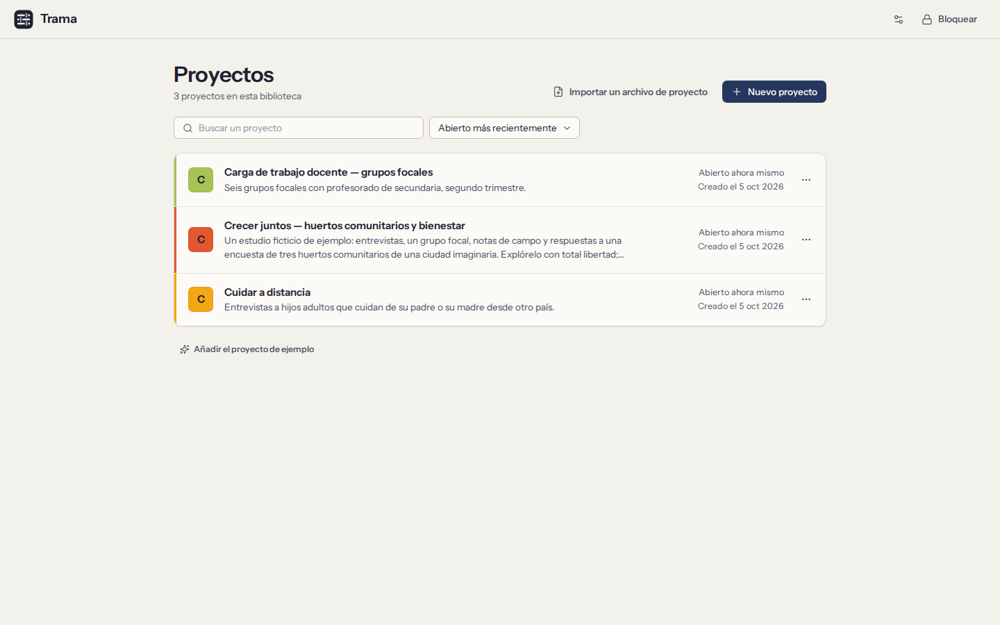

# Primeros pasos

Trama guarda todos sus proyectos en una **biblioteca** cifrada en su ordenador. Usted abre la biblioteca con una frase de contraseña que solo conoce usted; dentro, cada estudio es un **proyecto** con sus documentos, su libro de códigos, sus memorandos y sus casos.

## Instalar Trama

- **Linux:** use el paquete `.deb` en Ubuntu o Debian, el `.rpm` en Fedora o el `.AppImage` en cualquier distribución (hágalo ejecutable y ábralo). La reproducción de audio y vídeo usa los complementos GStreamer del sistema, que la mayoría de los escritorios ya tienen.
- **Windows:** ejecute el instalador (`.exe` o `.msi`). Las versiones de prueba aún no están firmadas, así que Windows puede decir que ha protegido su equipo: elija **Más información → Ejecutar de todas formas**.
- **macOS:** abra el `.dmg` y arrastre **Trama** a **Aplicaciones**. Si macOS se niega a abrir una aplicación sin firmar, permítala en **Ajustes del Sistema → Privacidad y seguridad**.

Trama funciona igual en los tres sistemas. No necesita cuenta, clave de licencia ni conexión a Internet, ni siquiera para instalar o buscar actualizaciones.

## Probar el proyecto de ejemplo

La forma más rápida de ver qué hace Trama es el proyecto de ejemplo: un estudio ficticio sobre huertos comunitarios, con seis entrevistas, un grupo focal con su grabación, notas de campo y respuestas de una encuesta, ya codificados por dos investigadores.

- En la pantalla de bienvenida, elija **Probar el proyecto de ejemplo**. Se abre en memoria: no se conserva nada de lo que cambie, y una franja en la parte superior se lo recuerda. Elija **Salir del ejemplo** para volver.
- En su biblioteca, **Añadir el proyecto de ejemplo** coloca una copia junto a sus proyectos, donde puede quedarse el tiempo que quiera; elimínela cuando ya no la necesite.
- Los instaladores añaden también un acceso directo **Trama (ejemplo)**. Abre una biblioteca de ejemplo aparte, cuya frase de contraseña es **trama**, y empieza de cero cada vez. Su biblioteca nunca se toca.

Todas las personas y todos los lugares del ejemplo son inventados. No ponga nunca datos reales en él.

## Abrir Trama por primera vez

1. Elija el idioma en la parte superior. Puede cambiarlo más adelante.
2. Elija **Crear mi biblioteca**.
3. Escriba su nombre o sus iniciales. Firma la codificación que haga, para que los coautores sepan qué es de quién. Se queda en este ordenador.
4. Elija una frase de contraseña y anote su frase de recuperación (las dos se explican a continuación).

## Elegir una frase de contraseña

Escribirá la frase de contraseña cada vez que abra Trama. Protege todos los proyectos de la biblioteca.

- Use **unas cuantas palabras sin relación entre sí que pueda recordar**, como `garza violeta tranvía otoño`. Cuanto más larga, más segura; debe tener al menos 10 caracteres. Una barra bajo el campo muestra su fortaleza.
- Trama no puede restablecerla, ni nadie más: no hay servidor ni cuenta. Para eso está la frase de recuperación.
- Puede cambiar la frase de contraseña más adelante en **Ajustes**. Sus proyectos se quedan como están; solo cambia la cerradura.

## Anotar la frase de recuperación

A continuación, Trama muestra **12 palabras**. Son la única forma de volver a entrar en su biblioteca si olvida la frase de contraseña.

1. Escriba las 12 palabras en papel, en orden. También puede imprimirlas.
2. Guarde el papel en un lugar seguro y lejos del ordenador: una copia que solo existe en este ordenador se pierde con él.
3. Marque **He anotado las 12 palabras** y continúe.
4. Trama le pide algunas de las palabras para comprobar que su copia es correcta. Después se crea la biblioteca.

Si copia las palabras al portapapeles, péguelas en un lugar seguro y copie después otra cosa, para que no se queden en el portapapeles.

## Proyectos

Tras desbloquear, verá sus proyectos. Un proyecto reúne el material de un estudio: documentos, códigos, segmentos codificados, memorandos, casos y atributos. Su biblioteca puede tener tantos proyectos como necesite, y cada uno se cifra con su propia clave.

- **Nuevo proyecto** pide un nombre, una descripción opcional (su pregunta de investigación, o una nota para usted en el futuro) y un color.
- Haga clic en un proyecto para abrirlo. La próxima vez que desbloquee Trama, el último proyecto que tenía abierto se abre directamente.
- El menú **…** de un proyecto permite editar sus detalles o eliminarlo. Para eliminarlo, Trama le pide que escriba el nombre del proyecto, y lo borra de este ordenador para siempre (las copias de seguridad guardadas en otro lugar no se tocan).
- **Importar un archivo de proyecto** trae un archivo `.trama` o un proyecto REFI-QDA (`.qdpx`) de NVivo, MAXQDA o ATLAS.ti como proyecto nuevo; consulte [Intercambiar proyectos](09-exchange.md).
- Para cambiar de proyecto con uno abierto, use el nombre del proyecto en la parte superior de la navegación.

## Moverse por un proyecto

La navegación de la izquierda lleva a todas las partes de un proyecto:

| Pantalla | Para qué sirve |
|---|---|
| **Documentos** | Leer y codificar el material ([Codificación](03-coding.md)) |
| **Libro de códigos** | Los códigos, su jerarquía y sus definiciones ([El libro de códigos](04-codebook.md)) |
| **Segmentos codificados** | Todo lo codificado, filtrado y reunido ([Segmentos codificados](05-retrieval-and-memos.md)) |
| **Memorandos** | Su escritura analítica ([Memorandos](05-retrieval-and-memos.md#memos)) |
| **Casos** | Participantes, lugares u organizaciones y sus atributos ([Casos](06-cases-and-attributes.md)) |
| **Análisis** | Búsqueda, coocurrencia, matrices, frecuencia de palabras y gráficos ([Análisis](07-analysis.md)) |
| **Acuerdo** | Codificadores, copias de los compañeros y acuerdo entre codificadores ([Trabajo en equipo](08-teamwork-and-agreement.md)) |
| **Importar** | Traer documentos al proyecto ([Documentos](02-documents.md#import)) |
| **Proyecto** | Los datos del proyecto, las exportaciones (archivos de proyecto, REFI-QDA, libro de códigos, informes), las copias de seguridad automáticas y su restauración ([Intercambiar proyectos](09-exchange.md), [Copias de seguridad](10-privacy-and-security.md#backups)) |
| **Seudonimización** | Sustituir nombres de forma coherente ([Seudonimización](10-privacy-and-security.md#pseudonymisation)) |
| **Registro de auditoría** | Un registro de todos los cambios ([Registro de auditoría](10-privacy-and-security.md#audit-trail)) |

La **paleta de comandos** (`Ctrl+K`) encuentra cualquier pantalla, documento, proyecto o acción al escribir parte de su nombre. **Volver** (`Alt+←`, o el botón de retroceso del ratón) le lleva adonde estaba, salvo mientras se reproduce una grabación: entonces `Alt+←` y `Alt+→` retroceden y avanzan en la grabación (consulte [Transcripciones y grabaciones](02-documents.md#transcripts)).

Todo lo que hace se guarda sobre la marcha. No hay botón Guardar.

## Bloquear y desbloquear

- Trama **se bloquea solo** tras 10 minutos sin uso. Elija cuánto tiempo en **Ajustes** (o en las preferencias de la pantalla de proyectos): 5, 10, 15, 30 o 60 minutos.
- Para bloquearlo usted, elija **Bloquear** en la navegación o pulse `Ctrl+L`. Al bloquear, se guarda lo que estaba escribiendo, se cierra el proyecto y se borran las claves de la memoria.
- Para desbloquear, escriba su frase de contraseña. El proyecto que tenía abierto vuelve a abrirse.

**¿Ha olvidado la frase de contraseña?** En la pantalla de desbloqueo, elija **Usar la frase de recuperación**, escriba las 12 palabras en orden y elija una frase de contraseña nueva. La anterior deja de funcionar.

Si pierde **tanto** la frase de contraseña **como** la frase de recuperación, nadie puede abrir la biblioteca: ni usted ni quienes hacen Trama. Mantenga copias de seguridad cifradas y el papel con las 12 palabras.

## Ajustes

Los **Ajustes** reúnen las opciones que le corresponden a usted y a este ordenador:

- el idioma de la interfaz (English, Português, Español) y el tema (claro, oscuro o el del sistema);
- cuánto tarda Trama en bloquearse;
- la frase de contraseña y la frase de recuperación, que puede cambiar en cualquier momento;
- **Qué sale de este ordenador**: todas las formas en que los datos pueden salir de Trama, y cuándo (consulte [Privacidad y seguridad](10-privacy-and-security.md));
- para el proyecto abierto, el idioma del material, que se usa en la frecuencia de palabras y en las palabras vacías.

## Atajos de teclado

Todo en Trama se puede hacer con el teclado. Los que más usará:

| Teclas | Qué hacen |
|---|---|
| `Ctrl+K` | Abrir la paleta de comandos |
| `Ctrl+Z` / `Ctrl+Shift+Z` | Deshacer / rehacer |
| `Ctrl+L` | Bloquear Trama |
| `Alt+←` | Volver (mientras se reproduce una grabación: retroceder 5 segundos) |
| `Ctrl+F` | Buscar en el documento que está leyendo |
| `1` … `9` | Con texto seleccionado, aplicar el código que tiene esa tecla de atajo |
| `Enter` | Con texto seleccionado, buscar o crear un código; sobre texto codificado, ver sus códigos |
| `Ctrl+I` | Crear un código in vivo con las palabras seleccionadas |
| `Delete` | Quitar la codificación seleccionada, o eliminar el elemento seleccionado de una lista |
| `F2` | Cambiar el nombre del documento, código o caso seleccionado |
| `Shift+F10` | Abrir el menú del elemento seleccionado |
| `?` | Al leer un documento, ver sus atajos |

La Ayuda tiene la lista completa en la página **Atajos de teclado**. Los botones muestran su atajo en la información emergente.
