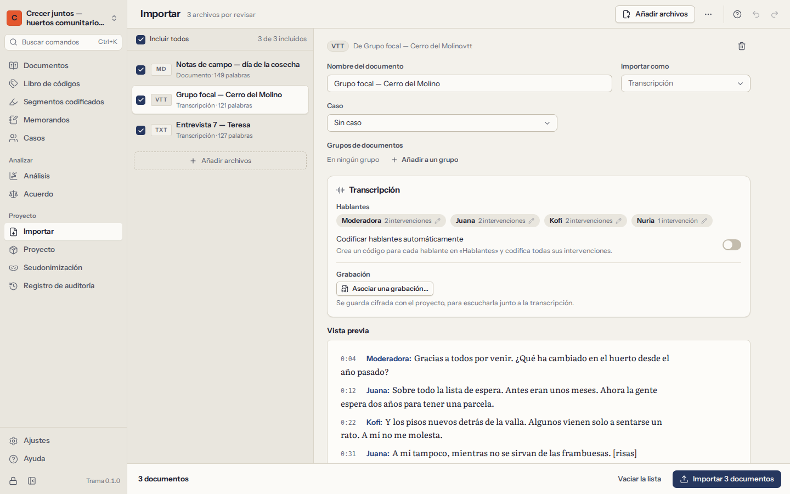
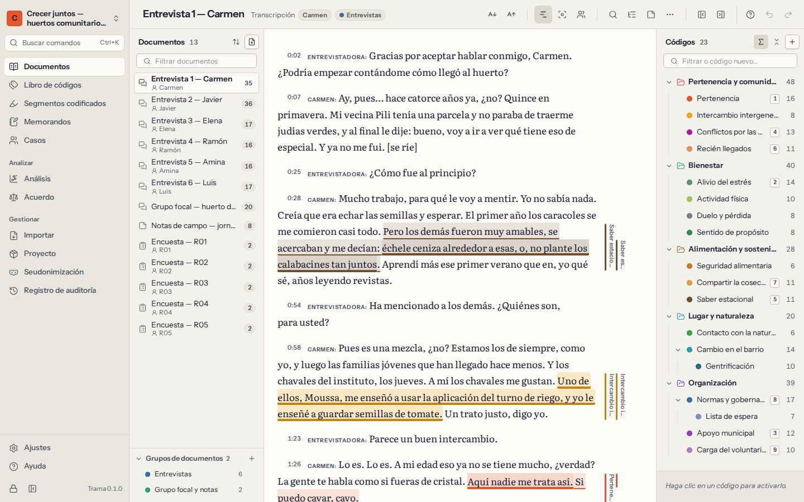

# Documentos

Los documentos son su material: transcripciones de entrevistas y grupos focales, notas de campo, informes, artículos, respuestas abiertas de una encuesta. Trama trabaja con su **texto**: usted codifica palabras, oraciones y párrafos. Los archivos originales y las grabaciones se guardan, cifrados, dentro del proyecto.

## Importar documentos

Abra **Importar** en la navegación (o **Importar documentos** en la lista de documentos) y elija los archivos. Trama lee cada archivo, le muestra lo que ha encontrado y los posibles problemas, y añade los documentos cuando usted lo confirma.

| Tipo de archivo | Extensiones | Notas |
|---|---|---|
| Texto plano | `.txt` | Cualquier codificación; los archivos que no están en UTF-8 se leen como Windows-1252 y se señalan para que revise las letras con tilde. |
| Markdown | `.md` | Se quitan las marcas de formato; el texto se conserva. |
| Word | `.docx` | Texto, títulos y listas. Las imágenes y los comentarios se dejan fuera (Trama dice cuántos). Se conserva el archivo original. |
| OpenDocument | `.odt` | Igual que Word. |
| Texto enriquecido | `.rtf` | Incluidas las páginas de códigos antiguas de Windows. |
| Página web | `.html`, `.htm` | El texto legible, sin menús ni scripts. |
| PDF | `.pdf` | La capa de texto de cada página. Se conserva el PDF original. Los PDF protegidos piden la contraseña. |
| Subtítulos | `.vtt`, `.srt` | Se leen como transcripciones con marcas de tiempo (vea más abajo). |
| Hojas de cálculo | `.csv`, `.xlsx` | Se leen como respuestas de encuestas (vea más abajo). |

Algunas cosas que conviene saber:

- Los **PDF escaneados** no tienen capa de texto, solo imágenes de las páginas. Trama indica qué páginas no tienen texto. No reconoce texto en imágenes: pase antes el escaneo por un programa de OCR, o importe una versión en Word o en texto.
- Los **nombres** salen de los nombres de los archivos. Puede cambiar el nombre de un documento en cualquier momento (`F2` en la lista).
- El **texto se guarda en forma canónica**: los saltos de línea, los caracteres invisibles y las formas Unicode se normalizan al importar, para que las posiciones sean exactas. Los párrafos se separan con saltos de línea.
- Los archivos muy grandes no son un problema. Una transcripción de un megabyte se abre y se codifica con fluidez.

## Transcripciones y grabaciones

Trama reconoce las transcripciones y mantiene **un turno de palabra por párrafo**, escrito como `Hablante: lo que dijo`. Así es fácil codificar un turno completo, comparar hablantes y leer un grupo focal.

- Los **archivos de subtítulos** (`.vtt`, `.srt`) de Zoom, Teams, Otter o de programas de transcripción se convierten en transcripciones con una marca de tiempo en cada turno.
- Los **archivos de texto y de Word** se leen como transcripciones cuando lo parecen: líneas que empiezan con el nombre de quien habla seguido de dos puntos, o con marcas de tiempo como `[00:01:23]`. Trama es prudente: una nota de campo con líneas como `Fecha: …` sigue siendo un documento corriente. Al importar, puede indicar que un archivo se lea como transcripción siempre, nunca o cuando lo parezca.
- Los **nombres de los hablantes** que solo se diferencian en mayúsculas (`INÉS` e `Inés`) se tratan como la misma persona. Puede cambiar los nombres antes de importar («Hablante 1» → «Entrevistadora»).
- Puede pedir a Trama que **codifique los turnos de cada hablante** con un código con su nombre, para recuperar después todo lo que dijo una persona.

**Grabaciones.** Una transcripción puede llevar su audio o su vídeo. En la cabecera del documento, elija **Asociar una grabación…** y seleccione el archivo; se cifra y se guarda en el proyecto. Aparece un reproductor sobre el texto:

- `Ctrl+Space` reproduce o pausa; `Alt+Shift+←` y `Alt+Shift+→` retroceden o avanzan 5 segundos.
- `Alt+Enter` reproduce desde el párrafo donde está el cursor.
- **Seguir la grabación en el texto** resalta el turno que se está oyendo.
- Quitar una grabación borra el archivo del proyecto; la transcripción y sus marcas de tiempo se conservan.

## Respuestas de encuestas

Las respuestas abiertas de un cuestionario suelen llegar en una hoja de cálculo: una fila por persona encuestada, una columna por pregunta. Importe el archivo `.csv` o `.xlsx` y Trama le preguntará cómo leerlo:

1. **La hoja** que debe leer, en los libros con varias hojas.
2. **La columna con el identificador de cada persona**, o ninguna (las filas se numeran).
3. **Las columnas con respuestas abiertas**: el texto que quiere codificar.
4. **Las columnas que describen a las personas encuestadas** (edad, grupo, lugar…). Se convierten en [atributos de los casos](06-cases-and-attributes.md), con un caso por persona.
5. **La disposición**: un documento por persona (cada pregunta como título, con la respuesta debajo) o un documento por pregunta (la respuesta de cada persona bajo su identificador).

Trama también puede codificar cada respuesta con un código con el nombre de su pregunta, para que «todo lo que se respondió a la pregunta 3» esté a un clic.

## La lista de documentos

**Documentos** muestra la lista de documentos a la izquierda, el documento abierto en el centro y el libro de códigos a la derecha. Oculte cualquiera de los paneles laterales para dar más espacio al texto; arrastre los bordes para cambiar su tamaño.

- **Filtre** la lista escribiendo parte de un nombre.
- **Ordene** según su propio orden (arrastre los documentos para reorganizarlos), por nombre, por lo que tienen más codificado o por la fecha en que se añadieron.
- **Agrupe** la lista por grupo de documentos o por caso.
- Seleccione varios documentos con `Ctrl` o `Shift` y un clic, y actúe sobre todos desde el menú.
- El menú de cada documento (clic derecho, o `Shift+F10`) permite **cambiar el nombre**, **asignar el caso**, ponerlo en **grupos**, darle un **color**, abrir su **memorando**, ver sus **propiedades** (tipo, archivo original, longitud, número de segmentos codificados, cuánto texto está codificado) o **eliminarlo**.

Al eliminar un documento se eliminan también sus segmentos codificados y los memorandos sobre él. Trama dice cuántos antes de que usted confirme, y puede deshacerlo al momento.

## Grupos de documentos

Un grupo de documentos reúne documentos que van juntos: las entrevistas, la primera oleada, un lugar, los documentos pendientes de codificar. Un documento puede estar en varios grupos.

- Cree un grupo desde **Grupos de documentos…** en el menú de un documento, o en la sección de grupos de la lista de documentos.
- Elija un grupo para ver solo sus documentos. Los grupos también se pueden renombrar, colorear y eliminar; eliminar un grupo nunca elimina sus documentos.
- Los grupos se usan en todo el análisis: para filtrar segmentos codificados, para comparar el uso de palabras, como columnas de una matriz código × documento y en los gráficos.

## Documentos y casos

Un **caso** es una unidad de análisis: normalmente un participante, a veces un lugar, un hogar o una organización. Cada documento puede pertenecer a un caso; un caso puede tener varios documentos (dos entrevistas a la misma persona, por ejemplo). Asigne el caso de un documento desde su menú (**Asignar caso…**): escriba para encontrar un caso, o escriba un nombre nuevo para crearlo.

Los casos tienen **atributos** como la edad, el rol o el barrio, que permiten comparar grupos de personas. Tienen [un capítulo propio](06-cases-and-attributes.md).
