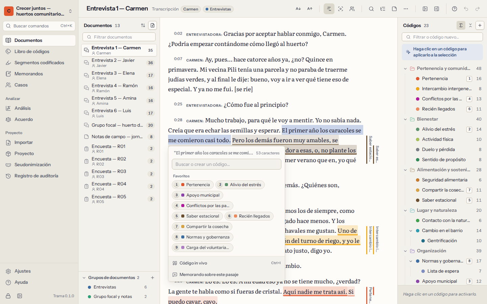

# Codificación

Codificar es marcar un pasaje y asignarle un código: una etiqueta breve para aquello de lo que trata el pasaje, como *Soledad* o *Compartir saberes*. Un pasaje puede tener varios códigos, los códigos pueden solaparse, y el mismo código se aplica dondequiera que aparezca su idea. Después recuperará todos los pasajes de un código, comparará códigos y buscará patrones.

## Seleccionar y codificar un pasaje

Abra un documento desde **Documentos**. Después:

1. **Seleccione el pasaje** con el ratón, o con `Shift` y las flechas.
2. Se abre un pequeño panel junto a la selección. Escriba para **buscar un código** —o escriba un nombre nuevo para **crearlo**— y pulse `Enter`. También aparecen sus **códigos favoritos** (los que tienen tecla de atajo) y los que ha usado más recientemente; haga clic en uno para aplicarlo.
3. El pasaje queda codificado: aparece una franja de color en el margen, a su lado, y el texto toma el color del código.

Los espacios en los extremos de la selección se dejan fuera. Si codifica un pasaje que toca o se solapa con otro que ya codificó con el mismo código, Trama **amplía** ese segmento codificado en lugar de crear otro.

Cada segmento codificado se firma con su nombre como codificador (consulte [Trabajo en equipo](08-teamwork-and-agreement.md)). La codificación se puede deshacer con `Ctrl+Z`.

## El panel de códigos

El libro de códigos junto al texto es otra forma de codificar:

- **Con texto seleccionado**, haga clic en un código para aplicarlo.
- **Sin selección**, un clic hace que el código quede **activo**: su definición aparece al pie del panel, para tenerla presente mientras lee. Haga clic otra vez para soltarlo.
- El cuadro de la parte superior filtra los códigos mientras escribe. Si nada coincide, pulse `Enter` para **crear un código** con ese nombre, dentro del código activo si lo hay.
- Los números junto a cada código indican cuántos segmentos codificados tiene; puede ver los de cada código por separado, los que incluyen sus subcódigos, o ninguno.
- Arrastre los códigos para reorganizarlos o para poner uno dentro de otro, y use el menú de cada código para cambiar su nombre o su color, darle una tecla de atajo, editar su definición, fusionarlo o eliminarlo. El [capítulo sobre el libro de códigos](04-codebook.md) lo explica todo.

## Códigos in vivo

Un código **in vivo** toma su nombre de las propias palabras del participante. Seleccione una expresión breve —«una segunda familia», «siempre hay alguien con quien hablar»— y pulse `Ctrl+I`, o elija **Código in vivo** en el panel junto a la selección. Trama crea un código con el nombre de esas palabras y se lo aplica. Puede cambiarle el nombre, moverlo o fusionarlo más adelante, como cualquier otro código.

## Codificar con el teclado

Puede codificar un documento entero sin tocar el ratón:

| Teclas | Qué hacen |
|---|---|
| Flechas | Mover el cursor por el texto |
| `Shift` + flechas | Seleccionar texto |
| `1` … `9` | Aplicar el código que tiene esa tecla de atajo |
| `Enter` | Abrir el panel para buscar o crear un código para la selección |
| `Ctrl+I` | Código in vivo a partir de la selección |
| `Esc` | Borrar la selección |
| `Enter` (sobre texto codificado, sin selección) | Ver los códigos donde está el cursor |
| `Delete` | Quitar la codificación elegida en esa lista |
| `Ctrl+F` | Buscar en el documento |
| `?` | Ver estos atajos |

Para dar una tecla de atajo a un código, elija **Tecla de atajo…** en su menú y elija un número del 1 al 9. Cada número corresponde a un solo código a la vez; los códigos con tecla son sus **favoritos**.

## Franjas de codificación y lo que se ve

- Las **franjas** del margen muestran cada segmento codificado junto a su pasaje, una columna por código, con el color del código. Señale una franja para ver el nombre del código; haga clic para abrir ese segmento codificado. Muestre u oculte las franjas desde la cabecera del documento.
- **Mostrar solo el código activo** atenúa todos los demás códigos, lo que ayuda a comprobar si un código se ha aplicado de forma coherente.
- **Codificadores**: cuando varias personas han codificado el proyecto, elija qué codificación se muestra: la de todos, solo la suya o la de un compañero.
- **Tamaño del texto**: aumente o reduzca el texto desde la cabecera. La elección se recuerda.
- Haga clic en texto codificado (o ponga el cursor en él y pulse `Enter`) para ver los **segmentos codificados en este punto**. En cada uno puede añadir un comentario, **cambiar de código**, **ajustar los límites** (seleccione la nueva extensión y pulse `Enter`), escribir un memorando, abrir el código en el libro de códigos o **quitar esta codificación**.

## Buscar en un documento

`Ctrl+F` abre una barra de búsqueda sobre el texto. Las coincidencias se resaltan y se numeran; `Enter` o las flechas junto al cuadro pasan de una a la siguiente. **Codificar las N…** (N es el número de coincidencias) aplica un código a todas las coincidencias a la vez, algo útil para nombres de lugares o expresiones que se repiten. Para buscar en todos los documentos, use la [Búsqueda de texto](07-analysis.md#search) de Análisis.

## Editar el texto

Las transcripciones tienen erratas, y a veces hay que quitar un nombre. Elija **Editar el texto…** en la cabecera del documento para corregir el texto en el propio documento.

- Los segmentos codificados **siguen a sus palabras**: si inserta una palabra antes de un pasaje codificado, la codificación se desplaza; si cambia una palabra de dentro, la codificación sigue rodeándola.
- Un segmento codificado cuyo texto borre por completo se quita. Trama le avisa de cuántos segmentos codificados tiene el documento antes de empezar, y le dice al final si se ha quitado alguno.
- Las marcas de tiempo de las transcripciones también siguen al texto.
- Guardar el texto es un solo paso, que se puede deshacer.

Para sustituir nombres de forma coherente en todos los documentos, use la [Seudonimización](10-privacy-and-security.md#pseudonymisation) en lugar de editar cada documento a mano.

## Memorandos y comentarios sobre pasajes

Hay dos formas de anotar algo sobre un pasaje:

- Un **comentario** es una nota breve sobre un segmento codificado (hasta 4000 caracteres): «¿ironía?», «consultar con Rui». Los comentarios aparecen en [Segmentos codificados](05-retrieval-and-memos.md) y en las exportaciones.
- Un **memorando** es escritura analítica más extensa. Elija **Memorando sobre este pasaje** en el panel junto a una selección, o **Memorando** en un segmento codificado. Los memorandos sobre pasajes aparecen en el cajón **Memorandos** del documento y en [Memorandos](05-retrieval-and-memos.md#memos), con un enlace de vuelta al pasaje.

## Codificar mientras escucha

En las transcripciones con una grabación asociada, el reproductor está sobre el texto. Codifique mientras escucha: `Ctrl+Space` reproduce y pausa sin salir del texto, `Alt+Shift+←` repite los últimos 5 segundos y **Seguir la grabación en el texto** mantiene a la vista el turno que se está oyendo. Consulte [Transcripciones y grabaciones](02-documents.md#transcripts).
