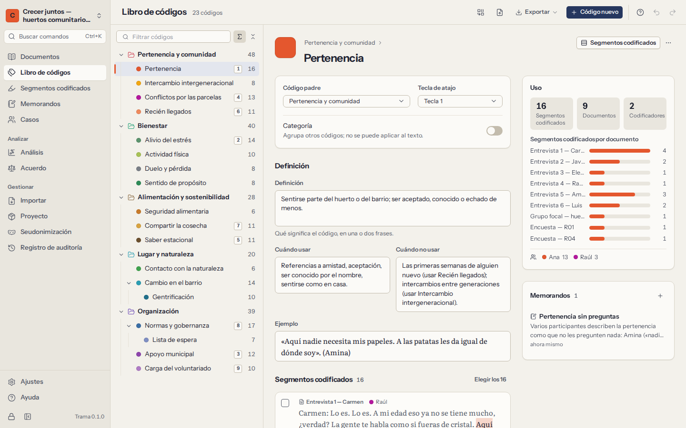

# El libro de códigos

El libro de códigos es la lista de sus códigos, organizada como un árbol, cada uno con un color y, idealmente, una definición. Crece mientras lee: aparecen códigos, que luego se fusionan, se separan y se reorganizan. **Libro de códigos** en la navegación muestra el árbol completo a la izquierda y los detalles del código elegido a la derecha.

## Códigos y jerarquía

- **Código nuevo** añade un código en el nivel superior, o dentro del código elegido con **Subcódigo nuevo**. También puede crear códigos mientras codifica, desde el panel junto a una selección.
- **Arrastre** un código sobre otro para convertirlo en subcódigo, o entre códigos para cambiar su orden. **Mover al nivel superior**, en su menú, lo saca de su código padre. Un código no puede quedar dentro de uno de sus propios subcódigos.
- Con el teclado: las flechas recorren el árbol y abren o cierran ramas, escribir unas letras salta a un código, `F2` cambia el nombre, `Delete` elimina y `Shift+F10` abre el menú del código.
- Las **categorías** son códigos que solo agrupan otros códigos: «Motivaciones», «Obstáculos». No se pueden aplicar al texto. Convierta un código en categoría (o al revés) con el interruptor **Categoría** de sus propiedades.
- Cada código tiene un **color**, que se usa en sus franjas, en el resaltado del texto y en los gráficos. Elija uno de la paleta o escriba cualquier color.

Los números junto a cada código indican cuántos segmentos codificados tiene. Pueden incluir los segmentos de sus subcódigos, mostrar cada código por separado u ocultarse: elíjalo en las opciones del panel.

## Definiciones

Un buen libro de códigos dice qué significa cada código, para que usted lo aplique igual en marzo que en octubre, y para que un segundo codificador lo aplique como usted. Cada código tiene cuatro campos:

| Campo | Qué escribir |
|---|---|
| **Definición** | Qué recoge el código, en una o dos frases. |
| **Cuándo usar** | Los criterios de inclusión: «Aplíquelo cuando el participante describa…» |
| **Cuándo no usar** | Los criterios de exclusión, a menudo indicando el código vecino que hay que usar en su lugar. |
| **Ejemplo** | Un pasaje típico, citado. |

La definición aparece al pie del panel de códigos mientras codifica con el código activo, y los cuatro campos forman parte de todas las exportaciones del libro de códigos.

## Los detalles de un código

Al elegir un código en **Libro de códigos** se muestra:

- dónde está en el árbol, sus propiedades y su definición;
- cómo se usa: número de segmentos codificados, de documentos y de codificadores, y los segmentos por documento;
- una vista previa de sus segmentos codificados, con **Ver todos en Segmentos codificados** para leerlos todos;
- los memorandos sobre el código, con **Memorando nuevo sobre este código**.

## Fusionar y separar códigos

A medida que el análisis madura, dos códigos resultan a menudo ser uno, y un código resulta ser dos.

**Fusionar.** Elija **Fusionar en…** en el menú de un código y elija el código que se conserva. Sus segmentos codificados, subcódigos y memorandos pasan a ese código, y el primero se elimina. Para fusionar varios códigos a la vez, elija **Fusionar varios códigos…** en los detalles del código, marque los códigos que se fusionan y elija el que se conserva. Trama muestra cuántos segmentos se moverán antes de que confirme. Cuando dos códigos fusionados cubrían el mismo pasaje del mismo codificador, los segmentos se unen en uno.

**Separar.** En los detalles de un código, marque los segmentos codificados que corresponden a una idea nueva y elija **Separar en un subcódigo…**. Ponga nombre al nuevo subcódigo; los segmentos elegidos pasan a él y los demás se quedan.

**Eliminar.** Al eliminar un código se eliminan sus segmentos codificados y los memorandos sobre ellos; Trama dice cuántos. Si el código tiene subcódigos, elija si quiere **conservar los subcódigos** (suben un nivel, con sus segmentos) o **eliminar también los subcódigos**.

Todo esto se puede deshacer al momento con `Ctrl+Z`, y todo queda en el [registro de auditoría](10-privacy-and-security.md#audit-trail).

## Exportar e importar un libro de códigos

**Exporte** el libro de códigos desde la pantalla **Libro de códigos** como:

- **Libro de códigos REFI-QDA** (`.qdc`): se abre en NVivo, MAXQDA, ATLAS.ti y otros programas compatibles con REFI-QDA;
- **Documento de Word** (`.docx`): para un anexo, o para que lo lea un segundo codificador;
- **Tabla CSV** o **Libro de Excel** (`.xlsx`): una fila por código, con su ruta, su código padre, su color, si es una categoría, su tecla de atajo, los cuatro campos de la definición y cuántos segmentos y documentos tiene;
- **Markdown** (`.md`).

**Importe** un libro de códigos desde un archivo `.qdc`, `.csv` o `.xlsx`: uno hecho por Trama, por otro programa o escrito a mano en una hoja de cálculo (basta una columna llamada **Name**/**Nombre** o **Path**/**Ruta**; una ruta como `Obstáculos > Tiempo`, o una columna **Código padre**, crea la jerarquía). Antes de cambiar nada, Trama muestra qué códigos son nuevos, cuáles se actualizarían y cuáles ya son iguales. Los códigos existentes conservan sus definiciones y colores, salvo que elija **Sustituir definiciones y colores**; si no, solo se rellenan sus campos vacíos. Una importación nunca elimina nada.

Los conjuntos de códigos (una función de MAXQDA y NVivo) no se importan: Trama no tiene conjuntos de códigos. Los grupos de documentos y la jerarquía cubren la mayoría de sus usos.
