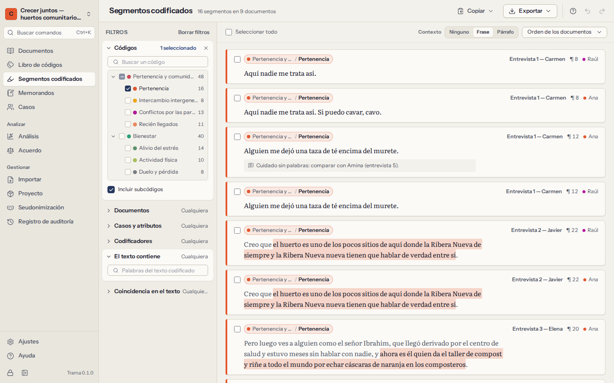
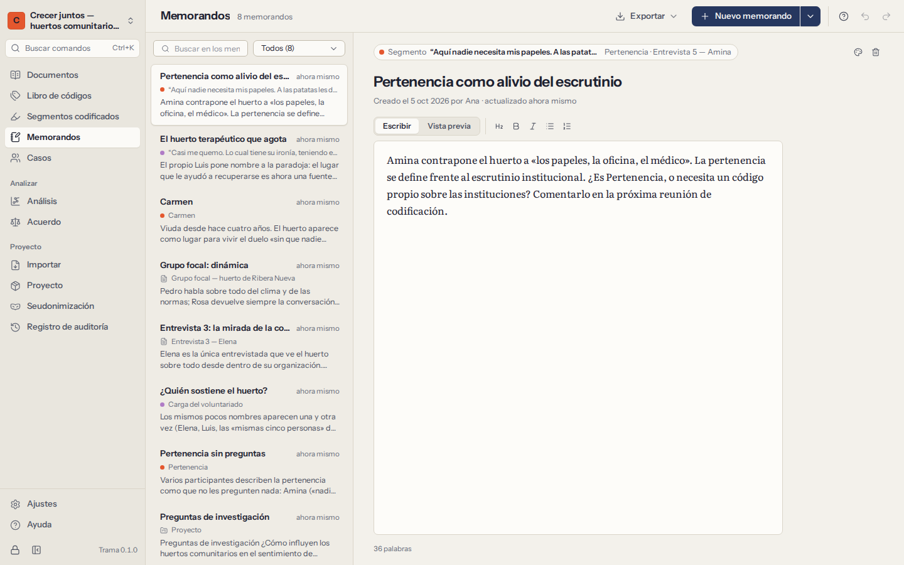

# Segmentos codificados y memorandos

Codificar es solo la mitad del trabajo; la otra mitad es leer lo codificado, uno junto a otro, y anotar lo que ve. **Segmentos codificados** reúne pasajes de distintos documentos; **Memorandos** guarda su escritura.

## Segmentos codificados

**Segmentos codificados** lista todos los pasajes codificados del proyecto, cada uno con su código, su documento y el lugar del documento donde está. Los filtros de la izquierda acotan la lista; la lista de la derecha se actualiza a medida que elige.

### Filtros

| Filtro | Qué conserva |
|---|---|
| **Códigos** | Los segmentos de los códigos que marque. **Incluir subcódigos** añade los segmentos de sus subcódigos. |
| **Documentos** | Los segmentos de los documentos o grupos de documentos que marque. |
| **Casos y atributos** | Los segmentos de los documentos de ciertos casos, o de casos que cumplen condiciones de atributos: *Edad es mayor que 60*, *Rol es Coordinadora*. Combine las condiciones con **todas** o **alguna**. |
| **Codificadores** | Los segmentos codificados por las personas que marque. |
| **El texto contiene** | Los segmentos cuyo texto contiene las palabras que escriba. |
| **Coincidencia en el texto** | Los segmentos que **se solapan con**, **están dentro de** o **contienen** un segmento de otros códigos en el mismo documento; por ejemplo, pasajes codificados como *Soledad* que están dentro de un pasaje codificado como *Jubilación*. |

Los filtros se combinan: deben cumplirse todos los que ponga. **Borrar filtros** vuelve a empezar. Si abre **Segmentos codificados** desde un código (en el libro de códigos o en el panel de códigos), empieza con ese código ya elegido.

### Leer los segmentos

- **Ordene** por orden de los documentos, por orden del libro de códigos, los más cortos primero o los más recientes primero.
- **Contexto** muestra cada segmento con el resto de su oración o de su párrafo, para que un segmento corto no pierda su sentido.
- Cada segmento muestra su comentario, si lo tiene, y un enlace a su memorando.
- Haga clic en el documento de un segmento (o pulse `Enter`) para **abrirlo en el documento**, en ese pasaje, ya seleccionado. Volver (`Alt+←`) regresa a la lista.
- Con el teclado: las flechas recorren la lista, `Enter` abre y `Space` selecciona.

### Copiar y exportar segmentos

- **Copiar** pone en el portapapeles los segmentos seleccionados —o todos los que se ven—, cada uno con su origen (documento, código y párrafo), listos para pegar en un borrador.
- **Exportar** los guarda como tabla **CSV** o **Excel** (una fila por segmento: código, ruta del código, documento, párrafo, posición, codificador, texto, texto con contexto, comentario, fecha), o como informe de **Word** o **HTML** agrupado por código. Los informes empiezan con una descripción de los filtros usados, para que la selección pueda repetirse y documentarse.

Las exportaciones salen de Trama sin cifrar. Consulte [qué sale de este ordenador](10-privacy-and-security.md#leaves).

## Memorandos

Los memorandos guardan su pensamiento a medida que se desarrolla: una intuición sobre todo el proyecto, notas sobre una entrevista, el significado de un código, una observación sobre un pasaje, el retrato de un participante. Escribir memorandos sobre la marcha es lo que convierte la codificación en análisis.

Un memorando trata **sobre** algo:

| Memorando sobre | Empiécelo desde |
|---|---|
| El proyecto | **Memorandos → Nuevo memorando** |
| Un documento | el menú del documento (**Memorando del documento…**), o **Nuevo memorando sobre… → Un documento** |
| Un código | los detalles del código en **Libro de códigos**, o **Nuevo memorando sobre… → Un código** |
| Un segmento codificado | **Memorando sobre este pasaje** al codificar, o **Memorando** en un segmento codificado |
| Un caso | los detalles del caso en **Casos**, o **Nuevo memorando sobre… → Un caso** |

### Escribir

- Los memorandos se guardan mientras escribe; no hay botón Guardar.
- Admiten formato sencillo, que se ve en **Vista previa**: `## título`, `**negrita**`, `*cursiva*`, `- lista`, `1. lista`. La barra de herramientas lo añade por usted (`Ctrl+B`, `Ctrl+I`).
- Dé un **color** a un memorando para marcar su estado: una idea, un hallazgo, algo que comprobar.
- Cada memorando muestra quién lo creó y cuándo, y cuándo se modificó por última vez. **Ir a** abre aquello de lo que trata.

### Encontrar y exportar memorandos

**Memorandos** lista todos los memorandos, con los cambios más recientes primero. Busque por palabras del título o del texto, o muestre solo un tipo (proyecto, documentos, códigos, segmentos codificados, casos). Los memorandos aparecen también donde corresponde: en el cajón de memorandos del documento, en los detalles de un código, en los detalles de un caso.

**Exporte** todos los memorandos como **documento de Word** o en **Markdown**, agrupados por aquello de lo que tratan: un buen punto de partida para redactar los resultados o la sección de métodos.

Eliminar un memorando se puede deshacer al momento. Al eliminar un documento, un código o un segmento codificado se eliminan también los memorandos sobre él (Trama lo avisa antes de que confirme).
