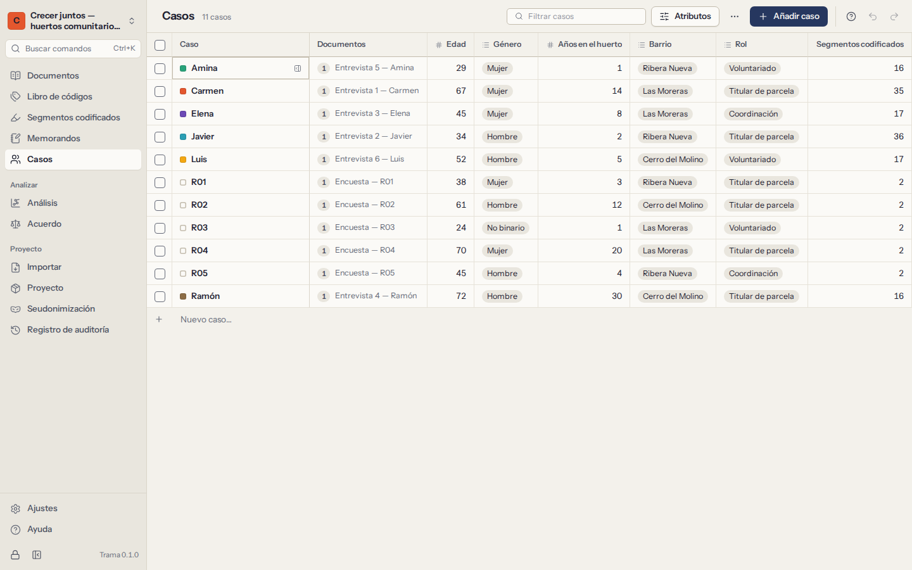

# Casos y atributos

Un **caso** es una unidad de análisis: normalmente un participante, a veces un hogar, una escuela, un lugar o una organización. Los **atributos** describen los casos —edad, género, rol, barrio, años de experiencia— para que pueda preguntarse cómo varía lo que dice la gente entre grupos.

## Casos

**Casos** muestra una tabla: una fila por caso, una columna por atributo, con el número de documentos y de segmentos codificados de cada caso.

- **Añada un caso** escribiendo su nombre en la última fila y pulsando `Enter`.
- **Edite un valor** haciendo clic en una celda (o yendo a ella con las flechas) y escribiendo. `Enter` guarda, `Esc` cancela y `F2` edita la celda en la que está.
- **Filtre** la tabla escribiendo parte del nombre de un caso.
- **Seleccione** casos con las casillas del principio de cada fila para eliminar varios a la vez. Al eliminar un caso se conservan sus documentos (se quedan sin caso) y se eliminan sus valores de atributos y los memorandos sobre él. Se puede deshacer.
- **Abra los detalles** de un caso para ver y editar su descripción y su color, sus valores de atributos, los **documentos** asociados (asocie más, o desasocie uno), sus **segmentos codificados por código** y los memorandos sobre él.

## Asociar documentos a casos

Cada documento pertenece como mucho a un caso, y un caso puede tener varios documentos. Asócielos en cualquiera de los dos sentidos:

- desde la lista de documentos: **Asignar caso…** en el menú de un documento;
- desde los detalles del caso: **Asociar un documento…**;
- para muchos a la vez: **Crear un caso por documento** crea un caso con el nombre de cada documento que aún no tiene caso, y los asocia (si ya existe un caso con ese nombre, se reutiliza). Es lo ideal cuando hay una entrevista por participante.

Las importaciones de encuestas crean automáticamente un caso por persona encuestada, con las columnas descriptivas como atributos (consulte [Respuestas de encuestas](02-documents.md#surveys)).

## Atributos

Elija **Atributos** sobre la tabla para añadir, renombrar, reordenar o eliminar atributos. Cada atributo tiene un nombre, una descripción opcional (qué registra y cómo) y un **tipo**:

| Tipo | Valores | Ejemplo |
|---|---|---|
| **Texto** | Cualquier cosa | Profesión |
| **Número** | Números enteros o decimales (`42`, `3,5` o `3.5`) | Edad, años en el huerto |
| **Fecha** | Fechas escritas como `2026-10-05` | Fecha de la entrevista |
| **Sí/no** | Sí o no | Tiene hijos |
| **Opción** | Una de una lista de opciones | Rol: Coordinadora, Voluntaria, Visitante |

- Los valores que no encajan con el tipo se rechazan, con un mensaje que explica por qué.
- En un atributo de **Opción**, escriba las opciones una por línea. Un valor nuevo escrito en la tabla se añade a las opciones automáticamente.
- Al cambiar el tipo de un atributo se convierten los valores que se pueda. Antes de que confirme, Trama le dice cuántos no se pueden convertir y se borrarían, y puede deshacerlo.
- Al eliminar un atributo se eliminan sus valores en todos los casos (también se puede deshacer).

Los atributos se comparan en [Análisis](07-analysis.md): tablas **Código × atributo**, filtros en [Segmentos codificados](05-retrieval-and-memos.md#filters) y gráficos por grupos. Allí los números se pueden agrupar en intervalos.

## Importar atributos de una hoja de cálculo

A menudo los atributos ya están en una hoja de cálculo de participantes. Elija **Importar atributos de una hoja de cálculo…** y seleccione un archivo CSV o Excel con **una fila por caso**: una columna con los nombres de los casos y una columna por atributo, por ejemplo:

| Participante | Edad | Rol |
|---|---|---|
| Teresa | 71 | Voluntaria |
| Rui | 34 | Coordinador |

1. Elija la hoja (en un libro) y **la columna con los nombres de los casos**. Trama muestra cuántos nombres coinciden con casos existentes y cuántos son nuevos.
2. Elija qué columnas importar. Cada una va a un atributo existente con el mismo nombre, o se convierte en un atributo nuevo; Trama propone un tipo a partir de los valores.
3. Elija si quiere **crear los casos que aún no existen** o dejar fuera esas filas.
4. Importe. Un resumen muestra los casos actualizados y creados, los atributos nuevos, los nombres que no coincidieron con ningún caso y las celdas que no encajaban con el tipo de su atributo (esas se omiten).

Los nombres se comparan sin tener en cuenta mayúsculas ni tildes.

## Exportar la tabla de casos

**Exportar tabla en CSV** o **en Excel** guarda la tabla tal como la ve: una fila por caso, una columna por atributo. Los casos, los atributos y sus valores también forman parte de los proyectos REFI-QDA (consulte [Intercambiar proyectos](09-exchange.md)).
