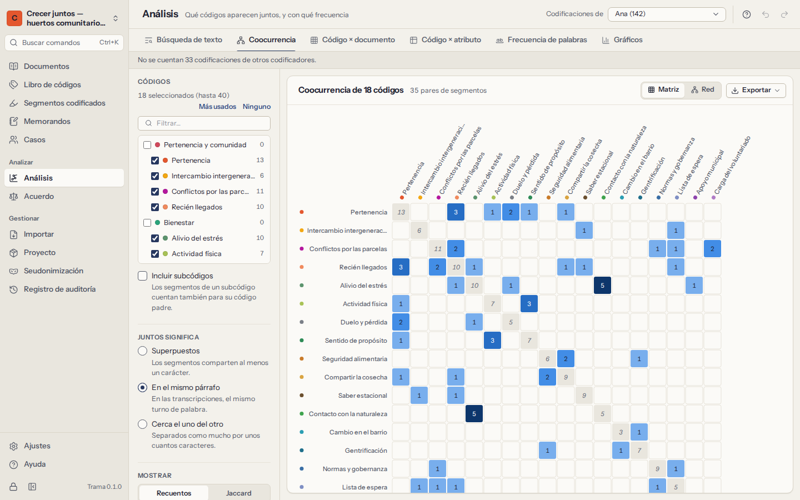
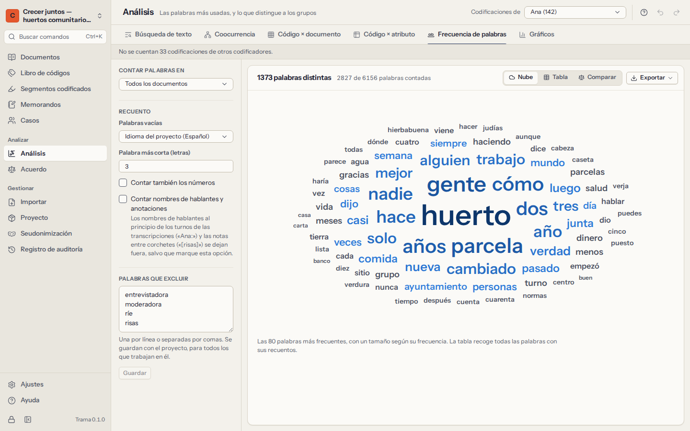

# Análisis

**Análisis** reúne las herramientas para mirar el material en conjunto: buscar en él, ver qué códigos van juntos, cómo se reparten los códigos entre documentos y grupos de personas, qué palabras usa la gente, y gráficos de todo ello. Todos los números se pueden abrir: haga clic en una celda, una barra o una palabra para leer los pasajes que hay detrás.

Todo el análisis se ejecuta en su ordenador, sobre el proyecto completo, y se actualiza cuando codifica más.

<a id="search"></a>

## Búsqueda de texto

La búsqueda encuentra palabras y frases en sus documentos y muestra cada resultado **en contexto**, alineado por el resultado, con las palabras de antes y de después (una vista de palabra clave en contexto).

- Escriba lo que busca y pulse `Enter`. Elija **Palabras**, **Frase** o **Regex** (una expresión regular, para patrones avanzados).
- En el modo **Palabras** puede combinar palabras:

| Escribe | Trama encuentra |
|---|---|
| `confianza familia` | párrafos con las dos palabras |
| `confianza OR fe` | párrafos con cualquiera de las dos |
| `confianza NOT dinero` | párrafos con *confianza* pero sin *dinero* |
| `"atención sanitaria"` | la frase exacta |
| `huert*` | huerto, huertos, huerta… |

- Opciones: **solo palabras completas**, **distinguir mayúsculas y minúsculas**, **distinguir acentos** (de forma predeterminada, *médica* también encuentra *medica*).
- **Buscar en** todos los documentos, en documentos elegidos, en grupos de documentos o solo en los segmentos de un código.
- Haga clic en un resultado para abrir el documento en ese punto.
- **Codificar todos…** aplica un código (existente o nuevo) a todos los resultados: solo a las palabras encontradas, a la oración completa (normalmente lo mejor para palabras sueltas) o al párrafo completo (en las transcripciones, el turno de quien habla). Los pasajes ya codificados con ese código se quedan como están, y un solo Deshacer quita todo lo añadido.

<a id="cooccurrence"></a>

## Coocurrencia



¿Qué códigos aparecen juntos, y con qué frecuencia? Elija dos o más códigos y qué significa **juntos**:

- **Superpuestos**: los dos segmentos codificados comparten al menos un carácter;
- **En el mismo párrafo**: en las transcripciones, el mismo turno de palabra;
- **Cerca el uno del otro**: separados como mucho por un número de caracteres.

El resultado es una **matriz** (códigos frente a códigos) o una **red** (círculos para los códigos, líneas para las coocurrencias; arrastre los círculos para reorganizarlos). Haga clic en una celda o en una línea para leer los pares de pasajes.

Hay dos formas de contar:

- **Recuentos**: el número de *pares* de segmentos que aparecen juntos. Un segmento largo de A que se solapa con tres segmentos de B cuenta 3 (como en MAXQDA). La diagonal muestra el número de segmentos de cada código.
- **Jaccard**: un valor de 0 (nunca juntos) a 1 (siempre juntos) que tiene en cuenta con qué frecuencia se usa cada código, para que los códigos frecuentes no dominen:

```
Jaccard(A, B) = (segmentos de A con B + segmentos de B con A)
              ÷ (segmentos de A + segmentos de B)
```

Con **Incluir subcódigos**, los segmentos de un subcódigo cuentan para su código padre.

<a id="matrix"></a>

## Código × documento

¿Cómo se reparte cada código en el material? Las filas son códigos; las columnas son **documentos**, **grupos de documentos** o **casos**. Cada celda muestra una de estas medidas:

- **Segmentos**: el número de segmentos codificados;
- **Caracteres**: cuánto texto está codificado, con los solapamientos contados una sola vez;
- **Presencia**: si el código aparece o no;
- **% del documento**: la parte del texto codificada con el código.

Con los subcódigos incluidos, la fila de un código padre suma sus subcódigos. Haga clic en una celda para leer sus segmentos.

<a id="crosstab"></a>

## Código × atributo

¿Hablan de forma distinta sobre un tema los participantes de más edad y los más jóvenes? Elija un [atributo](06-cases-and-attributes.md#attributes): sus valores pasan a ser las columnas, y los códigos, las filas. Los atributos numéricos se pueden agrupar en grupos iguales (de dos a cinco) o mostrarse con una columna por valor.

Cuente **segmentos**, **documentos** (con el código al menos una vez) o **casos** (con el código en cualquiera de sus documentos), opcionalmente como porcentaje de la fila o de la columna. Los documentos sin caso aparecen en *(sin valor)*.

**La prueba de ji cuadrado.** Al contar documentos o casos, Trama comprueba para cada código si la proporción de documentos (o casos) con el código varía entre los valores del atributo más de lo que explicaría el azar:

```
χ²  = Σ (observado − esperado)² ÷ esperado
gl  = (filas − 1) × (columnas − 1)
V   = √( χ² ÷ (n × (mín(filas, columnas) − 1)) )
```

Una *p* pequeña (por debajo de 0,05, en negrita) apunta a una diferencia que merece una mirada más atenta; la V de Cramér indica lo fuerte que es, de 0 a 1. Léala como una pista, no como una prueba: las muestras cualitativas son pequeñas y se eligen a propósito, no al azar, y una prueba no dice nada sobre *por qué* existe una diferencia. Cuando muchos recuentos esperados están por debajo de 5, la prueba no es fiable, y Trama lo señala. No se muestra ninguna prueba para segmentos, porque los segmentos no son independientes entre sí: una persona habladora puede decir lo mismo muchas veces.

<a id="words"></a>

## Frecuencia de palabras



¿Qué palabras usa más la gente? Cuente las palabras de todos los documentos, de un grupo de documentos o solo de los segmentos de un código.

- Las **palabras vacías** —palabras muy comunes como *el*, *y*, *de*— se dejan fuera según el idioma del proyecto (definido en Ajustes) u otro que elija: inglés, portugués, español, francés, alemán, italiano o neerlandés. Elija **Mantener todas las palabras** para no excluir ninguna.
- Fije la **palabra más corta** que se cuenta, y si cuentan los números.
- Añada sus propias **palabras que excluir**: el nombre de la entrevistadora, *vale*, *bueno*. Se guardan en el proyecto, para todos los que trabajan en él. **Excluir esta palabra**, en cualquier palabra, la añade.
- Vea una **nube** con las palabras más frecuentes o una **tabla** con todas las palabras, su recuento, el número de documentos en que aparecen y su porcentaje. Haga clic en una palabra para leerla en contexto.

**Comparar dos grupos** muestra las palabras que un grupo de documentos usa claramente más que otro, o que todos los demás documentos. Trama usa la prueba de razón de verosimilitud (G²), que funciona bien con los recuentos pequeños y desiguales de los textos reales, y conserva solo las palabras significativas con *p* < 0,05. La barra muestra cuánto más usa cada lado la palabra, en relación con la extensión de cada lado.

<a id="charts"></a>

## Gráficos

- **Frecuencia de códigos**: segmentos y documentos por código, ordenados; los códigos más usados o todos, todos los códigos o solo los de nivel superior con sus subcódigos sumados.
- **Retratos de documentos**: cada documento como una franja de principio a fin, coloreada por el código que cubre la mayor parte de cada tramo; más pálido significa que solo parte del tramo está codificada. Haga clic en un tramo para abrir el documento en ese punto. Los retratos muestran de un vistazo en qué parte de las entrevistas surge un tema.
- **Códigos por grupos**: barras apiladas con hasta ocho códigos en cada grupo de documentos o caso, como recuentos o como proporciones (100 %).

Todos los gráficos tienen también una vista de tabla.

<a id="export-results"></a>

## Exportar resultados

Todas las herramientas tienen **Exportar**: la tabla en **CSV** o **Excel**, y los gráficos como imágenes **SVG** (nítidas a cualquier tamaño, para publicaciones) o **PNG**. Los archivos exportados no están cifrados; consulte [qué sale de este ordenador](10-privacy-and-security.md#leaves).
