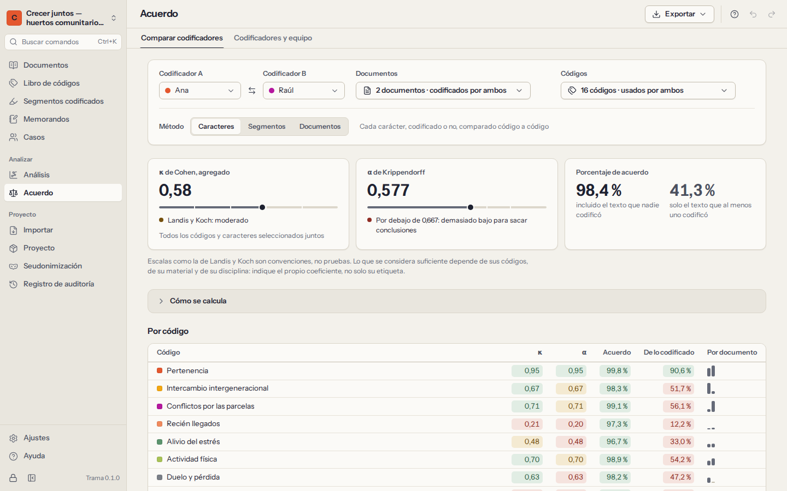

# Trabajo en equipo y acuerdo entre codificadores

Trama no tiene servidor y nunca usa Internet, así que un equipo trabaja como los investigadores han intercambiado siempre documentos: **cada persona codifica su propia copia del proyecto, y las copias se fusionan**. Como cada segmento codificado está firmado por su codificador, Trama puede medir después hasta qué punto coinciden dos codificadores y ayudarles a hablar de aquello en lo que no coinciden.

<a id="coders"></a>

## Codificadores

Un **codificador** es alguien que codifica en el proyecto, normalmente una persona. **Acuerdo → Codificadores y equipo** los muestra con el número de segmentos que ha codificado cada uno.

- Su codificador se elige en cada ordenador: es el nombre que dio al crear la biblioteca o el proyecto. Las codificaciones, los memorandos y las entradas del registro de auditoría hechos en este ordenador se firman con él.
- La primera vez que abre un proyecto creado en otro ordenador, Trama pregunta quién codifica: elija su nombre si ya codificó en él, o añádase.
- **Añadir codificador** añade a un compañero; puede cambiar el nombre y el color de los codificadores.
- **Soy yo** cambia quién codifica en este ordenador, por ejemplo si se eligió un nombre equivocado. El trabajo ya hecho conserva el codificador que lo hizo. Quién codifica en este ordenador se recuerda solo en este ordenador; no se guarda en el proyecto ni en las copias que envía.

<a id="copies"></a>

## Copias para compañeros

1. **Hacer una copia para un compañero** guarda el proyecto completo —documentos, libro de códigos, segmentos codificados, memorandos, casos— en un único archivo `.trama`. Protéjalo con una **contraseña** cuando viaje por correo electrónico o en un USB, y dígale la contraseña a su compañero por otra vía, por teléfono, por ejemplo. La clave de seudonimización se deja fuera, salvo que la incluya.
2. Su compañero elige **Importar un archivo de proyecto** en su pantalla de proyectos, abre el archivo (con la contraseña) e indica quién es. Sus codificaciones se firman con su nombre.
3. Codifica su copia: los mismos documentos u otros. También puede añadir códigos y memorandos.
4. Le devuelve su copia del mismo modo: **Hacer una copia para un compañero** desde su Trama.

Para medir el acuerdo de forma justa, acuerden antes el libro de códigos (con definiciones) y qué documentos codifican los dos de forma independiente, y no miren la codificación del otro en esos documentos hasta compararlas.

<a id="merge"></a>

## Fusionar la copia de un compañero

**Fusionar la copia de un compañero** y elija el archivo que le ha devuelto. Antes de cambiar nada, Trama muestra lo que trae la copia: cuántos documentos, códigos, segmentos codificados, memorandos y casos son **nuevos**, cuántos son versiones **más recientes** de registros que ya tiene y qué codificadores son nuevos.

- El trabajo nuevo entra y no se pierde nada de lo suyo.
- Cuando un registro se ha cambiado en los dos lados, se conserva la versión **más reciente**.
- No se quita nada de su proyecto salvo que su compañero lo eliminara después de su último cambio en ese registro.
- Solo se pueden fusionar copias del **mismo proyecto**. Un proyecto distinto (o una copia de seguridad automática) se reconoce y se rechaza con una explicación; en ese caso, impórtelo como proyecto nuevo.

Cada fusión queda en el [registro de auditoría](10-privacy-and-security.md#audit-trail). Fusione a menudo: las fusiones pequeñas y frecuentes son más fáciles de entender que una grande al final.

<a id="compare"></a>

## Comparar dos codificadores



**Acuerdo → Comparar codificadores** mide cómo han codificado el mismo material dos codificadores, A y B.

1. Elija el **Codificador A** y el **Codificador B**.
2. Elija los **documentos** —de forma predeterminada, los que han codificado los dos— y los **códigos** —de forma predeterminada, los que han usado los dos—. Los códigos usados por un solo codificador pueden incluirse si lo pide.
3. Elija el **método**: caracteres, segmentos o documentos (se explican más abajo). Para segmentos, fije el **solapamiento necesario** para que dos segmentos cuenten como el mismo.

Los resultados muestran estadísticos de resumen, una tabla **por código** y **por documento**, y la lista de **desacuerdos**.

<a id="disagreements"></a>

### Revisar los desacuerdos

Los desacuerdos son la parte útil: cada uno es un pasaje en el que el libro de códigos puede afinarse. La lista muestra todos los segmentos sin equivalente: codificados por un solo codificador, o con **límites distintos** en exceso. Seleccione uno para leer el pasaje con las codificaciones de los dos, una junto a otra. Después:

- **Aceptar a A** o **Aceptar a B**: conservar la codificación de uno y quitar la del otro;
- **Mantener ambas**: dejar las dos y marcar el desacuerdo como resuelto.

**Ocultar los resueltos** ayuda a no perderse en una lista larga. Cada decisión se puede deshacer.

<a id="report"></a>

### Informar

**Exportar** guarda los resultados como informe de **Word** o **página web** (qué se comparó, los estadísticos, una nota sobre cómo se calculan y los desacuerdos), como tablas de **Excel** o como tabla **CSV** por código. Informe del propio coeficiente —y del método y el umbral—, no solo de su etiqueta.

<a id="statistics"></a>

## Cómo se calculan los estadísticos

Trama enseña sus cuentas: cada estadístico puede seguirse hasta los recuentos de los que sale, y no se promedia nada sin decirlo. Las fórmulas siguientes son las que usa Trama.

<a id="character-level"></a>

### Caracteres (predeterminado)

Para cada código, cada carácter de cada documento elegido recibe dos etiquetas: codificado o no por A, codificado o no por B. Los caracteres se cuentan en cuatro celdas:

| | B codificó | B no codificó |
|---|---|---|
| **A codificó** | ambos | solo A |
| **A no codificó** | solo B | ninguno |

Los recuentos de todos los documentos se **suman antes** de calcular cualquier estadístico (una estimación *agregada*). Así, una entrevista larga pesa más que una nota breve. Promediar un kappa por documento, como hacen algunos programas, hace que un documento de dos líneas cuente tanto como una entrevista de una hora. El valor agregado de todos los códigos suma del mismo modo las celdas de cada código.

**Porcentaje de acuerdo**: la proporción de caracteres en los que ambos coinciden:

```
N                   = ambos + solo A + solo B + ninguno
acuerdo             = (ambos + ninguno) ÷ N
acuerdo, codificado = ambos ÷ (ambos + solo A + solo B)
```

La mayor parte del texto no la codifica nadie, así que el primer valor suele ser alto aunque los codificadores coincidan poco; el segundo deja fuera el texto que no codificó ninguno y es mucho más exigente.

**κ (kappa) de Cohen**: el acuerdo por encima del que daría el azar, donde el azar depende de cuánto codifica cada codificador:

```
pₒ = (ambos + ninguno) ÷ N
pₑ = a₁ × b₁ + a₀ × b₀
κ  = (pₒ − pₑ) ÷ (1 − pₑ)
```

Aquí, a₁ y b₁ son las proporciones de caracteres que codificaron A y B, y a₀ = 1 − a₁ y b₀ = 1 − b₁ las que no codificaron.

1 es acuerdo perfecto, 0 no es mejor que el azar y por debajo de 0 es peor que el azar.

**α (alfa) de Krippendorff**: como κ, pero el azar sale de las etiquetas de los dos codificadores juntas. Para dos codificadores y dos valores (codificado / no codificado), con *N* caracteres:

```
d  = solo A + solo B
n  = 2N
n₁ = 2 × ambos + d
n₀ = 2 × ninguno + d
α  = 1 − (n − 1) × d ÷ (n₀ × n₁)
```

Con dos codificadores y sin datos ausentes, α queda muy cerca de κ. Krippendorff aconseja confiar en la codificación con α ≥ 0,800 y sacar solo conclusiones provisionales con α ≥ 0,667.

**Cuando un estadístico no está definido.** Si no hay ninguna variación —nadie usó el código en estos documentos, por ejemplo—, el acuerdo esperado por azar es total y κ y α no se pueden calcular (darían 0 ÷ 0). Trama muestra un guion en lugar de fingir que el valor es 0 o 1.

<a id="segment-level"></a>

### Segmentos

Un segmento de A **tiene equivalente** cuando B tiene un segmento del mismo código, en el mismo documento, que se solapa con él al menos en la proporción elegida de su extensión conjunta:

```
solapamiento = caracteres compartidos
               ÷ (final más tardío − inicio más temprano)
acuerdo      = segmentos con equivalente
               ÷ todos los segmentos de ambos
```

Cada segmento de los dos codificadores se comprueba por separado, así que un segmento largo puede confirmar varios cortos. Un umbral del 90 % exige límites casi idénticos; bájelo si el equipo acordó codificar «más o menos el mismo pasaje».

En el nivel de segmentos no hay una celda «ninguno» a partir de la cual estimar el azar, así que Trama muestra la **κ de Brennan y Prediger**, que toma el acuerdo por azar como 1/*k*, siendo *k* el número de códigos comparados (al menos 2):

```
κ = (pₒ − 1/k) ÷ (1 − 1/k)
```

<a id="document-level"></a>

### Documentos

Para cada código y documento: ¿usó cada codificador el código allí al menos una vez? Se cuentan las mismas cuatro celdas sobre los pares código–documento, y el porcentaje de acuerdo, κ y α se calculan como para los caracteres. Es el nivel más tolerante, útil al principio, cuando la pregunta es si los codificadores se fijan en los mismos temas.

<a id="interpreting"></a>

### Interpretar los números

Trama etiqueta κ con las bandas de Landis y Koch (1977): por debajo de 0, *pobre*; hasta 0,20, *leve*; 0,21–0,40, *aceptable*; 0,41–0,60, *moderado*; 0,61–0,80, *considerable*; por encima de 0,80, *casi perfecto*. Estas bandas son convenciones, no pruebas. Lo que es suficiente depende de sus códigos, de su material y de su disciplina. Algunas ideas que conviene tener presentes:

- El acuerdo es un medio para llegar a un libro de códigos mejor, no un fin. Un valor bajo en un código suele significar que su definición necesita trabajo; hablen de los desacuerdos y afinen la definición.
- Los códigos poco frecuentes dan valores inestables: un solo desacuerdo mueve mucho κ.
- Indique qué estadístico, qué nivel, qué documentos y códigos, y qué umbral: el informe de Trama lo incluye todo.
