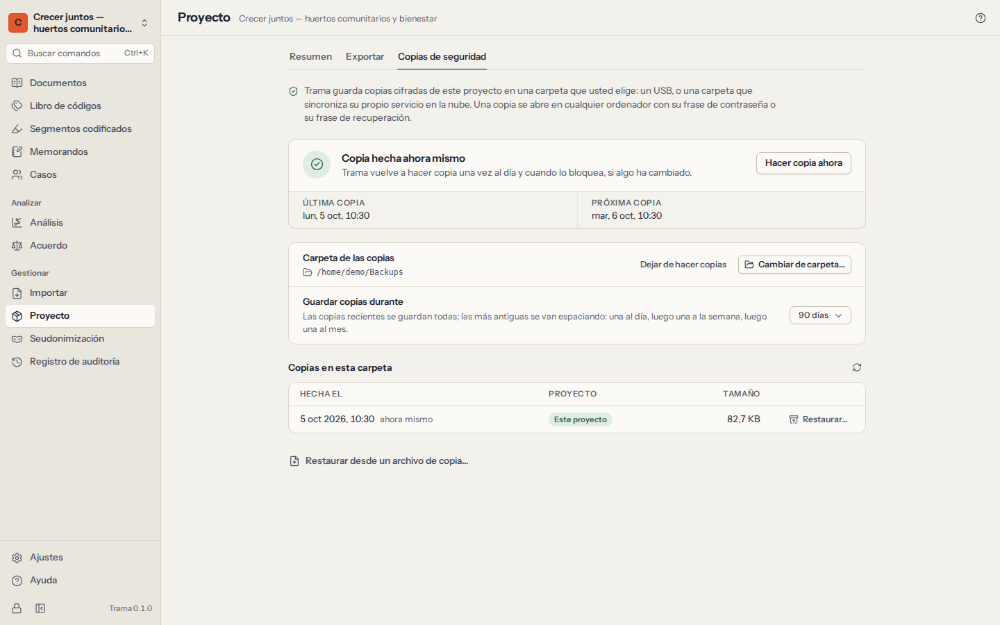

# Privacidad y seguridad

Los datos de las entrevistas son datos personales, a menudo sensibles. Trama está hecho para que se queden en su ordenador, cifrados y bajo su control, y para que pueda explicar exactamente cómo a un comité de ética, a un delegado de protección de datos o a un participante.

## Cifrado

- Su **biblioteca** se desbloquea con su frase de contraseña o con su frase de recuperación de 12 palabras. Cada una desenvuelve una clave de biblioteca aleatoria de 256 bits; ni la frase de contraseña ni la clave se guardan nunca. Para convertir una frase de contraseña en una clave se usa **Argon2id** con 64 MiB de memoria, lo que hace lento adivinar frases de contraseña incluso con equipos potentes.
- Cada **proyecto** es una base de datos **SQLCipher** independiente (AES-256), con su propia clave derivada de la clave de la biblioteca.
- Los **archivos originales y las grabaciones** se cifran con **XChaCha20-Poly1305** en bloques autenticados, de modo que cualquier manipulación se detecta.
- La **lista de proyectos** también está cifrada: quien tenga sus archivos ni siquiera puede leer los nombres de sus estudios.
- Las **copias de seguridad** y las exportaciones protegidas con contraseña están cifradas (vea más abajo).

Cuando Trama **se bloquea** —tras el tiempo sin uso que haya elegido, cuando pulsa `Ctrl+L` o cuando lo cierra—, guarda su trabajo, cierra el proyecto y sobrescribe las claves que tenía en memoria.

Los detalles técnicos, y los límites, están en `docs/security/threat-model.md` en el código fuente de Trama.

## Sin red, sin cuenta

Trama **no hace ninguna conexión de red**. No hay cuenta, servidor de licencias, nube, comprobación de actualizaciones, telemetría ni envío de informes de errores. La aplicación de escritorio no tiene permiso para usar la red, y sus pruebas automáticas lo comprueban. El manual que está leyendo forma parte de la aplicación.

Esto también significa que nadie —ni siquiera quienes hacen Trama— puede ver sus datos, recuperar su frase de contraseña ni restaurar una biblioteca perdida. Guarde la frase de recuperación en papel y mantenga copias de seguridad.

## Qué sale de este ordenador

Los datos solo salen de Trama cuando usted los saca. **Ajustes → Qué sale de este ordenador** enumera todas las vías, y la misma lista se publica con el código fuente de Trama (`PRIVACY.md`):

| Salida | Cuándo | ¿Cifrado? |
|---|---|---|
| Copias de seguridad automáticas | Cuando elige una carpeta de copias | Siempre |
| Archivo de proyecto (`.trama`) | Cuando lo exporta | Si pone una contraseña |
| Copia para un compañero | Cuando la hace | Si pone una contraseña (se propone) |
| Proyecto REFI-QDA (`.qdpx`) | Cuando lo exporta | No |
| Archivos del libro de códigos | Cuando los exporta | No |
| Tablas, informes y gráficos (CSV, Excel, Word, HTML, SVG, PNG) | Cuando los exporta | No |
| La clave de seudonimización | Solo si la exporta o la incluye | No, como tabla |
| El portapapeles | Cuando copia algo | No |

Las exportaciones sin cifrar son archivos corrientes: guárdelas y compártalas como indique su plan de gestión de datos.

## Copias de seguridad

Un ordenador puede averiarse, perderse o ser robado. Configure copias de seguridad automáticas para cada proyecto que importe:

1. Abra **Proyecto**, pase a la pestaña **Copias de seguridad** y elija una **carpeta de copias**: un USB que guarde en un lugar seguro, la unidad de red de su institución o una carpeta sincronizada con una nube. La copia se cifra antes de llegar allí.
2. A partir de entonces, Trama copia el proyecto al abrirlo, una vez al día mientras está abierto, al bloquear Trama o cerrar el proyecto (si algo ha cambiado) y siempre que elija **Hacer copia ahora**.
3. Elija hasta dónde llegan las copias: 30, 90 o 365 días. Las copias más antiguas se van espaciando —hasta diez del último día, después una al día durante dos semanas, una a la semana durante dos meses y una al mes a partir de ahí—, y las tres más recientes se conservan siempre.

Trama avisa cuando una copia falla (la carpeta no existe, está llena o no permite escribir) y cuando la última copia correcta tiene más de tres días.

**Qué contiene una copia:** el proyecto completo, incluidos los elementos eliminados y la clave de seudonimización, cifrado con la clave de su biblioteca, con el llavero dentro. Se abre con su frase de contraseña o con su frase de recuperación, en este ordenador o en otro.

**Restaurar:** en **Proyecto → Copias de seguridad**, elija **Restaurar…** junto a una copia de la lista, o **Restaurar desde un archivo de copia…**, debajo de la lista. La copia se convierte en un proyecto nuevo de su biblioteca, con la fecha en que la restauró en el nombre (por ejemplo, «Estudio de los huertos (restaurado el 2026-10-05)»), para no sustituir nunca lo que tiene. El proyecto en el que trabaja sigue abierto; elija **Abrir ahora** para pasar a la copia restaurada. En un ordenador nuevo, cree primero su biblioteca y después traiga la copia con **Importar un archivo de proyecto**, en la pantalla de proyectos: Trama pide la frase de contraseña o la frase de recuperación de la biblioteca que hizo la copia.

Quien pueda abrir la carpeta de copias ve que existen archivos de copia, sus fechas y sus tamaños, pero no lo que contienen.

## Eliminar

- Eliminar un documento, código, memorando o caso se puede deshacer al momento (`Ctrl+Z`). Los elementos eliminados se quedan dentro del proyecto cifrado para que deshacer y fusionar las copias de los compañeros funcionen correctamente.
- Las exportaciones nunca contienen el contenido de los elementos eliminados; las copias de seguridad cifradas, sí.
- **Eliminar un proyecto** borra su base de datos y sus archivos de este ordenador para siempre. Las copias de seguridad guardadas en otro lugar no se tocan: elimínelas usted si los datos deben destruirse, por ejemplo al final de un plazo de conservación.

## Seudonimización

La **seudonimización** sustituye nombres y otros datos identificativos de forma coherente en todos los documentos —«Ana Lima» pasa a ser «[Participante 1]» en todas partes—, mientras los segmentos codificados y las marcas de tiempo de las transcripciones siguen al texto modificado. Las mismas sustituciones se hacen en los nombres de documentos, casos, códigos y grupos, en los nombres de archivo, en las descripciones y atributos de texto de los casos, en los memorandos, en los comentarios de los segmentos codificados y en las definiciones de los códigos. Los elementos eliminados también se seudonimizan, para que deshacer más tarde una eliminación no traiga un nombre de vuelta, y todo lo que se restaure después o llegue con la copia de un compañero vuelve a tener la clave aplicada.

1. **Prepare la clave.** Añada entradas una a una (el original, tal como aparece, y su sustitución), o elija **Sugerir nombres**: Trama enumera palabras y expresiones con mayúscula de sus documentos que pueden ser nombres o lugares, y numera las sustituciones por usted (`[Participante 1]`, `[Lugar 2]`…). Las sugerencias son solo un punto de partida: los apodos, las calles, los lugares de trabajo y los detalles poco comunes pueden identificar a alguien igual de bien. Lea también sus documentos.
2. **Ajuste las opciones de cada entrada.** **Palabra completa** deja tranquilo «Ana» dentro de «Anabel». **Mayúsculas** sustituye «Rosa» el nombre, no «rosa» la flor.
3. **Vista previa** muestra todas las sustituciones antes de cambiar nada: documento por documento y, después, en todo el resto del proyecto (nombres, nombres de archivo, memorandos, comentarios, definiciones), agrupadas por tipo.
4. **Aplicar a los documentos.** Los originales se sustituyen en los propios documentos, no solo en las exportaciones. Los segmentos codificados que solo cubrían un nombre sustituido se quitan. Puede aplicar la clave entera o solo las entradas que marque.

Aplicarla solo se puede deshacer con **Deshacer justo después**; en cuanto sigue trabajando, el cambio es permanente. Haga antes una copia de seguridad.

**La clave** (qué se sustituyó por qué) es el vínculo con la identidad de sus participantes. Se queda dentro del proyecto cifrado, se deja fuera de todas las exportaciones y copias salvo que la incluya expresamente, y siempre está en las copias de seguridad cifradas. **Exportar clave** la guarda como tabla CSV para su archivo: guarde ese archivo cifrado y separado del material seudonimizado, como suelen exigir las aprobaciones éticas. Al eliminar una entrada se borra al instante el nombre original del proyecto; no se puede deshacer.

Los archivos PDF y Word originales se conservan tal como se importaron. Cuando el texto de un documento se ha editado (seudonimizado, por ejemplo), las exportaciones REFI-QDA y las copias .trama dejan fuera su PDF o su archivo de Word original, porque el original seguiría mostrando lo que se quitó (las copias de seguridad lo guardan todo). Por la misma razón, una vez usada la seudonimización, las exportaciones y las copias dejan fuera los nombres de los archivos originales de los documentos cuyo texto se ha editado, y de cualquier documento cuyo nombre de archivo contenga un nombre sustituido dentro de una palabra más larga (`consentimiento_analima.docx`), que al aplicar la clave no se puede reescribir.

**El registro de auditoría no se seudonimiza.** Nunca se edita, así que las entradas escritas antes de aplicar la clave («Añadió el documento «Entrevista — Ana Lima»») conservan los nombres. La vista previa y la ventana Aplicar dicen cuántas entradas lo hacen. Esas entradas se quedan como están dentro del proyecto y en sus copias de seguridad. Las exportaciones, las copias para un compañero y la exportación CSV del registro dejan fuera los nombres (la entrada se lee, en inglés, `"…" (names left out)`), y todas las demás entradas salen con la clave aplicada, también después de eliminar la entrada de la clave.

## El registro de auditoría

El **Registro de auditoría** es un registro, en el que solo se añade, de todos los cambios relevantes: documentos añadidos, renombrados, editados o eliminados; códigos creados, fusionados, separados o eliminados; pasajes codificados y descodificados; memorandos escritos; casos y atributos modificados; seudonimización aplicada; copias fusionadas; exportaciones y copias de seguridad realizadas. Cada entrada dice cuándo, quién (qué codificador) y qué.

- Busque en el registro, o fíltrelo por tipo de acción, codificador y fechas.
- **Exportar CSV** lo guarda, para una auditoría o para la sección de métodos de una tesis.
- Las entradas no se pueden editar ni eliminar. Los pasos deshechos y rehechos se registran como tales.

## Textos para comités de ética y planes de gestión de datos

Puede adaptar los párrafos siguientes para una solicitud al comité de ética, un plan de gestión de datos (PGD) o una hoja de información para participantes. Compruébelos con los requisitos de su institución y describa sus propias medidas de copia de seguridad y conservación.

> **Software y almacenamiento.** Los datos cualitativos se analizarán con Trama, software libre y de código abierto (Mozilla Public License 2.0) que funciona íntegramente en el ordenador del investigador. Trama no establece conexiones de red: no tiene cuenta de usuario, servicio en la nube, comprobación de actualizaciones ni telemetría, y no se envía ningún dato a los desarrolladores del software ni a terceros.

> **Cifrado en reposo.** Todos los datos del proyecto —transcripciones, archivos originales y grabaciones, códigos, memorandos y atributos de los participantes— se almacenan cifrados en el ordenador del investigador: la base de datos del proyecto con SQLCipher (AES-256) y los archivos con XChaCha20-Poly1305, con claves derivadas de la frase de contraseña del investigador mediante Argon2id. El software se bloquea automáticamente tras un periodo de inactividad y retira las claves de la memoria. Una frase de recuperación de 12 palabras, guardada en papel en un lugar seguro, permite el acceso si se olvida la frase de contraseña.

> **Copias de seguridad.** Se realizan automáticamente copias de seguridad cifradas en [una unidad de red gestionada por la universidad / un disco externo cifrado guardado en un armario cerrado con llave]. Las copias solo pueden abrirse con la frase de contraseña o la frase de recuperación del investigador.

> **Seudonimización.** Las transcripciones se seudonimizarán en el propio software, sustituyendo nombres y datos identificativos de forma coherente en todos los documentos. La clave que vincula los seudónimos con las identidades reales se guarda separada de los datos seudonimizados, dentro del proyecto cifrado, y se excluye de todos los archivos exportados y compartidos.

> **Intercambio dentro del equipo.** Cuando otros investigadores codifican los datos, las copias del proyecto se intercambian como archivos cifrados protegidos con contraseña a través de [el servicio institucional de intercambio de archivos / un USB cifrado]; las contraseñas se comunican por un canal distinto. No se sube ningún dato a servicios de análisis en la nube.

> **Auditoría y conservación.** El software mantiene un registro de auditoría, en el que solo se añade, de los cambios en los datos. Al final del plazo de conservación, el proyecto y sus copias de seguridad se eliminarán de todos los lugares de almacenamiento.

Sea preciso sobre lo que Trama **no** hace: no protege los datos que exporte sin cifrar (tablas, informes, archivos REFI-QDA), no puede proteger un ordenador desbloqueado de quien esté sentado delante ni de software malicioso que se ejecute en él, y no puede recuperar los datos si se pierden tanto la frase de contraseña como la frase de recuperación.
