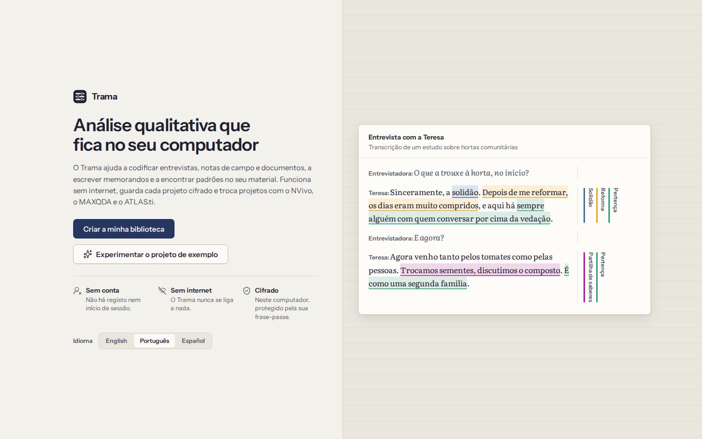
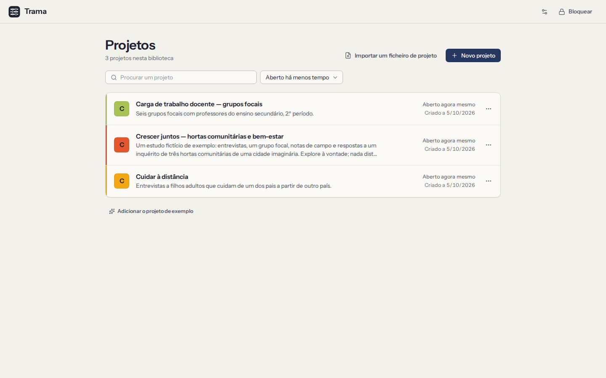

# Primeiros passos

O Trama guarda todos os seus projetos numa **biblioteca** cifrada no seu computador. Abre a biblioteca com uma frase-passe que só o próprio conhece; lá dentro, cada estudo é um **projeto** com os seus documentos, livro de códigos, memorandos e casos.

## Instalar o Trama

- **Linux:** use o pacote `.deb` no Ubuntu ou no Debian, o `.rpm` no Fedora ou o `.AppImage` em qualquer distribuição (torne-o executável e abra-o). A reprodução de áudio e vídeo usa os plugins GStreamer do sistema, que a maioria dos ambientes de trabalho já tem.
- **Windows:** execute o instalador (`.exe` ou `.msi`). As versões de teste ainda não estão assinadas, por isso o Windows pode dizer que protegeu o computador: escolha **Mais informações → Executar mesmo assim**.
- **macOS:** abra o `.dmg` e arraste o **Trama** para **Aplicações**. Se o macOS se recusar a abrir uma aplicação não assinada, autorize-a em **Definições do Sistema → Privacidade e segurança**.

O Trama funciona da mesma forma nos três sistemas. Não precisa de conta, de chave de licença nem de ligação à Internet — nem sequer para instalar ou procurar atualizações.

## Experimentar o projeto de exemplo

A forma mais rápida de ver o que o Trama faz é o projeto de exemplo: um estudo fictício sobre hortas comunitárias, com seis entrevistas, um grupo focal com a respetiva gravação, notas de campo e respostas a um inquérito, já codificados por dois investigadores.

- No ecrã de boas-vindas, escolha **Experimentar o projeto de exemplo**. Abre em memória: nada do que alterar é mantido, e uma faixa no topo lembra-o disso. Escolha **Sair do exemplo** para voltar.
- Na sua biblioteca, **Adicionar o projeto de exemplo** coloca uma cópia junto dos seus projetos, onde pode ficar o tempo que quiser; elimine-a quando já não precisar.
- Os instaladores acrescentam também um atalho **Trama (exemplo)**. Abre uma biblioteca de exemplo separada, cuja frase-passe é **trama**, e começa do zero sempre que é aberta. A sua biblioteca nunca é tocada.

Todas as pessoas e todos os lugares do exemplo são inventados. Nunca coloque lá dados reais.

## Abrir o Trama pela primeira vez

1. Escolha o idioma no topo. Pode mudá-lo mais tarde.
2. Escolha **Criar a minha biblioteca**.
3. Escreva o seu nome ou as suas iniciais. Assina a codificação que fizer, para que os coautores saibam o que é de quem. Fica neste computador.
4. Escolha uma frase-passe e anote a sua frase de recuperação (ambas explicadas a seguir).

## Escolher uma frase-passe

Escreve a frase-passe sempre que abre o Trama. Protege todos os projetos da biblioteca.

- Use **algumas palavras sem relação entre si que consiga recordar**, como `garça violeta elétrico outono`. Quanto mais longa, mais forte; tem de ter pelo menos 10 caracteres. Uma barra por baixo do campo mostra a força.
- O Trama não a consegue repor, nem mais ninguém: não há servidor nem conta. É para isso que serve a frase de recuperação.
- Pode mudar a frase-passe mais tarde em **Definições**. Os projetos ficam como estão; só muda a fechadura.

## Anotar a frase de recuperação

A seguir, o Trama mostra **12 palavras**. São a única forma de voltar a entrar na biblioteca se se esquecer da frase-passe.

1. Escreva as 12 palavras em papel, pela ordem. Também as pode imprimir.
2. Guarde o papel num sítio seguro e longe do computador — uma cópia que só existe neste computador perde-se com ele.
3. Assinale **Escrevi as 12 palavras** e continue.
4. O Trama pede-lhe algumas das palavras, para confirmar que a cópia está certa. Depois, a biblioteca é criada.

Se copiar as palavras para a área de transferência, cole-as num sítio seguro e copie depois outra coisa qualquer, para que não fiquem lá.

## Projetos

Depois de desbloquear, vê os seus projetos. Um projeto reúne o material de um estudo: documentos, códigos, segmentos codificados, memorandos, casos e atributos. A biblioteca pode ter tantos projetos quantos precisar, e cada um é cifrado com a sua própria chave.

- **Novo projeto** pede um nome, uma descrição opcional (a pergunta de investigação, ou uma nota para si próprio no futuro) e uma cor.
- Clique num projeto para o abrir. Da próxima vez que desbloquear o Trama, o último projeto que tinha aberto abre logo.
- O menu **…** de um projeto permite editar os detalhes ou eliminá-lo. Para eliminar, o Trama pede que escreva o nome do projeto, e remove-o deste computador para sempre (as cópias de segurança guardadas noutro sítio não são tocadas).
- **Importar um ficheiro de projeto** traz um ficheiro `.trama` ou um projeto REFI-QDA (`.qdpx`) do NVivo, do MAXQDA ou do ATLAS.ti como novo projeto — ver [Trocar projetos](09-exchange.md).
- Para mudar de projeto com um já aberto, use o nome do projeto no topo da navegação.

## Orientar-se num projeto

A navegação à esquerda leva a todas as partes de um projeto:

| Ecrã | Para que serve |
|---|---|
| **Documentos** | Ler e codificar o material ([Codificação](03-coding.md)) |
| **Livro de códigos** | Os códigos, a hierarquia e as definições ([O livro de códigos](04-codebook.md)) |
| **Segmentos codificados** | Tudo o que codificou, filtrado e reunido ([Segmentos codificados](05-retrieval-and-memos.md)) |
| **Memorandos** | A sua escrita analítica ([Memorandos](05-retrieval-and-memos.md#memos)) |
| **Casos** | Participantes, locais ou organizações e os seus atributos ([Casos](06-cases-and-attributes.md)) |
| **Análise** | Pesquisa, coocorrência, matrizes, frequência de palavras e gráficos ([Análise](07-analysis.md)) |
| **Concordância** | Codificadores, cópias dos colegas e concordância entre codificadores ([Trabalho em equipa](08-teamwork-and-agreement.md)) |
| **Importar** | Trazer documentos para o projeto ([Documentos](02-documents.md#import)) |
| **Projeto** | Os dados do projeto, as exportações (ficheiros de projeto, REFI-QDA, livro de códigos, relatórios), as cópias de segurança automáticas e o seu restauro ([Trocar projetos](09-exchange.md), [Cópias de segurança](10-privacy-and-security.md#backups)) |
| **Pseudonimização** | Substituir nomes de forma coerente ([Pseudonimização](10-privacy-and-security.md#pseudonymisation)) |
| **Registo de auditoria** | Um registo de todas as alterações ([Registo de auditoria](10-privacy-and-security.md#audit-trail)) |

A **paleta de comandos** (`Ctrl+K`) encontra qualquer ecrã, documento, projeto ou ação quando escreve parte do nome. **Voltar** (`Alt+←`, ou o botão de retroceder do rato) leva-o ao sítio onde estava — exceto enquanto uma gravação está a tocar, em que `Alt+←` e `Alt+→` recuam e avançam na gravação (ver [Transcrições e gravações](02-documents.md#transcripts)).

Tudo o que faz é guardado à medida que trabalha. Não há botão Guardar.

## Bloquear e desbloquear

- O Trama **bloqueia-se sozinho** ao fim de 10 minutos sem utilização. Escolha quanto tempo em **Definições** (ou nas preferências do ecrã de projetos): 5, 10, 15, 30 ou 60 minutos.
- Para o bloquear, escolha **Bloquear** na navegação ou prima `Ctrl+L`. Bloquear guarda o que estava a escrever, fecha o projeto e apaga as chaves da memória.
- Para desbloquear, escreva a frase-passe. O projeto que tinha aberto volta a abrir.

**Esqueceu-se da frase-passe?** No ecrã de desbloqueio, escolha **Usar a frase de recuperação**, escreva as 12 palavras pela ordem e escolha uma nova frase-passe. A antiga deixa de funcionar.

Se perder **tanto** a frase-passe **como** a frase de recuperação, ninguém consegue abrir a biblioteca — nem o próprio, nem quem faz o Trama. Mantenha cópias de segurança cifradas e o papel com as 12 palavras.

## Definições

As **Definições** reúnem as escolhas que lhe dizem respeito a si e a este computador:

- o idioma da interface (English, Português, Español) e o tema (claro, escuro ou o do sistema);
- quanto tempo até o Trama se bloquear;
- a frase-passe e a frase de recuperação, que pode mudar a qualquer momento;
- **O que sai deste computador**: todas as formas de os dados saírem do Trama, e quando (ver [Privacidade e segurança](10-privacy-and-security.md));
- para o projeto aberto, o idioma do material, usado na frequência de palavras e nas palavras vazias.

## Atalhos de teclado

Tudo no Trama se pode fazer com o teclado. Os que vai usar mais:

| Teclas | O que fazem |
|---|---|
| `Ctrl+K` | Abrir a paleta de comandos |
| `Ctrl+Z` / `Ctrl+Shift+Z` | Anular / refazer |
| `Ctrl+L` | Bloquear o Trama |
| `Alt+←` | Voltar (durante a reprodução de uma gravação: recuar 5 segundos) |
| `Ctrl+F` | Procurar no documento que está a ler |
| `1` … `9` | Com texto selecionado, aplicar o código que tem essa tecla de atalho |
| `Enter` | Com texto selecionado, procurar ou criar um código; em texto codificado, ver os seus códigos |
| `Ctrl+I` | Criar um código in vivo com as palavras selecionadas |
| `Delete` | Remover a codificação selecionada, ou eliminar o item selecionado numa lista |
| `F2` | Mudar o nome do documento, código ou caso selecionado |
| `Shift+F10` | Abrir o menu do item selecionado |
| `?` | Ao ler um documento, ver os respetivos atalhos |

A Ajuda tem a lista completa na página **Atalhos de teclado**. Os botões mostram o atalho na dica.
