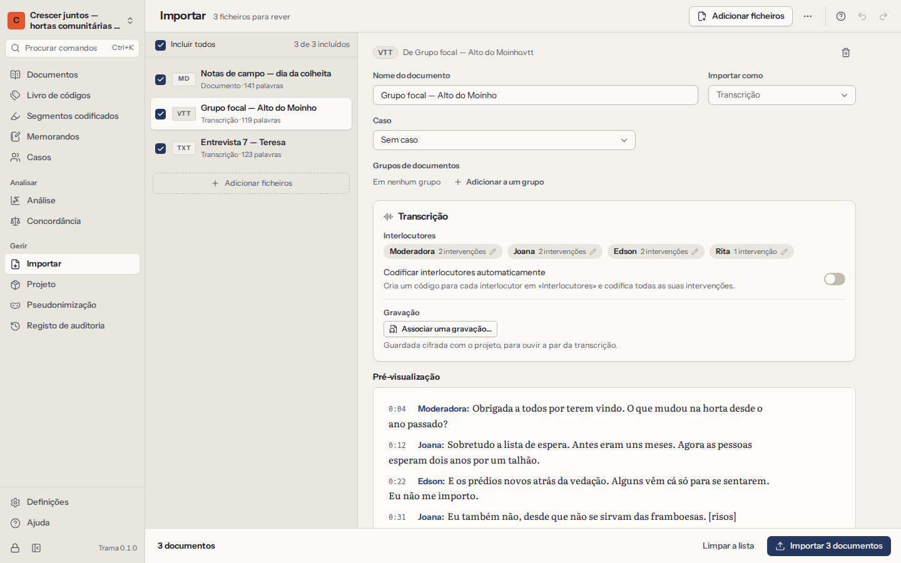
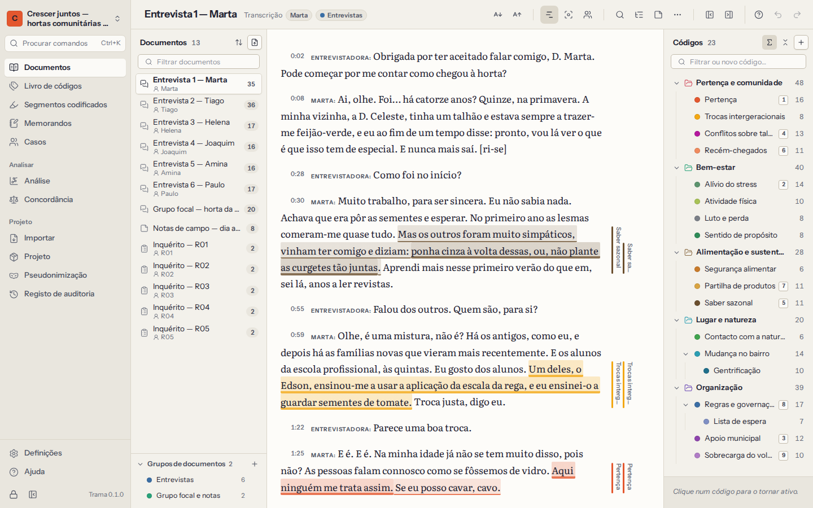

# Documentos

Os documentos são o seu material: transcrições de entrevistas e grupos focais, notas de campo, relatórios, artigos, respostas abertas a um inquérito. O Trama trabalha com o **texto**: codifica palavras, frases e parágrafos. Os ficheiros originais e as gravações são guardados, cifrados, dentro do projeto.

## Importar documentos

Abra **Importar** na navegação (ou **Importar documentos** na lista de documentos) e escolha os ficheiros. O Trama lê cada ficheiro, mostra o que encontrou e eventuais problemas, e acrescenta os documentos quando confirmar.

| Tipo de ficheiro | Extensões | Notas |
|---|---|---|
| Texto simples | `.txt` | Qualquer codificação; os ficheiros que não estão em UTF-8 são lidos como Windows-1252 e assinalados, para que verifique as letras acentuadas. |
| Markdown | `.md` | As marcas de formatação são removidas; o texto fica. |
| Word | `.docx` | Texto, títulos e listas. As imagens e os comentários ficam de fora (o Trama diz quantos). O ficheiro original é guardado. |
| OpenDocument | `.odt` | Como no Word. |
| Rich Text | `.rtf` | Incluindo páginas de código antigas do Windows. |
| Página web | `.html`, `.htm` | O texto legível, sem menus nem scripts. |
| PDF | `.pdf` | A camada de texto de cada página. O PDF original é guardado. Os PDF protegidos pedem a palavra-passe. |
| Legendas | `.vtt`, `.srt` | Lidas como transcrições com marcas de tempo (ver abaixo). |
| Folhas de cálculo | `.csv`, `.xlsx` | Lidas como respostas a inquéritos (ver abaixo). |

Algumas coisas a saber:

- Os **PDF digitalizados** não têm camada de texto, só imagens das páginas. O Trama indica as páginas sem texto. Não reconhece texto em imagens; passe primeiro a digitalização por um programa de OCR, ou importe uma versão em Word ou em texto.
- Os **nomes** vêm dos nomes dos ficheiros. Pode mudar o nome de um documento a qualquer momento (`F2` na lista).
- O **texto fica num formato canónico**: as quebras de linha, os caracteres invisíveis e as formas Unicode são normalizados na importação, para que as posições se mantenham exatas. Os parágrafos são separados por quebras de linha.
- Ficheiros muito grandes não são problema. Uma transcrição de um megabyte abre e codifica-se sem esforço.

## Transcrições e gravações

O Trama reconhece transcrições e mantém **uma intervenção por parágrafo**, escrita como `Orador: o que disse`. Assim é fácil codificar uma intervenção inteira, comparar oradores e ler um grupo focal.

- Os **ficheiros de legendas** (`.vtt`, `.srt`) do Zoom, do Teams, do Otter ou de programas de transcrição tornam-se transcrições com uma marca de tempo em cada intervenção.
- Os **ficheiros de texto e de Word** são lidos como transcrições quando parecem uma: linhas que começam com o nome de quem fala seguido de dois pontos, ou com marcas de tempo como `[00:01:23]`. O Trama é cauteloso: uma nota de campo com linhas como `Data: …` continua a ser um documento comum. Ao importar, pode indicar que um ficheiro deve ser lido como transcrição sempre, nunca, ou quando parecer uma.
- Os **nomes de quem fala** que só diferem em maiúsculas (`INÊS` e `Inês`) são tratados como a mesma pessoa. Pode mudar os nomes antes de importar («Orador 1» → «Entrevistadora»).
- Pode pedir ao Trama que **codifique as intervenções de cada pessoa** com um código com o nome dela, para mais tarde recuperar tudo o que alguém disse.

**Gravações.** Uma transcrição pode ter o respetivo áudio ou vídeo. No cabeçalho do documento, escolha **Associar uma gravação…** e escolha o ficheiro; fica cifrado e guardado no projeto. Aparece um leitor por cima do texto:

- `Ctrl+Space` reproduz ou pausa; `Alt+Shift+←` e `Alt+Shift+→` recuam ou avançam 5 segundos.
- `Alt+Enter` reproduz a partir do parágrafo onde está o cursor.
- **Acompanhar a gravação no texto** realça a intervenção que está a ser ouvida.
- Remover uma gravação apaga o ficheiro do projeto; a transcrição e as marcas de tempo ficam.

## Respostas a inquéritos

As respostas abertas de um questionário costumam chegar numa folha de cálculo: uma linha por inquirido, uma coluna por pergunta. Importe o ficheiro `.csv` ou `.xlsx` e o Trama pergunta como o deve ler:

1. **A folha** a ler, nos livros com várias folhas.
2. **A coluna com o identificador do inquirido**, ou nenhuma (as linhas são então numeradas).
3. **As colunas com respostas abertas** — o texto que quer codificar.
4. **As colunas que descrevem os inquiridos** (idade, grupo, local…). Tornam-se [atributos dos casos](06-cases-and-attributes.md), com um caso por inquirido.
5. **A organização**: um documento por inquirido (cada pergunta como título, com a resposta por baixo) ou um documento por pergunta (a resposta de cada inquirido por baixo do respetivo identificador).

O Trama pode também codificar cada resposta com um código com o nome da pergunta, para que «tudo o que se respondeu à pergunta 3» fique à distância de um clique.

## A lista de documentos

**Documentos** mostra a lista de documentos à esquerda, o documento aberto ao centro e o livro de códigos à direita. Oculte qualquer um dos painéis laterais para dar mais espaço ao texto; arraste as margens para os redimensionar.

- **Filtre** a lista escrevendo parte de um nome.
- **Ordene** pela sua própria ordem (arraste os documentos para os reorganizar), por nome, pelo que tem mais codificação ou pela data em que foram acrescentados.
- **Agrupe** a lista por grupo de documentos ou por caso.
- Selecione vários documentos com `Ctrl` ou `Shift` e um clique e aja sobre todos a partir do menu.
- O menu de cada documento (clique com o botão direito, ou `Shift+F10`) permite **mudar o nome**, **definir o caso**, colocá-lo em **grupos**, dar-lhe uma **cor**, abrir o **memorando**, ver as **propriedades** (tipo, ficheiro original, extensão, número de segmentos codificados, quanto do texto está codificado) ou **eliminá-lo**.

Eliminar um documento elimina também os seus segmentos codificados e os memorandos sobre ele. O Trama diz quantos antes de confirmar, e pode anular de imediato.

## Grupos de documentos

Um grupo de documentos reúne documentos que pertencem ao mesmo conjunto: as entrevistas, a primeira vaga, um local, os documentos ainda por codificar. Um documento pode estar em vários grupos.

- Crie um grupo em **Grupos de documentos…** no menu de um documento, ou na secção de grupos da lista de documentos.
- Escolha um grupo para mostrar só os seus documentos. Os grupos também podem mudar de nome, de cor e ser eliminados; eliminar um grupo nunca elimina os seus documentos.
- Os grupos são usados em toda a análise: para filtrar segmentos codificados, para comparar o uso de palavras, como colunas de uma matriz código × documento e nos gráficos.

## Documentos e casos

Um **caso** é uma unidade de análise — normalmente um participante, por vezes um local, um agregado familiar ou uma organização. Cada documento pode pertencer a um caso; um caso pode ter vários documentos (duas entrevistas à mesma pessoa, por exemplo). Defina o caso de um documento no seu menu (**Definir caso…**): escreva para encontrar um caso, ou escreva um nome novo para o criar.

Os casos têm **atributos** como a idade, a função ou o bairro, que permitem comparar grupos de pessoas. Têm [um capítulo próprio](06-cases-and-attributes.md).
