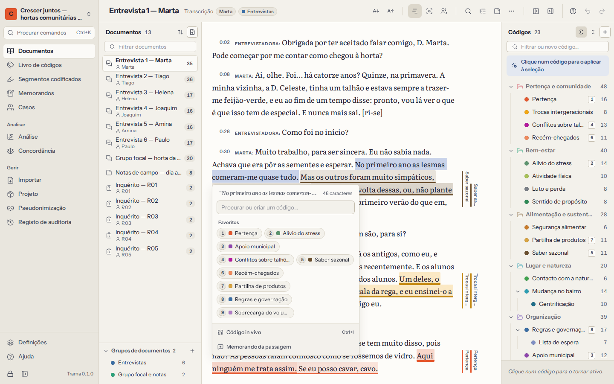

# Codificação

Codificar é assinalar uma passagem e atribuir-lhe um código — uma etiqueta curta para aquilo de que a passagem trata, como *Solidão* ou *Partilha de saberes*. Uma passagem pode ter vários códigos, os códigos podem sobrepor-se, e o mesmo código aplica-se onde quer que a sua ideia apareça. Mais tarde, recupera todas as passagens de um código, compara códigos e procura padrões.

## Selecionar e codificar uma passagem

Abra um documento em **Documentos**. Depois:

1. **Selecione a passagem** com o rato, ou com `Shift` e as setas.
2. Abre-se um pequeno painel junto à seleção. Escreva para **procurar um código** — ou escreva um nome novo para **o criar** — e prima `Enter`. Os seus **códigos favoritos** (os que têm tecla de atalho) e os que usou mais recentemente também aparecem; clique num para o aplicar.
3. A passagem fica codificada: aparece uma barra colorida na margem, ao lado dela, e o texto ganha a cor do código.

Os espaços nas extremidades da seleção ficam de fora. Se codificar uma passagem que toca ou se sobrepõe a uma que já codificou com o mesmo código, o Trama **alarga** esse segmento codificado em vez de criar outro.

Cada segmento codificado é assinado com o seu nome como codificador (ver [Trabalho em equipa](08-teamwork-and-agreement.md)). A codificação pode ser anulada com `Ctrl+Z`.

## O painel de códigos

O livro de códigos ao lado do texto é outra forma de codificar:

- **Com texto selecionado**, clique num código para o aplicar.
- **Sem seleção**, um clique torna o código **ativo**: a definição aparece no fundo do painel, para a ter presente enquanto lê. Clique outra vez para o largar.
- A caixa no topo filtra os códigos à medida que escreve. Se nada corresponder, prima `Enter` para **criar um código** com esse nome — dentro do código ativo, se houver um.
- Os números ao lado de cada código indicam quantos segmentos codificados tem; pode ver os de cada código isolado, os que incluem os subcódigos, ou nenhuns.
- Arraste os códigos para os reorganizar ou para colocar um dentro de outro, e use o menu de cada código para mudar o nome, a cor, dar-lhe uma tecla de atalho, editar a definição, fundi-lo ou eliminá-lo. O [capítulo sobre o livro de códigos](04-codebook.md) explica tudo isto.

## Códigos in vivo

Um código **in vivo** tira o nome das próprias palavras do participante. Selecione uma expressão curta — «uma segunda família», «há sempre alguém com quem falar» — e prima `Ctrl+I`, ou escolha **Código in vivo** no painel junto à seleção. O Trama cria um código com o nome dessas palavras e aplica-o. Pode mudar-lhe o nome, movê-lo ou fundi-lo mais tarde, como a qualquer outro código.

## Codificar com o teclado

Pode codificar um documento inteiro sem tocar no rato:

| Teclas | O que fazem |
|---|---|
| Setas | Mover o cursor pelo texto |
| `Shift` + setas | Selecionar texto |
| `1` … `9` | Aplicar o código que tem essa tecla de atalho |
| `Enter` | Abrir o painel para procurar ou criar um código para a seleção |
| `Ctrl+I` | Código in vivo a partir da seleção |
| `Esc` | Limpar a seleção |
| `Enter` (em texto codificado, sem seleção) | Ver os códigos onde está o cursor |
| `Delete` | Remover a codificação escolhida nessa lista |
| `Ctrl+F` | Procurar no documento |
| `?` | Ver estes atalhos |

Para dar uma tecla de atalho a um código, escolha **Tecla de atalho…** no seu menu e escolha um número de 1 a 9. Cada número pertence a um código de cada vez; os códigos com tecla são os seus **favoritos**.

## Barras de codificação e o que vê

- As **barras** na margem mostram cada segmento codificado ao lado da passagem, uma coluna por código, na cor do código. Aponte para uma barra para ver o nome do código; clique para abrir esse segmento codificado. Mostre ou oculte as barras no cabeçalho do documento.
- **Mostrar só o código ativo** esbate todos os outros códigos, o que ajuda a verificar se um código foi aplicado de forma coerente.
- **Codificadores**: quando várias pessoas codificaram o projeto, escolha de quem é a codificação a mostrar — de todos, só a sua, ou a de um colega.
- **Tamanho do texto**: aumente ou diminua o texto no cabeçalho. A escolha fica memorizada.
- **Segmentos codificados**, no cabeçalho, abre a lista dos segmentos codificados deste documento, e **Memorandos** os memorandos sobre o documento e as suas passagens.
- Clique em texto codificado (ou ponha o cursor nele e prima `Enter`) para ver os **segmentos codificados neste ponto**. Em cada um pode acrescentar um comentário, **mudar de código**, **ajustar os limites** (selecione a nova extensão e prima `Enter`), escrever um memorando, abrir o código no livro de códigos ou **remover esta codificação**.

## Procurar num documento

`Ctrl+F` abre uma barra de pesquisa por cima do texto. As ocorrências ficam realçadas e numeradas; `Enter` ou as setas junto à caixa passam de uma para a seguinte. **Codificar as N…** (N é o número de ocorrências) aplica um código a todas as ocorrências de uma vez — útil para nomes de lugares ou expressões recorrentes. Para pesquisar em todos os documentos, use a [Pesquisa de texto](07-analysis.md#search) na Análise.

## Editar o texto

As transcrições têm gralhas, e às vezes um nome tem de desaparecer. Escolha **Editar o texto…** no cabeçalho do documento para corrigir o texto no próprio documento.

- Os segmentos codificados **acompanham as suas palavras**: se inserir uma palavra antes de uma passagem codificada, a codificação desloca-se; se mudar uma palavra lá dentro, a codificação continua a envolvê-la.
- Um segmento codificado cujo texto apague por completo é removido. O Trama avisa quantos segmentos codificados o documento tem antes de começar, e diz-lhe no fim se algum foi removido.
- As marcas de tempo das transcrições também acompanham o texto.
- Guardar o texto é um único passo, que pode anular.

Para substituir nomes de forma coerente em todos os documentos, use a [Pseudonimização](10-privacy-and-security.md#pseudonymisation) em vez de editar cada documento à mão.

## Memorandos e comentários sobre passagens

Há duas formas de tomar nota sobre uma passagem:

- Um **comentário** é uma nota curta num segmento codificado (até 4000 caracteres) — «ironia?», «confirmar com o Rui». Os comentários aparecem em [Segmentos codificados](05-retrieval-and-memos.md) e nas exportações.
- Um **memorando** é escrita analítica mais longa. Escolha **Memorando da passagem** no painel junto a uma seleção, ou **Memorando** num segmento codificado. Os memorandos sobre passagens aparecem na gaveta **Memorandos** do documento e em [Memorandos](05-retrieval-and-memos.md#memos), com uma ligação de volta à passagem.

## Codificar enquanto ouve

Nas transcrições com gravação associada, o leitor fica por cima do texto. Codifique enquanto ouve: `Ctrl+Space` reproduz e pausa sem sair do texto, `Alt+←` repete os últimos 5 segundos durante a reprodução (`Alt+Shift+←` a qualquer momento) e **Acompanhar a gravação no texto** mantém à vista a intervenção que está a ser ouvida. Ver [Transcrições e gravações](02-documents.md#transcripts).
