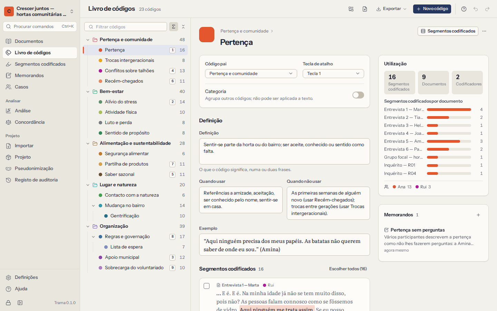

# O livro de códigos

O livro de códigos é a lista dos seus códigos, organizada em árvore, cada um com uma cor e — idealmente — uma definição. Cresce à medida que lê: surgem códigos, que depois se fundem, se separam e se reorganizam. **Livro de códigos** na navegação mostra a árvore completa à esquerda e os detalhes do código escolhido à direita.

## Códigos e hierarquia

- **Novo código** acrescenta um código no nível superior, ou dentro do código escolhido com **Novo subcódigo**. Também pode criar códigos enquanto codifica, no painel junto a uma seleção.
- **Arraste** um código para cima de outro para o tornar subcódigo, ou entre códigos para o reordenar. **Mover para o nível superior**, no menu, tira-o de dentro do código-pai. Um código não pode ficar dentro de um dos seus próprios subcódigos.
- Com o teclado: as setas percorrem a árvore e abrem ou fecham ramos, escrever algumas letras salta para um código, `F2` muda o nome, `Delete` elimina e `Shift+F10` abre o menu do código.
- As **categorias** são códigos que apenas agrupam outros códigos — «Motivações», «Obstáculos». Não se aplicam ao texto. Transforme um código em categoria (ou o contrário) com o interruptor **Categoria** nas propriedades.
- Cada código tem uma **cor**, usada nas barras, no realce do texto e nos gráficos. Escolha uma da paleta ou escreva qualquer cor.

Os números junto a cada código indicam quantos segmentos codificados tem. Podem incluir os segmentos dos subcódigos, mostrar cada código isolado ou ficar ocultos — escolha nas opções do painel.

## Definições

Um bom livro de códigos diz o que cada código significa, para que o aplique da mesma forma em março e em outubro, e para que um segundo codificador o aplique como o próprio. Cada código tem quatro campos:

| Campo | O que escrever |
|---|---|
| **Definição** | O que o código capta, numa ou duas frases. |
| **Quando usar** | Os critérios de inclusão: «Aplique quando o participante descreve…» |
| **Quando não usar** | Os critérios de exclusão, muitas vezes indicando o código vizinho a usar em vez deste. |
| **Exemplo** | Uma passagem típica, citada. |

A definição aparece no fundo do painel de códigos enquanto codifica com o código ativo, e os quatro campos fazem parte de todas as exportações do livro de códigos.

## Os detalhes de um código

Escolher um código em **Livro de códigos** mostra:

- onde fica na árvore, as propriedades e a definição;
- como é usado: número de segmentos codificados, de documentos e de codificadores, e os segmentos por documento;
- uma pré-visualização dos segmentos codificados, com **Ver todos em Segmentos codificados** para os ler todos;
- os memorandos sobre o código, com **Novo memorando sobre este código**.

## Fundir e separar códigos

À medida que a análise amadurece, dois códigos revelam-se muitas vezes um só, e um código revela-se dois.

**Fundir.** Escolha **Fundir em…** no menu de um código e escolha o código a manter. Os segmentos codificados, os subcódigos e os memorandos passam para esse código, e o primeiro é eliminado. Para fundir vários códigos de uma vez, escolha **Fundir vários códigos…** nos detalhes do código, assinale os códigos a fundir e escolha o que fica. O Trama mostra quantos segmentos vão passar antes de confirmar. Quando dois códigos fundidos cobriam a mesma passagem do mesmo codificador, os segmentos juntam-se num só.

**Separar.** Nos detalhes de um código, assinale os segmentos codificados que pertencem a uma ideia nova e escolha **Separar num subcódigo…**. Dê um nome ao novo subcódigo; os segmentos escolhidos passam para ele e os restantes ficam.

**Eliminar.** Eliminar um código elimina os seus segmentos codificados e os memorandos sobre eles; o Trama diz quantos. Se o código tiver subcódigos, escolha se quer **manter os subcódigos** (sobem um nível, com os seus segmentos) ou **eliminar também os subcódigos**.

Tudo isto se pode anular de imediato com `Ctrl+Z`, e tudo fica no [registo de auditoria](10-privacy-and-security.md#audit-trail).

## Exportar e importar um livro de códigos

**Exporte** o livro de códigos a partir do ecrã **Livro de códigos** como:

- **Livro de códigos REFI-QDA** (`.qdc`) — abre no NVivo, no MAXQDA, no ATLAS.ti e noutros programas compatíveis com REFI-QDA;
- **Documento Word** (`.docx`) — para um anexo, ou para um segundo codificador ler;
- **Tabela CSV** ou **Livro Excel** (`.xlsx`) — uma linha por código, com o caminho, o código-pai, a cor, se é categoria, a tecla de atalho, os quatro campos da definição e quantos segmentos e documentos tem;
- **Markdown** (`.md`).

**Importe** um livro de códigos de um ficheiro `.qdc`, `.csv` ou `.xlsx` — feito pelo Trama, por outro programa ou escrito à mão numa folha de cálculo (basta uma coluna chamada **Name**/**Nome** ou **Path**/**Caminho**; um caminho como `Obstáculos/Tempo` cria a hierarquia). Antes de qualquer alteração, o Trama mostra que códigos são novos, quais seriam atualizados e quais já são iguais. Os códigos existentes mantêm as definições e as cores, a menos que escolha **Substituir definições e cores**; caso contrário, só se preenchem os campos vazios. Uma importação nunca elimina nada.

Os conjuntos de códigos (uma funcionalidade do MAXQDA e do NVivo) não são importados: o Trama não tem conjuntos de códigos. Os grupos de documentos e a hierarquia cobrem a maior parte dos seus usos.
