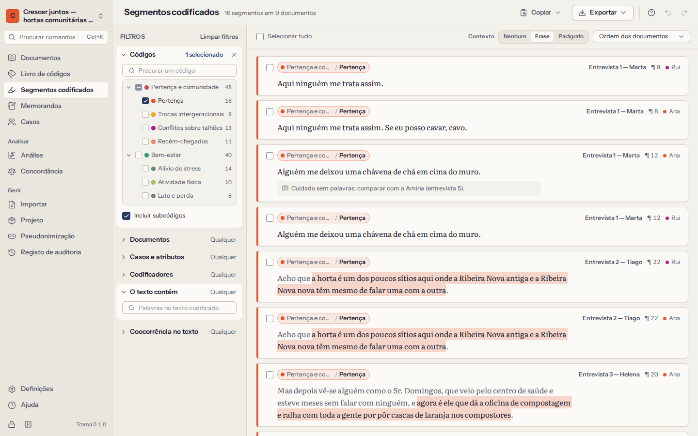
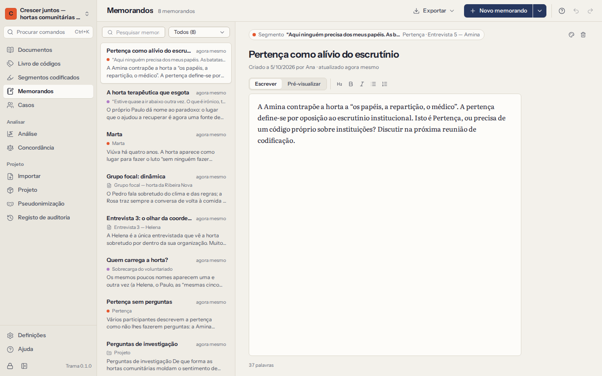

# Segmentos codificados e memorandos

Codificar é só metade do trabalho; a outra metade é ler o que codificou, lado a lado, e registar o que vê. **Segmentos codificados** reúne passagens de vários documentos; **Memorandos** guarda a sua escrita.

## Segmentos codificados

**Segmentos codificados** lista todas as passagens codificadas do projeto, cada uma com o código, o documento e o sítio do documento onde está. Os filtros à esquerda estreitam a lista; a lista à direita atualiza-se à medida que escolhe.

### Filtros

| Filtro | O que mantém |
|---|---|
| **Códigos** | Os segmentos dos códigos que assinalar. **Incluir subcódigos** acrescenta os segmentos dos seus subcódigos. |
| **Documentos** | Os segmentos dos documentos ou grupos de documentos que assinalar. |
| **Casos e atributos** | Os segmentos dos documentos de certos casos, ou de casos que cumprem condições de atributos — *Idade é maior que 60*, *Função é Coordenadora*. Combine as condições com **todas** ou **qualquer**. |
| **Codificadores** | Os segmentos codificados pelas pessoas que assinalar. |
| **O texto contém** | Os segmentos cujo texto contém as palavras que escrever. |
| **Coocorrência no texto** | Os segmentos que **se sobrepõem a**, **estão dentro de** ou **contêm** um segmento de outros códigos no mesmo documento — por exemplo, passagens codificadas com *Solidão* que estão dentro de uma passagem codificada com *Reforma*. |

Os filtros combinam-se: todos os que definir têm de se verificar. **Limpar filtros** recomeça. Abrir **Segmentos codificados** a partir de um código (no livro de códigos ou no painel de códigos) começa já com esse código escolhido.

### Ler os segmentos

- **Ordene** pela ordem dos documentos, pela ordem do livro de códigos, os mais curtos primeiro ou os mais recentes primeiro.
- **Contexto** mostra cada segmento com o resto da frase ou do parágrafo à volta, para que um segmento curto não perca o sentido.
- Cada segmento mostra o comentário, se tiver, e uma ligação para o memorando.
- Clique no documento de um segmento (ou prima `Enter`) para **o abrir no documento**, nessa passagem, já selecionada. Voltar (`Alt+←`) regressa à lista.
- Com o teclado: as setas percorrem a lista, `Enter` abre, `Space` seleciona.

### Copiar e exportar segmentos

- **Copiar** coloca na área de transferência os segmentos selecionados — ou todos os que estão à vista —, cada um com a sua origem (documento, código e parágrafo), prontos a colar num rascunho.
- **Exportar** guarda-os como tabela **CSV** ou **Excel** (uma linha por segmento: código, caminho do código, documento, parágrafo, posição, codificador, texto, texto com contexto, comentário, data), ou como relatório **Word** ou **HTML** agrupado por código. Os relatórios começam com uma descrição dos filtros usados, para que a seleção se possa repetir e relatar.

As exportações saem do Trama sem cifra. Ver [o que sai deste computador](10-privacy-and-security.md#leaves).

## Memorandos

Os memorandos guardam o seu pensamento à medida que se desenvolve: uma intuição sobre todo o projeto, notas sobre uma entrevista, o significado de um código, uma observação sobre uma passagem, o retrato de um participante. Escrever memorandos ao longo do trabalho é o que transforma a codificação em análise.

Um memorando é **sobre** alguma coisa:

| Memorando sobre | Comece em |
|---|---|
| O projeto | **Memorandos → Novo memorando** |
| Um documento | o menu do documento (**Memorando do documento…**), ou **Novo memorando sobre… → Um documento** |
| Um código | os detalhes do código no **Livro de códigos**, ou **Novo memorando sobre… → Um código** |
| Um segmento codificado | **Memorando da passagem** ao codificar, ou **Memorando** num segmento codificado |
| Um caso | os detalhes do caso em **Casos**, ou **Novo memorando sobre… → Um caso** |

### Escrever

- Os memorandos guardam-se à medida que escreve; não há botão Guardar.
- Pode usar formatação simples, que aparece em **Pré-visualizar**: `## título`, `**negrito**`, `*itálico*`, `- lista`, `1. lista`. A barra de ferramentas acrescenta-a por si (`Ctrl+B`, `Ctrl+I`).
- Dê uma **cor** a um memorando para marcar o seu estado — uma ideia, uma conclusão, algo a verificar.
- Cada memorando mostra quem o criou e quando, e quando foi alterado pela última vez. **Ir para** abre aquilo de que trata.

### Encontrar e exportar memorandos

**Memorandos** lista todos os memorandos, com as alterações mais recentes primeiro. Pesquise por palavras do título ou do texto, ou mostre só um tipo (projeto, documentos, códigos, segmentos codificados, casos). Os memorandos aparecem também onde pertencem: na gaveta de memorandos do documento, nos detalhes de um código, nos detalhes de um caso.

**Exporte** todos os memorandos como **documento Word** ou em **Markdown**, agrupados pelo que tratam — um bom ponto de partida para escrever os resultados ou a secção de métodos.

Eliminar um memorando pode ser anulado de imediato. Eliminar um documento, um código ou um segmento codificado elimina também os memorandos sobre ele (o Trama avisa antes de confirmar).
