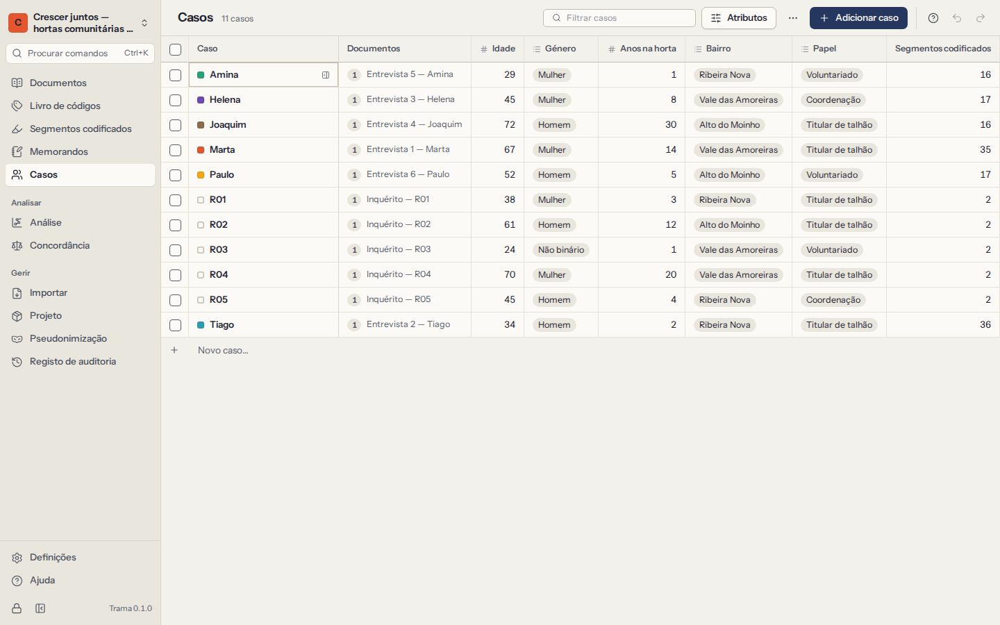

# Casos e atributos

Um **caso** é uma unidade de análise: normalmente um participante, por vezes um agregado familiar, uma escola, um local ou uma organização. Os **atributos** descrevem os casos — idade, género, função, bairro, anos de experiência — para que possa perguntar como o que as pessoas dizem varia entre grupos.

## Casos

**Casos** mostra uma tabela: uma linha por caso, uma coluna por atributo, com o número de documentos e de segmentos codificados de cada caso.

- **Acrescente um caso** escrevendo o nome na última linha e premindo `Enter`.
- **Edite um valor** clicando numa célula (ou indo até ela com as setas) e escrevendo. `Enter` guarda, `Esc` cancela, `F2` edita a célula onde está.
- **Filtre** a tabela escrevendo parte do nome de um caso.
- **Selecione** casos com as caixas no início das linhas para eliminar vários de uma vez. Eliminar um caso mantém os seus documentos (ficam sem caso) e elimina os valores dos atributos e os memorandos sobre ele. Pode anular.
- **Abra os detalhes** de um caso para ver e editar a descrição e a cor, os valores dos atributos, os **documentos** associados (associe mais, ou desassocie um), os **segmentos codificados por código** e os memorandos sobre ele.

## Associar documentos a casos

Cada documento pertence, no máximo, a um caso, e um caso pode ter vários documentos. Associe-os em qualquer dos sentidos:

- na lista de documentos: **Definir caso…** no menu de um documento;
- nos detalhes do caso: **Associar um documento…**;
- para muitos de uma vez: **Criar um caso por documento** cria um caso com o nome de cada documento que ainda não tem caso e associa-os (um caso que já tenha esse nome é reaproveitado). É o ideal para uma entrevista por participante.

As importações de inquéritos criam automaticamente um caso por inquirido, com as colunas descritivas como atributos (ver [Respostas a inquéritos](02-documents.md#surveys)).

## Atributos

Escolha **Atributos** por cima da tabela para acrescentar, mudar o nome, reordenar ou eliminar atributos. Cada atributo tem um nome, uma descrição opcional (o que regista e como) e um **tipo**:

| Tipo | Valores | Exemplo |
|---|---|---|
| **Texto** | Qualquer coisa | Profissão |
| **Número** | Números inteiros ou decimais (`42`, `3,5` ou `3.5`) | Idade, anos na horta |
| **Data** | Datas escritas como `2026-10-05` | Data da entrevista |
| **Sim/não** | Sim ou não | Tem filhos |
| **Escolha** | Uma de uma lista de opções | Função: Coordenadora, Voluntária, Visitante |

- Os valores que não correspondem ao tipo são recusados, com uma mensagem a explicar porquê.
- Num atributo de **Escolha**, escreva as opções uma por linha. Um valor novo escrito na tabela é acrescentado às opções automaticamente.
- Mudar o tipo de um atributo converte os valores que for possível. Antes de confirmar, o Trama diz quantos não podem ser convertidos e seriam apagados — e pode anular.
- Eliminar um atributo elimina os seus valores em todos os casos (também se pode anular).

Os atributos comparam-se na [Análise](07-analysis.md): tabelas **Código × atributo**, filtros em [Segmentos codificados](05-retrieval-and-memos.md#filters) e gráficos por grupo. Aí, os números podem ser agrupados em intervalos.

## Importar atributos de uma folha de cálculo

Muitas vezes os atributos já existem numa folha de cálculo de participantes. Escolha **Importar atributos de uma folha de cálculo…** e escolha um ficheiro CSV ou Excel com **uma linha por caso**: uma coluna com os nomes dos casos e uma coluna por atributo, por exemplo:

| Participante | Idade | Função |
|---|---|---|
| Teresa | 71 | Voluntária |
| Rui | 34 | Coordenador |

1. Escolha a folha (num livro) e **a coluna com os nomes dos casos**. O Trama mostra quantos nomes correspondem a casos existentes e quantos são novos.
2. Escolha as colunas a importar. Cada uma vai para um atributo existente com o mesmo nome, ou torna-se um atributo novo; o Trama sugere um tipo a partir dos valores.
3. Escolha se quer **criar os casos que ainda não existem**, ou deixar essas linhas de fora.
4. Importe. Um resumo mostra os casos atualizados e criados, os novos atributos, os nomes que não corresponderam a nenhum caso e as células que não se ajustavam ao tipo do atributo (essas são ignoradas).

Os nomes são comparados sem ter em conta maiúsculas e acentos.

## Exportar a tabela de casos

**Exportar tabela em CSV** ou **em Excel** guarda a tabela tal como a vê: uma linha por caso, uma coluna por atributo. Os casos, os atributos e os seus valores fazem também parte dos projetos REFI-QDA (ver [Trocar projetos](09-exchange.md)).
