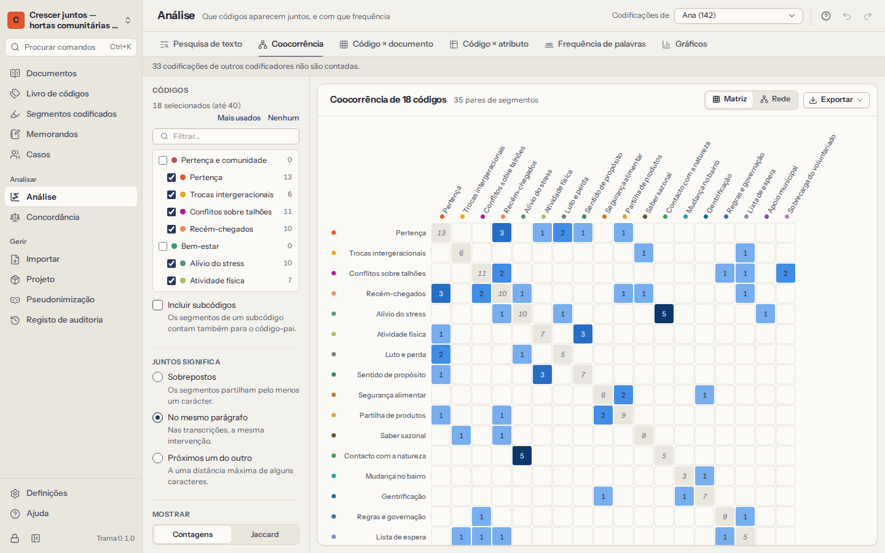
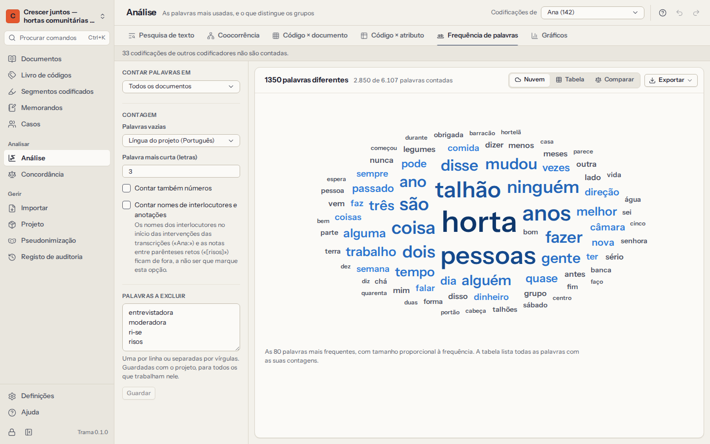

# Análise

A **Análise** reúne as ferramentas para olhar para todo o material: pesquisá-lo, ver que códigos andam juntos, como os códigos se distribuem pelos documentos e pelos grupos de pessoas, que palavras as pessoas usam, e gráficos de tudo isto. Todos os números se podem abrir: clique numa célula, numa barra ou numa palavra para ler as passagens por trás.

Toda a análise corre no seu computador, sobre o projeto inteiro, e atualiza-se quando codifica mais.

<a id="coders-counted"></a>

## De quem são as codificações contadas

Quando mais do que um codificador codificou no projeto — uma cópia de um colega integrada, ou um segundo codificador para verificar a concordância —, **Codificações de**, no canto superior direito da **Análise**, escolhe de quem são os segmentos codificados que as ferramentas contam. Por omissão, é a sua própria codificação; se ainda não codificou nada, são todos os codificadores. O Trama lembra-se da escolha para este projeto, neste computador, e uma nota por baixo das ferramentas indica quantas codificações de outros codificadores não são contadas.

Escolha **Todos os codificadores** para contar em conjunto a codificação de todos. Uma passagem que vários codificadores codificaram com o mesmo código conta então uma só vez, mesmo que os segmentos comecem ou acabem em palavras diferentes, e dois códigos só aparecem juntos quando foi o mesmo codificador a aplicar ambos — assim, dois codificadores que discordam sobre uma passagem nunca parecem uma coocorrência. A escolha aplica-se a tudo o que conta segmentos codificados; pesquisar e contar palavras em documentos inteiros não depende dela.

<a id="search"></a>

## Pesquisa de texto

A pesquisa encontra palavras e expressões nos seus documentos e mostra cada ocorrência **em contexto**, alinhada pela ocorrência, com as palavras antes e depois (uma vista de palavra-chave em contexto).

- Escreva o que procura e prima `Enter`. Escolha **Palavras**, **Expressão** ou **Regex** (uma expressão regular, para padrões avançados).
- No modo **Palavras** pode combinar palavras:

| Escreve | O Trama encontra |
|---|---|
| `confiança família` | parágrafos com as duas palavras |
| `confiança OR fé` | parágrafos com qualquer uma das palavras |
| `confiança NOT dinheiro` | parágrafos com *confiança* mas sem *dinheiro* |
| `"cuidados de saúde"` | a expressão exata |
| `horta*` | horta, hortas, hortaliça… |

- Opções: **só palavras inteiras**, **distinguir maiúsculas e minúsculas**, **distinguir acentos** (por omissão, *médica* também encontra *medica*).
- **Procurar em** todos os documentos, em documentos escolhidos, em grupos de documentos, ou só nos segmentos de um código.
- Clique numa ocorrência para abrir o documento nesse sítio.
- **Codificar todas…** aplica um código (existente ou novo) a todas as ocorrências: só às palavras encontradas, à frase inteira (normalmente o melhor para palavras soltas) ou ao parágrafo inteiro (nas transcrições, a intervenção de quem fala). As passagens já codificadas com esse código ficam como estão, e um único Anular remove tudo o que foi acrescentado.

<a id="cooccurrence"></a>

## Coocorrência



Que códigos aparecem juntos, e com que frequência? Escolha dois ou mais códigos e o que significa **juntos**:

- **Sobrepostos**: os dois segmentos codificados partilham pelo menos um carácter;
- **No mesmo parágrafo**: nas transcrições, a mesma intervenção;
- **Próximos um do outro**: a uma distância máxima de um certo número de caracteres.

O resultado é uma **matriz** (códigos contra códigos) ou uma **rede** (círculos para os códigos, linhas para as coocorrências; arraste os círculos para os reorganizar). Clique numa célula ou numa linha para ler os pares de passagens.

Há duas formas de contar:

- **Contagens** — o número de *pares* de segmentos que ocorrem juntos. Um segmento longo de A que se sobrepõe a três segmentos de B conta 3 (como no MAXQDA). A diagonal mostra o número de segmentos de cada código.
- **Jaccard** — um valor de 0 (nunca juntos) a 1 (sempre juntos) que tem em conta a frequência com que cada código é usado, para que os códigos frequentes não dominem:

```
Jaccard(A, B) = (segmentos de A com B + segmentos de B com A)
              ÷ (segmentos de A + segmentos de B)
```

Com **Incluir subcódigos**, os segmentos de um subcódigo contam para o código-pai.

<a id="matrix"></a>

## Código × documento

Como se distribui cada código pelo material? As linhas são códigos; as colunas são **documentos**, **grupos de documentos** ou **casos**. Cada célula mostra uma de:

- **Segmentos** — o número de segmentos codificados;
- **Caracteres** — quanto texto está codificado, com as sobreposições contadas uma só vez;
- **Presença** — se o código aparece ou não;
- **% do documento** — a parte do texto codificada com o código.

Com os subcódigos incluídos, a linha de um código-pai soma os seus subcódigos. Clique numa célula para ler os segmentos.

<a id="crosstab"></a>

## Código × atributo

Os participantes mais velhos e os mais novos falam de um tema de forma diferente? Escolha um [atributo](06-cases-and-attributes.md#attributes): os seus valores passam a colunas e os códigos a linhas. Os atributos numéricos podem ser agrupados em grupos iguais (de dois a cinco) ou mostrados com uma coluna por valor; **Automático** mostra uma coluna por valor quando há no máximo oito valores, e quatro grupos iguais nos outros casos.

Conte **segmentos**, **documentos** (com o código pelo menos uma vez) ou **casos** (com o código em qualquer dos seus documentos), opcionalmente em percentagem da linha ou da coluna. Os documentos sem caso aparecem em *(sem valor)*.

**O teste do qui-quadrado.** Ao contar documentos ou casos, o Trama testa, para cada código, se a proporção de documentos (ou casos) com o código varia entre os valores do atributo mais do que o acaso explicaria:

```
χ²  = Σ (observado − esperado)² ÷ esperado
gl  = (linhas − 1) × (colunas − 1)
V   = √( χ² ÷ (n × (mín(linhas, colunas) − 1)) )
```

Um *p* pequeno (abaixo de 0,05, a negrito) aponta para uma diferença que merece um olhar mais atento; o V de Cramér diz quão forte é, de 0 a 1. Leia-o como uma pista, não como uma prova: as amostras qualitativas são pequenas e escolhidas de propósito, não sorteadas, e um teste nada diz sobre *porque* existe uma diferença. Quando muitas contagens esperadas ficam abaixo de 5, o teste não é fiável, e o Trama assinala-o. Não se mostra nenhum teste para segmentos, porque os segmentos não são independentes uns dos outros — uma pessoa faladora pode dizer a mesma coisa muitas vezes.

<a id="words"></a>

## Frequência de palavras



Que palavras usam mais as pessoas? Conte as palavras de todos os documentos, de um grupo de documentos, ou só dos segmentos de um código.

- As **palavras vazias** — palavras muito comuns como *o*, *e*, *de* — ficam de fora, de acordo com o idioma do projeto (definido nas Definições) ou outro que escolher: inglês, português, espanhol, francês, alemão, italiano ou neerlandês. Escolha **Manter todas as palavras** para não excluir nenhuma.
- Defina a **palavra mais curta** a contar, e se os números contam.
- Acrescente as suas próprias **palavras a excluir** — o nome da entrevistadora, *pronto*, *portanto*. Ficam guardadas no projeto, para todos os que nele trabalham. **Excluir esta palavra**, em qualquer palavra, acrescenta-a.
- Veja uma **nuvem** com as palavras mais frequentes ou uma **tabela** com todas as palavras, a contagem, o número de documentos em que aparecem e a respetiva percentagem. Clique numa palavra para a ler em contexto.

**Comparar dois grupos** mostra as palavras que um grupo de documentos usa claramente mais do que outro — ou do que todos os restantes documentos. O Trama usa o teste da razão de verosimilhança (G²), que funciona bem com as contagens pequenas e desiguais dos textos reais, e mantém só as palavras significativas a *p* < 0,05. A barra mostra quanto mais cada lado usa a palavra, em relação à extensão de cada lado.

<a id="charts"></a>

## Gráficos

- **Frequência dos códigos** — segmentos e documentos por código, ordenados; os códigos mais usados ou todos, todos os códigos ou só os de nível superior com os subcódigos somados.
- **Retratos dos documentos** — cada documento como uma faixa do princípio ao fim, colorida pelo código que cobre a maior parte de cada fatia; mais pálido significa que só parte da fatia está codificada. Clique numa fatia para abrir o documento nesse ponto. Os retratos mostram num relance em que parte das entrevistas surge um tema.
- **Códigos pelos grupos** — barras empilhadas com até oito códigos em cada grupo de documentos ou caso, em contagens ou em proporções (100%).

Todos os gráficos têm também uma vista de tabela.

<a id="export-results"></a>

## Exportar resultados

Todas as ferramentas têm **Exportar**: a tabela em **CSV** ou **Excel**, e os gráficos como imagens **SVG** (nítidas em qualquer tamanho, para publicações) ou **PNG**. Os ficheiros exportados não são cifrados; ver [o que sai deste computador](10-privacy-and-security.md#leaves).
