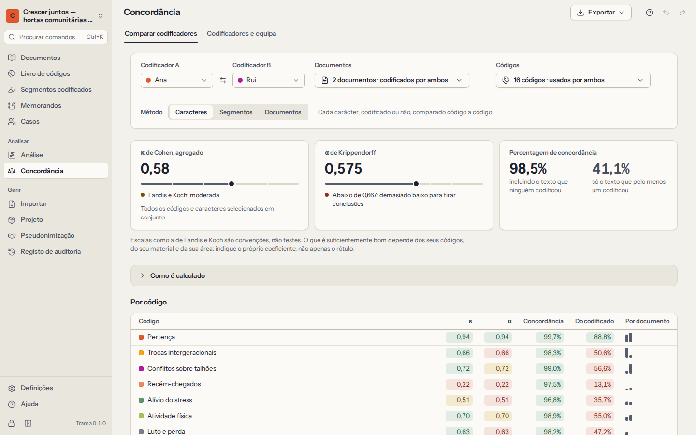

# Trabalho em equipa e concordância entre codificadores

O Trama não tem servidor e nunca usa a Internet, por isso uma equipa trabalha como os investigadores sempre trocaram documentos: **cada pessoa codifica a sua cópia do projeto, e as cópias são integradas**. Como cada segmento codificado é assinado pelo seu codificador, o Trama consegue depois medir até que ponto dois codificadores concordam, e ajudar a discutir onde não concordam.

<a id="coders"></a>

## Codificadores

Um **codificador** é alguém que codifica no projeto — normalmente uma pessoa. **Concordância → Codificadores e equipa** lista-os, com o número de segmentos que cada um codificou.

- O seu codificador é escolhido em cada computador: o nome que deu ao criar a biblioteca ou o projeto. As codificações, os memorandos e as entradas do registo de auditoria feitos neste computador são assinados com ele.
- Quando abre pela primeira vez um projeto feito noutro computador, o Trama pergunta quem está a codificar: escolha o seu nome, se já codificou nele, ou acrescente-se.
- **Adicionar codificador** acrescenta um colega; pode mudar o nome e a cor dos codificadores.
- **Sou eu** muda quem codifica neste computador, por exemplo quando foi escolhido o nome errado. O trabalho já feito mantém o codificador que o fez. Quem codifica neste computador fica memorizado só neste computador; não é guardado no projeto nem nas cópias que envia.

<a id="copies"></a>

## Cópias para colegas

1. **Fazer uma cópia para um colega** guarda o projeto inteiro — documentos, livro de códigos, segmentos codificados, memorandos, casos — num único ficheiro `.trama`. Proteja-o com uma **palavra-passe** quando viajar por e-mail ou numa pen USB, e diga a palavra-passe ao colega por outra via, por telefone, por exemplo. A chave de pseudonimização fica de fora, a menos que a inclua.
2. O colega escolhe **Importar um ficheiro de projeto** no ecrã de projetos, abre o ficheiro (com a palavra-passe) e indica quem é. As codificações dele ficam assinadas com o seu nome.
3. Codifica a sua cópia — os mesmos documentos, ou outros. Também pode acrescentar códigos e memorandos.
4. Devolve a cópia da mesma forma: **Fazer uma cópia para um colega** no Trama dele.

Para avaliar a concordância de forma justa, combinem antes o livro de códigos (com definições) e os documentos que ambos codificam de forma independente, e não olhem para a codificação um do outro nesses documentos até compararem.

<a id="merge"></a>

## Integrar a cópia de um colega

**Integrar a cópia de um colega** e escolha o ficheiro que ele devolveu. Antes de qualquer alteração, o Trama mostra o que a cópia traz: quantos documentos, códigos, segmentos codificados, memorandos e casos são **novos**, quantos são versões **mais recentes** de registos que já tem, e que codificadores são novos.

- O trabalho novo entra e nada do seu se perde.
- Quando um registo foi alterado dos dois lados, fica a versão **mais recente**.
- Nada é removido do seu projeto, a menos que o colega o tenha eliminado depois da sua última alteração a esse registo.
- Só se podem integrar cópias do **mesmo projeto**. Um projeto diferente (ou uma cópia de segurança automática) é reconhecido e recusado, com uma explicação; nesse caso, importe-o como projeto novo.

Cada integração fica no [registo de auditoria](10-privacy-and-security.md#audit-trail). Integre com frequência: integrações pequenas e frequentes são mais fáceis de compreender do que uma grande no fim.

<a id="compare"></a>

## Comparar dois codificadores



**Concordância → Comparar codificadores** mede como dois codificadores, A e B, codificaram o mesmo material.

1. Escolha o **Codificador A** e o **Codificador B**.
2. Escolha os **documentos** — por omissão, os que ambos codificaram — e os **códigos** — por omissão, os que ambos usaram. Os códigos usados só por um dos codificadores podem ser incluídos, se quiser.
3. Escolha o **método**: carateres, segmentos ou documentos (explicados abaixo). Para segmentos, defina a **sobreposição exigida** para que dois segmentos contem como o mesmo.

Os resultados mostram estatísticas-resumo, uma tabela **por código** e **por documento**, e a lista de **discordâncias**.

<a id="disagreements"></a>

### Rever as discordâncias

As discordâncias são a parte útil: cada uma é uma passagem onde o livro de códigos pode ficar mais claro. A lista mostra todos os segmentos sem correspondência — codificados só por um dos codificadores, ou com **limites diferentes** demais. Selecione um para ler a passagem com as codificações dos dois lado a lado. Depois:

- **Aceitar A** ou **Aceitar B** — manter a codificação de um e remover a do outro;
- **Manter ambas** — deixar as duas e marcar a discordância como resolvida.

**Ocultar as já resolvidas** ajuda a não se perder numa lista longa. Cada decisão pode ser anulada.

<a id="report"></a>

### Relatar

**Exportar** guarda os resultados como relatório **Word** ou **página web** (o que foi comparado, as estatísticas, uma nota sobre como são calculadas e as discordâncias), como tabelas **Excel** ou como tabela **CSV** por código. Relate o próprio coeficiente — e o método e o limiar —, não apenas o rótulo.

<a id="statistics"></a>

## Como se calculam as estatísticas

O Trama mostra as contas: cada estatística pode ser seguida até às contagens de onde vem, e nada é calculado como média sem o dizer. As fórmulas abaixo são as que o Trama usa.

<a id="character-level"></a>

### Carateres (por omissão)

Para cada código, cada caráter de cada documento escolhido recebe duas etiquetas: codificado ou não por A, codificado ou não por B. Os carateres são contados em quatro células:

| | B codificou | B não codificou |
|---|---|---|
| **A codificou** | ambos | só A |
| **A não codificou** | só B | nenhum |

As contagens de todos os documentos são **somadas antes** de calcular qualquer estatística (uma estimativa *agregada*). Assim, uma entrevista longa pesa mais do que uma nota curta. Calcular a média de um kappa por documento, como fazem alguns programas, deixa um documento de duas linhas valer tanto como uma entrevista de uma hora. O valor agregado de todos os códigos soma da mesma forma as células de cada código.

**Percentagem de concordância** — a proporção de carateres em que ambos concordam:

```
N                        = ambos + só A + só B + nenhum
concordância             = (ambos + nenhum) ÷ N
concordância, codificado = ambos ÷ (ambos + só A + só B)
```

A maior parte do texto não é codificada por ninguém, por isso o primeiro valor costuma ser alto mesmo quando os codificadores concordam pouco; o segundo deixa de fora o texto que nenhum codificou e é muito mais exigente.

**κ (kappa) de Cohen** — a concordância para além do que o acaso daria, em que o acaso depende de quanto codifica cada codificador:

```
pₒ = (ambos + nenhum) ÷ N
pₑ = a₁ × b₁ + a₀ × b₀
κ  = (pₒ − pₑ) ÷ (1 − pₑ)
```

Aqui, a₁ e b₁ são as proporções de carateres que A e B codificaram, e a₀ = 1 − a₁ e b₀ = 1 − b₁ as proporções que não codificaram.

1 é concordância perfeita, 0 não é melhor do que o acaso, e abaixo de 0 é pior do que o acaso.

**α (alfa) de Krippendorff** — como o κ, mas o acaso vem das etiquetas dos dois codificadores juntas. Para dois codificadores e dois valores (codificado / não codificado), com *N* carateres:

```
d  = só A + só B
n  = 2N
n₁ = 2 × ambos + d
n₀ = 2 × nenhum + d
α  = 1 − (n − 1) × d ÷ (n₀ × n₁)
```

Com dois codificadores e sem dados em falta, o α fica muito próximo do κ. Krippendorff aconselha a confiar na codificação com α ≥ 0,800 e a tirar só conclusões provisórias com α ≥ 0,667.

**Quando uma estatística não está definida.** Se não houver variação nenhuma — ninguém usou o código nestes documentos, por exemplo — a concordância esperada por acaso é total e o κ e o α não se podem calcular (dariam 0 ÷ 0). O Trama mostra um traço, em vez de fingir que o valor é 0 ou 1.

<a id="segment-level"></a>

### Segmentos

Um segmento de A **tem correspondência** quando B tem um segmento do mesmo código, no mesmo documento, que se sobrepõe a ele pelo menos na proporção escolhida da extensão conjunta:

```
sobreposição = carateres partilhados
               ÷ (fim mais tardio − início mais cedo)
concordância = segmentos com correspondência
               ÷ todos os segmentos dos dois
```

Cada segmento dos dois codificadores é verificado por si, por isso um segmento longo pode confirmar vários curtos. Um limiar de 90% exige limites quase idênticos; baixe-o se a equipa combinou codificar «mais ou menos a mesma passagem».

Ao nível dos segmentos não há célula «nenhum» a partir da qual estimar o acaso, por isso o Trama apresenta o **κ de Brennan e Prediger**, que toma a concordância por acaso como 1/*k*, sendo *k* o número de códigos comparados (pelo menos 2):

```
κ = (pₒ − 1/k) ÷ (1 − 1/k)
```

<a id="document-level"></a>

### Documentos

Para cada código e documento: cada codificador usou o código lá pelo menos uma vez? As mesmas quatro células são contadas sobre os pares código–documento, e a percentagem de concordância, o κ e o α calculam-se como para os carateres. É o nível mais tolerante, útil no início, quando a pergunta é se os codificadores reparam nos mesmos temas.

<a id="interpreting"></a>

### Interpretar os números

O Trama classifica o κ com as faixas de Landis e Koch (1977): abaixo de 0 *fraca*, até 0,20 *ligeira*, 0,21–0,40 *razoável*, 0,41–0,60 *moderada*, 0,61–0,80 *substancial*, acima de 0,80 *quase perfeita*. Estas faixas são convenções, não testes. O que é suficientemente bom depende dos seus códigos, do seu material e da sua área. Alguns pontos a ter presentes:

- A concordância é um meio para chegar a um livro de códigos melhor, não um fim. Um valor baixo num código significa normalmente que a definição precisa de trabalho; discuta as discordâncias e afine a definição.
- Os códigos raros dão valores instáveis: uma única discordância mexe muito com o κ.
- Relate que estatística, que nível, que documentos e códigos, e que limiar — o relatório do Trama inclui tudo isto.
