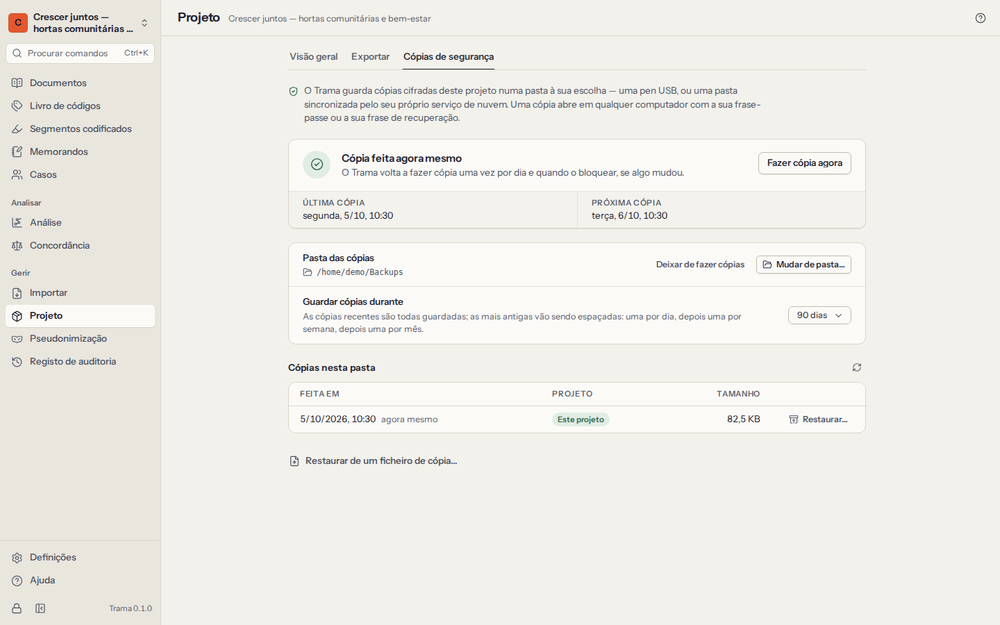

# Privacidade e segurança

Os dados de entrevistas são dados pessoais, muitas vezes sensíveis. O Trama foi feito para que fiquem no seu computador, cifrados, sob o seu controlo — e para que possa explicar exatamente como a uma comissão de ética, a um encarregado de proteção de dados ou a um participante.

## Cifra

- A sua **biblioteca** é desbloqueada pela frase-passe ou pela frase de recuperação de 12 palavras. Cada uma delas desembrulha uma chave de biblioteca aleatória de 256 bits; nem a frase-passe nem a chave são alguma vez guardadas. Transformar uma frase-passe numa chave usa o **Argon2id** com 64 MiB de memória, o que torna lento adivinhar frases-passe, mesmo com equipamento potente.
- Cada **projeto** é uma base de dados **SQLCipher** separada (AES-256), com a sua própria chave, derivada da chave da biblioteca.
- Os **ficheiros originais e as gravações** são cifrados com **XChaCha20-Poly1305** em blocos autenticados, para que qualquer adulteração seja detetada.
- A **lista de projetos** também é cifrada: quem tiver os seus ficheiros nem sequer consegue ler os nomes dos seus estudos.
- As **cópias de segurança** e as exportações protegidas com palavra-passe são cifradas (ver abaixo).

Quando o Trama **se bloqueia** — ao fim do tempo sem utilização que escolheu, quando prime `Ctrl+L` ou quando o fecha — guarda o seu trabalho, fecha o projeto e sobrescreve as chaves que tinha em memória.

Os pormenores técnicos, e os limites, estão em `docs/security/threat-model.md` no código-fonte do Trama.

## Sem rede, sem conta

O Trama **não faz qualquer ligação à rede**. Não há conta, servidor de licenças, nuvem, verificação de atualizações, telemetria nem envio de relatórios de erros. A aplicação para computador não tem permissão para usar a rede, e os testes automáticos verificam-no. O manual que está a ler faz parte da aplicação.

Isto também significa que ninguém — nem quem faz o Trama — pode ver os seus dados, recuperar a sua frase-passe ou restaurar uma biblioteca perdida. Guarde a frase de recuperação em papel e mantenha cópias de segurança.

## O que sai deste computador

Os dados só saem do Trama quando é o próprio a fazê-los sair. **Definições → O que sai deste computador** lista todas as formas, e a mesma lista é publicada com o código-fonte do Trama (`PRIVACY.md`):

| Saída | Quando | Cifrado? |
|---|---|---|
| Cópias de segurança automáticas | Depois de escolher uma pasta de cópias | Sempre |
| Ficheiro de projeto (`.trama`) | Quando o exporta | Se definir uma palavra-passe |
| Cópia para um colega | Quando a faz | Se definir uma palavra-passe (proposto) |
| Projeto REFI-QDA (`.qdpx`) | Quando o exporta | Não |
| Ficheiros do livro de códigos | Quando os exporta | Não |
| Tabelas e relatórios (CSV, Excel, Word, HTML) | Quando os exporta | Não |
| A chave de pseudonimização | Só se a exportar ou incluir | Não, quando em tabela |
| A área de transferência | Quando copia algo | Não |

As exportações sem cifra são ficheiros comuns: guarde-os e partilhe-os como o seu plano de gestão de dados indicar.

## Cópias de segurança

Um computador pode avariar, ser roubado ou perder-se. Configure cópias de segurança automáticas para todos os projetos que importam:

1. Abra **Projeto**, passe ao separador **Cópias de segurança** e escolha uma **pasta de cópias** — uma pen USB guardada num sítio seguro, a unidade de rede da sua instituição ou uma pasta sincronizada com uma nuvem. A cópia é cifrada antes de lá chegar.
2. O Trama passa então a copiar o projeto quando este abre, uma vez por dia enquanto está aberto, quando bloqueia o Trama ou fecha o projeto (se algo mudou), e sempre que escolher **Fazer cópia agora**.
3. Escolha até onde vão as cópias: 30, 90 ou 365 dias. As cópias mais antigas vão sendo espaçadas — tudo do último dia, depois uma por dia durante duas semanas, uma por semana durante dois meses e uma por mês a partir daí — e as três mais recentes são sempre mantidas.

O Trama avisa quando uma cópia falha (a pasta não existe, está cheia ou não permite escrita) e quando a última cópia bem-sucedida tem mais de três dias.

**O que uma cópia contém:** o projeto inteiro, incluindo os itens eliminados e a chave de pseudonimização, cifrado com a chave da sua biblioteca, com o porta-chaves lá dentro. Abre com a sua frase-passe ou com a sua frase de recuperação — neste computador ou noutro.

**Restaurar:** em **Projeto → Cópias de segurança**, escolha **Restaurar…** ao lado de uma cópia da lista, ou **Restaurar de um ficheiro de cópia…**, por baixo da lista. A cópia torna-se um projeto novo na sua biblioteca, com a data em que a restaurou no nome — por exemplo, “Estudo das hortas (restaurado a 2026-10-05)” —, para nunca substituir o que tem. O projeto em que está a trabalhar continua aberto; escolha **Abrir agora** para passar à cópia restaurada. Num computador novo, crie primeiro a sua biblioteca e depois traga a cópia com **Importar um ficheiro de projeto**, no ecrã dos projetos — o Trama pede a frase-passe ou a frase de recuperação da biblioteca que fez a cópia.

Quem conseguir abrir a pasta das cópias vê que existem ficheiros de cópia, as datas e os tamanhos, mas não o que contêm.

## Eliminar

- Eliminar um documento, código, memorando ou caso pode ser anulado de imediato (`Ctrl+Z`). Os itens eliminados ficam dentro do projeto cifrado para que anular e integrar cópias de colegas funcionem corretamente.
- As exportações nunca contêm o conteúdo de itens eliminados; as cópias de segurança cifradas contêm.
- **Eliminar um projeto** remove a sua base de dados e os seus ficheiros deste computador para sempre. As cópias de segurança guardadas noutro sítio não são tocadas — elimine-as o próprio se os dados tiverem de ser destruídos, por exemplo no fim de um prazo de conservação.

## Pseudonimização

A **pseudonimização** substitui nomes e outros dados identificativos de forma coerente em todos os documentos — «Ana Lima» passa a «[Participante 1]» em todo o lado —, enquanto os segmentos codificados e as marcas de tempo das transcrições acompanham o texto alterado. As mesmas substituições são feitas nos nomes de documentos, casos, códigos e grupos, nos nomes de ficheiros, nas descrições e atributos de texto dos casos, nos memorandos, nos comentários aos segmentos codificados e nas definições dos códigos.

1. **Construa a chave.** Acrescente entradas uma a uma (o original, exatamente como aparece, e a sua substituição), ou escolha **Sugerir nomes**: o Trama lista palavras e expressões com maiúscula dos seus documentos que podem ser nomes ou lugares, e numera as substituições por si (`[Participante 1]`, `[Lugar 2]`…). As sugestões são só um ponto de partida: alcunhas, ruas, locais de trabalho e pormenores raros podem identificar alguém da mesma forma. Leia também os seus documentos.
2. **Defina as opções de cada entrada.** **Palavra inteira** deixa em paz «Ana» dentro de «Anabela». **Maiúsculas** substitui «Rosa» o nome, e não «rosa» a flor.
3. **Pré-visualizar** mostra todas as substituições antes de qualquer alteração: documento a documento e, depois, em todo o resto do projeto (nomes, nomes de ficheiros, memorandos, comentários, definições), agrupadas por tipo.
4. **Aplicar aos documentos.** Os originais são substituídos nos próprios documentos, e não só nas exportações. Os segmentos codificados que cobriam apenas um nome substituído são removidos. Pode aplicar a chave inteira ou só as entradas que assinalar.

Aplicar só se pode anular com **Anular logo a seguir**; quando continua a trabalhar, a alteração torna-se permanente. Faça antes uma cópia de segurança.

**A chave** (o que substituiu o quê) é a ligação a quem são os seus participantes. Fica dentro do projeto cifrado, fica de fora de todas as exportações e cópias a menos que a inclua explicitamente, e está sempre nas cópias de segurança cifradas. **Exportar chave** guarda-a como tabela CSV para os seus registos — guarde esse ficheiro cifrado e separado do material pseudonimizado, como as aprovações éticas costumam exigir. Eliminar uma entrada apaga de imediato o nome original do projeto; não se pode anular.

Os ficheiros PDF e Word originais ficam como foram importados. Quando o texto de um documento foi editado (pseudonimizado, por exemplo), as exportações REFI-QDA e as cópias .trama deixam de fora o PDF original, porque o original continuaria a mostrar o que foi removido (as cópias de segurança guardam tudo).

**O registo de auditoria não é pseudonimizado.** Nunca é editado, por isso as entradas escritas antes de aplicar a chave («Adicionou o documento «Entrevista — Ana Lima»») mantêm os nomes. A pré-visualização e a janela Aplicar dizem quantas entradas o fazem. O registo viaja nas cópias .trama do projeto e na sua exportação CSV: partilhe-as só com quem pode ver os nomes.

## O registo de auditoria

O **Registo de auditoria** é um registo, só de acrescento, de todas as alterações relevantes: documentos acrescentados, com nome mudado, editados ou eliminados; códigos criados, fundidos, separados ou eliminados; passagens codificadas e descodificadas; memorandos escritos; casos e atributos alterados; pseudonimização aplicada; cópias integradas; exportações e cópias de segurança feitas. Cada entrada diz quando, quem (que codificador) e o quê.

- Pesquise no registo, ou filtre-o por tipo de ação, codificador e datas.
- **Exportar CSV** guarda-o, para uma auditoria ou para a secção de métodos de uma tese.
- As entradas não podem ser editadas nem eliminadas. Os passos anulados e refeitos ficam registados como tal.

## Texto para pedidos à comissão de ética e planos de gestão de dados

Pode adaptar os parágrafos abaixo para um pedido de parecer ético, um plano de gestão de dados (PGD) ou um documento de informação ao participante. Confirme-os com os requisitos da sua instituição e descreva as suas próprias soluções de cópia de segurança e de conservação.

> **Software e armazenamento.** Os dados qualitativos serão analisados com o Trama, software livre e de código aberto (Mozilla Public License 2.0) que funciona inteiramente no computador do investigador. O Trama não faz ligações à rede: não tem conta de utilizador, serviço na nuvem, verificação de atualizações nem telemetria, e nenhum dado é enviado aos programadores do software nem a terceiros.

> **Cifra em repouso.** Todos os dados do projeto — transcrições, ficheiros originais e gravações, códigos, memorandos e atributos dos participantes — são guardados cifrados no computador do investigador: a base de dados do projeto com SQLCipher (AES-256) e os ficheiros com XChaCha20-Poly1305, com chaves derivadas da frase-passe do investigador através de Argon2id. O software bloqueia-se automaticamente após um período de inatividade, retirando as chaves da memória. Uma frase de recuperação de 12 palavras, guardada em papel num local seguro, permite o acesso caso a frase-passe seja esquecida.

> **Cópias de segurança.** São feitas automaticamente cópias de segurança cifradas para [uma unidade de rede gerida pela universidade / um disco externo cifrado guardado num armário fechado]. As cópias só podem ser abertas com a frase-passe ou a frase de recuperação do investigador.

> **Pseudonimização.** As transcrições serão pseudonimizadas no próprio software, substituindo nomes e dados identificativos de forma coerente em todos os documentos. A chave que liga os pseudónimos às identidades reais é guardada separadamente dos dados pseudonimizados, dentro do projeto cifrado, e é excluída de todos os ficheiros exportados e partilhados.

> **Partilha na equipa.** Quando outros investigadores codificam os dados, as cópias do projeto são trocadas como ficheiros cifrados protegidos por palavra-passe através de [partilha de ficheiros institucional / pen USB cifrada]; as palavras-passe são comunicadas por um canal separado. Nenhum dado é carregado em serviços de análise na nuvem.

> **Auditoria e conservação.** O software mantém um registo de auditoria, só de acrescento, das alterações aos dados. No fim do prazo de conservação, o projeto e as suas cópias de segurança serão eliminados de todos os locais de armazenamento.

Seja rigoroso quanto ao que o Trama **não** faz: não protege os dados que exportar sem cifra (tabelas, relatórios, ficheiros REFI-QDA), não protege um computador desbloqueado de quem estiver sentado à frente dele nem de software malicioso que lá corra, e não consegue recuperar dados se se perderem tanto a frase-passe como a frase de recuperação.
